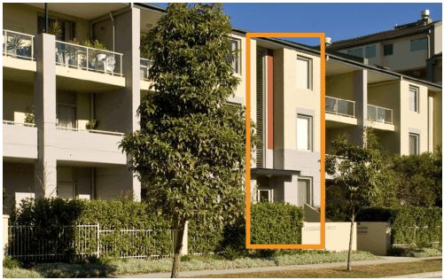
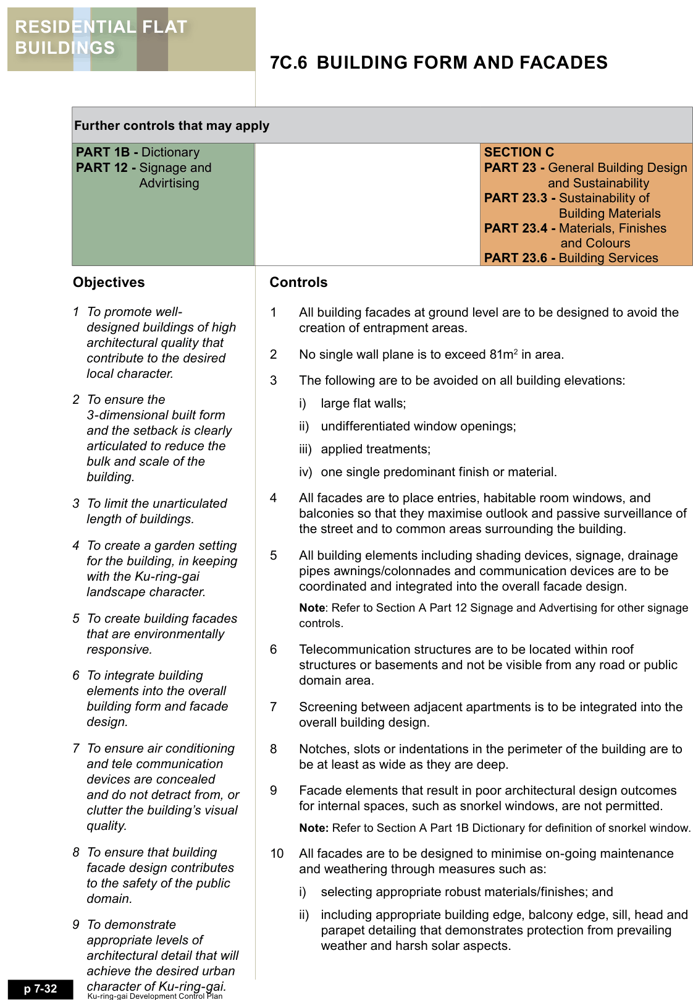

### 7C.5  BUILDING ENTRIES

#### Further controls that may apply

#### SECTION C

PART 22.1 - Equitable access

#### Objectives

#### Controls

1 The residential flat building entry is to be clearly expressed using

2 Buildings are to address the street by providing visible entry points

with the following:

1	 To ensure the building

entry and address is a

element in the street and

is safely accessible to all.

i) main building entrances that are level and directly accessible

ii)	 where site configuration is conducive to having a side entry,

2	 To ensure the building

the path to the building entrance is readily visible from the

street, and the building entrance is signalled with appropriate

3	 To provide direct legible,

safe and pleasant entry to

internal circulation spaces. 3 Entry foyers are to be no more than 1m above ground level. Any

ramped access required is to be integrated into the design of the

building or landscape. Mechanical chairlifts and the like will not be

spaces to allow for the

and to satisfy access and

4 Buildings are to have a clearly visible building entry for each vertical

circulation core with clear way-finding signs integrated into the

5	 To ensure mail boxes are

5 The building entry is to be legible and integrated with horizontal

and vertical building facade architectural elements. At street level,

the entry is to be articulated with awnings, porticos, recesses or

projecting bays for clear identification.

6	 To soften the impact of

6 All entry areas are to be well lit and designed to avoid any

concealment or entrapment areas and avoid dog leg entry foyers. All

### 7C.5 BUILDING ENTRIES (continued)

#### Controls

7 Lifts are to be directly visible from the building entry doorway. 8 Lockable mail boxes are to be:

i) provided close to the street; and

ii)	 	be at 90 degrees to the street and to Australia Post standards;

and

iii)	 	integrated with front fences or building entries. 9 On large development sites comprising multiple seperate buildings,

each building is to have its own clear entry with good sightlines.

Way-finding signs are to be provided. 10 All entries are to be integrated into the external circulation pattern of

the development. 11 Buildings on corner sites are to address both street frontages

and provide entry points and direct level access from both street

frontages. 12 Building entry paths are to be minimum 1.2m wide and located within

the common area with a minimum dimension of 1.2m on either side

for landscape planting. Paths are to provide extra width at building

entries to allow easy passing between pedestrians and to allow

effective turning. Note: This may result in increased side setbacks. 13 All common circulation corridors are to be at least 1.5m wide, and

the area outside lifts is to be at least 1.8m wide.

> [Picture on page 31: a picture, saved as a picture (images/part-07-residential-flat-buildings-page-31-25.gif, 150 dpi).]

#### Figure 7C.5-4:

#### Well defined residential

entry integrated with

the building facade

design.

### BUILDING DESIGN AND SUSTAINABILITY

> [Picture on page 32: a map, saved as a picture (images/part-07-residential-flat-buildings-page-32-1.gif, 150 dpi); the street names and other small labels are on the picture.]
> Words printed on the picture (title and legend, copied from the PDF):
> creation of entrapment areas.
> 1	 To promote well-
> designed buildings of high
> architectural quality that
> contribute to the desired
> 2	 To ensure the
> 3-dimensional built form
> articulated to reduce the
> length of buildings.
> with the Ku-ring-gai
> Note: Refer to Section A Part 12 Signage and Advertising for other signage
> that are environmentally
> 6	 To integrate building
> elements into the overall
> building form and facade
> overall building design.
> and tele communication
> devices are concealed
> clutter the building’s visual
> Note: Refer to Section A Part 1B Dictionary for definition of snorkel window.
> facade design contributes
> 9	 To demonstrate
> appropriate levels of
> architectural detail that will
> achieve the desired urban
> character of Ku-ring-gai.
