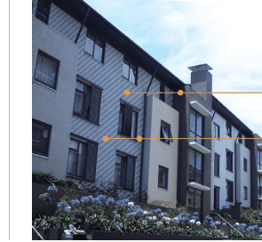
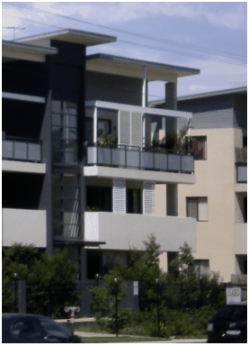
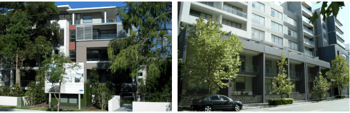
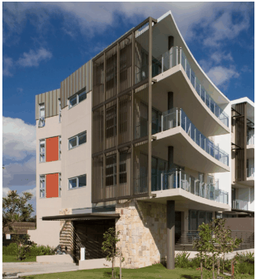
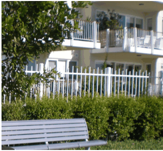
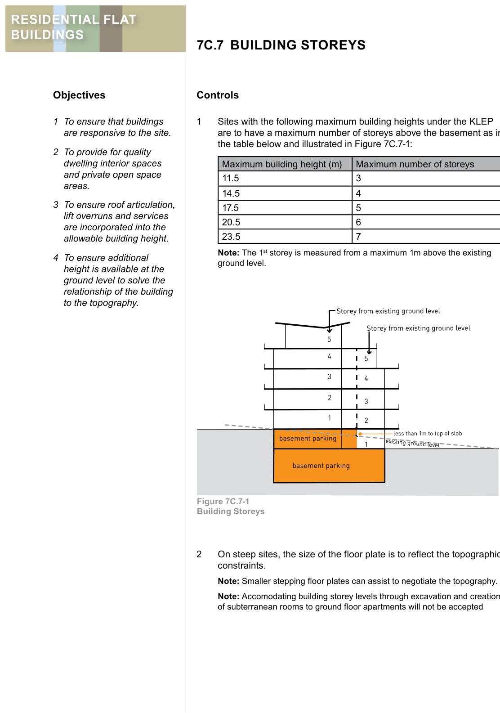

### 7C.6  BUILDING FORM AND FACADES

| Further controls that may apply |  |
|---|---|
| PART 1B - Dictionary PART 12 - Signage and Advirtising | SECTION C PART 23 - General Building Design and Sustainability PART 23.3 - Sustainability of Building Materials PART 23.4 - Materials, Finishes and Colours PART 23.6 - Building Services |
| Objectives | Controls |

1 All building facades at ground level are to be designed to avoid the

2 No single wall plane is to exceed 81m2 in area. 3 The following are to be avoided on all building elevations:

i) large flat walls;

ii)	 undifferentiated window openings;

iii)	 applied treatments;

iv)	 one single predominant finish or material.

and the setback is clearly

bulk and scale of the

3	 To limit the unarticulated

4 All facades are to place entries, habitable room windows, and

balconies so that they maximise outlook and passive surveillance of

the street and to common areas surrounding the building. 5 All building elements including shading devices, signage, drainage

pipes awnings/colonnades and communication devices are to be

coordinated and integrated into the overall facade design.

4	 To create a garden setting

for the building, in keeping

5	 To create building facades

6 Telecommunication structures are to be located within roof

structures or basements and not be visible from any road or public

7 Screening between adjacent apartments is to be integrated into the

8 Notches, slots or indentations in the perimeter of the building are to

be at least as wide as they are deep. 9 Facade elements that result in poor architectural design outcomes

for internal spaces, such as snorkel windows, are not permitted.

7	 To ensure air conditioning

and do not detract from, or

10 All facades are to be designed to minimise on-going maintenance

and weathering through measures such as:

i) selecting appropriate robust materials/finishes; and

8	 To ensure that building

to the safety of the public

ii)	 including appropriate building edge, balcony edge, sill, head and

parapet detailing that demonstrates protection from prevailing

weather and harsh solar aspects.

### (continued)

#### Controls

#### Objectives

#### Facade Articulation

11 All building facades are to be articulated with wall planes varying in

depth by not less than 0.6m, and supplemented with architectural

elements.

10	To enable the building

facade openings to

directly relate to the

street frontage and to the

common open landscaped

gardens around the

building.

12 Facade articulation is to be well composed with attractive

proportions and coherent rhythms and integrated into the building

form and structure. Methods of achieving articulated facades

include:

11	To provide private open

spaces that are integrated

into the overall design of

development.

i) defining a base, middle and top relating to the overall proportion

of the building;

ii)	 expressing the internal building layout or structure, such as

vertical bays or party walls;

iii)	 using a variety of window types to create rhythm or express the

building uses;

12	To co-locate sustainable

design features as

integrated building

elements which enhance

the buildings appearance.

iv)	 using recessed balconies and deep windows to add visual depth;

v)	 use of eaves, louvres and sun shading devices to openings.

vi)	 using elements that cast shadow and accentuate the

appearance of depth;

13	To ensure openings

and  articulation on

the elevations do not

compromise the liveability

of the internal areas.

vii)	 using changes of material, texture and colour integrated with the

building articulation to break down large or repetitive facades

and reduce the bulk and scale of the building.

13 Blade walls are not to be the sole element used to provide

articulation.

14	To provide distinct building

articulation on corner sites

that reinforce the street

intersection and create

a unique memorable

building that supports

urban wayfinding.

14 All developments are to utilise shading/glare control devices to

articulate the facade and contribute to the streetscape. Design

solutions can include:

i) providing external horizontal shading to north-facing windows,

such as eaves, overhangs, pergolas, awnings, colonnades,

upper floor balconies, and/or deciduous vegetation;

ii)	 providing vertical shading to east and west windows, such as

sliding screens, adjustable louvres, blinds and/or shutters;

iii)	 providing shading to glazed and transparent roofs;

iv)	 integration of shading devices with solar energy collection

technology.

> [Picture on page 33: a picture, saved as a picture (images/part-07-residential-flat-buildings-page-33-66.gif, 150 dpi).]

Facade articulation

to be 0.6-2.5m in

depth. Single wall plane

to be 81m² or less

in area.

#### Figure 7C.6-1:

#### Controls for building facade

articulation.

### BUILDING DESIGN AND SUSTAINABILITY

### (continued)

#### Controls Building Length

15 The continuous length of a single building on any elevation is not to

exceed 36m. 16 The length of a single building elevation facing the side or rear

boundary may exceed 36m provided that:

i) the façade is recessed in depth and width to appear as

distinctive and seperate building bays or wings; and

ii)	 the recess is retained as common area with landscaping which

includes at least one medium tree (at least 8m canopy diameter

at maturity).

#### Balconies

> [Picture on page 34: a picture, saved as a picture (images/part-07-residential-flat-buildings-page-34-14.gif, 150 dpi).]

#### Figure 7C.6-2:

#### Building layout expressed

through vertical facade

articulation and elements.

17 Balcony or terrace design may incorporate building elements such

as pergolas, sun screens, shutters, operable walls and the like to

respond to the street context, building orientation and residential

amenity. The use of such building elements are not to enable the

balcony or terrace to be used as a habitable room. 18 Balconies that run the full length of the building facade are not

permitted. 19 Continuous transparent or translucent balustrades are not permitted

to balconies or terraces. 20 Balconies are not to project more than 1.5m from the outermost wall

of the building facade. Note: Refer to Part 23.4 Materials and Finishes, Control 22 for further

requirements on balconies.

> [Picture on page 34: a picture, saved as a picture (images/part-07-residential-flat-buildings-page-34-32.gif, 150 dpi).]

#### Figure 7C.6-4:

#### Good building facade proportion

created by a distinctive base.

#### Figure 7C.6-3:

#### Well articulated building facade

with the use of balconies. Sun

shading devices incorporated into

the balcony design for solar access

control.

### (continued)

#### Controls Corner Sites

21 Street corners are to be emphasised architecturally by accentuating

parts of the building facade. This may be through:

i) changes in height, colour or facade materials;

> [Picture on page 35: a picture, saved as a picture (images/part-07-residential-flat-buildings-page-35-7.gif, 150 dpi).]

ii)	 changes at the corner;

iii)	 change in building articulation;

iv)	 facade orientation;

v)	 change in roof expression;

vi)	 splayed setbacks or curves;

vii)	 providing corner building entries.

> [Picture on page 35: a picture, saved as a picture (images/part-07-residential-flat-buildings-page-35-14.gif, 150 dpi).]

#### Figure 7C.6-5:

#### Partially recessed balconies add

visual interest to the facade.

#### Figure 7C.6-6:

Distinct form to highlight the

building corner.

### BUILDING DESIGN AND SUSTAINABILITY

> [Picture on page 36: a map, saved as a picture (images/part-07-residential-flat-buildings-page-36-1.gif, 150 dpi); the street names and other small labels are on the picture.]
> Words printed on the picture (title and legend, copied from the PDF):
> dwelling interior spaces
> and private open space
> lift overruns and services
> are incorporated into the
> allowable building height.
> Note: The 1st storey is measured from a maximum 1m above the existing
> 4	 To ensure additional
> relationship of the building
> to the topography.
> Storey from existing ground level
> Storey from existing ground level
> less than 1m to top of slab
> 1 existing ground level
> Note: Smaller stepping floor plates can assist to negotiate the topography.
> Note: Accomodating building storey levels through excavation and creation
> of subterranean rooms to ground floor apartments will not be accepted

Figure 7C.7-1
