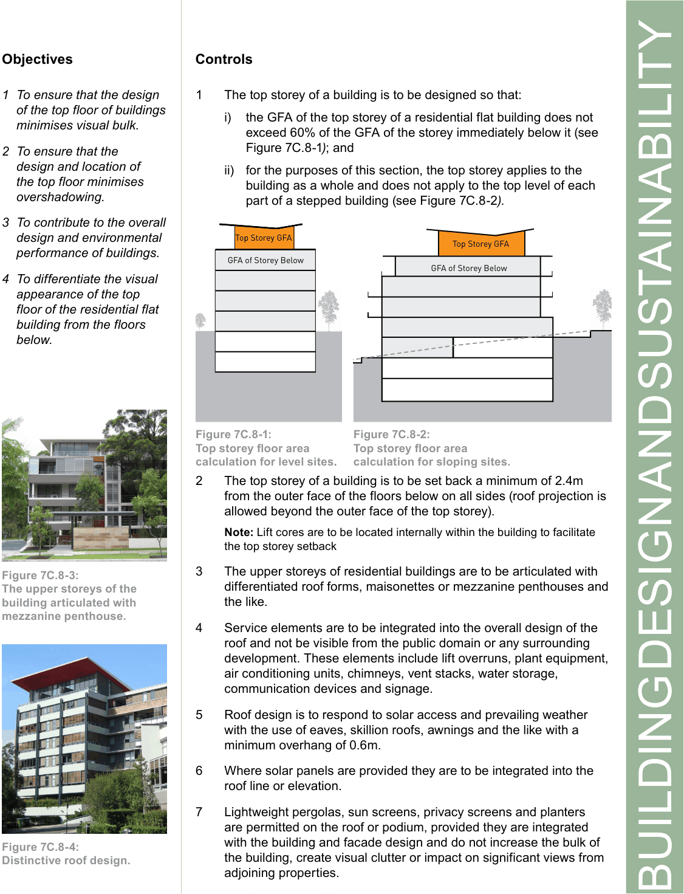

### 7C.8  TOP STOREY DESIGN AND ROOF FORMS

#### Objectives

> [Picture on page 37: a map, saved as a picture (images/part-07-residential-flat-buildings-page-37-3.gif, 150 dpi); the street names and other small labels are on the picture.]
> Words printed on the picture (title and legend, copied from the PDF):
> Top Storey GFA
> Top Storey GFA
> GFA of Storey Below
> GFA of Storey Below
> Top storey floor area
> calculation for level sites.
> Top storey floor area
> calculation for sloping sites.
> Note: Lift cores are to be located internally within the building to facilitate
> the top storey setback
> communication devices and signage.
> minimum overhang of 0.6m.
> roof line or elevation.

Figure 7C.8-1); and

Figure 7C.8-1:

Figure 7C.8-2:

#### Controls

1 The top storey of a building is to be designed so that:

1	 To ensure that the design

of the top floor of buildings

minimises visual bulk.

i) the GFA of the top storey of a residential flat building does not

exceed 60% of the GFA of the storey immediately below it (see

ii)	 for the purposes of this section, the top storey applies to the

2	 To ensure that the

design and location of

the top floor minimises

overshadowing.

building as a whole and does not apply to the top level of each

part of a stepped building (see Figure 7C.8-2).

rey GFA

3	 To contribute to the overall

design and environmental

performance of buildings.

Below

4	 To differentiate the visual

appearance of the top

floor of the residential flat

building from the floors

below.

2 The top storey of a building is to be set back a minimum of 2.4m

from the outer face of the floors below on all sides (roof projection is

allowed beyond the outer face of the top storey).

3 The upper storeys of residential buildings are to be articulated with

differentiated roof forms, maisonettes or mezzanine penthouses and

#### Figure 7C.8-3:

The upper storeys of the

building articulated with

mezzanine penthouse.

4 Service elements are to be integrated into the overall design of the

roof and not be visible from the public domain or any surrounding

development. These elements include lift overruns, plant equipment,

air conditioning units, chimneys, vent stacks, water storage,

5 Roof design is to respond to solar access and prevailing weather

with the use of eaves, skillion roofs, awnings and the like with a

6 Where solar panels are provided they are to be integrated into the

#### Figure 7C.8-4:

#### Distinctive roof design.

7 Lightweight pergolas, sun screens, privacy screens and planters

are permitted on the roof or podium, provided they are integrated

with the building and facade design and do not increase the bulk of

the building, create visual clutter or impact on significant views from

### BUILDING DESIGN AND SUSTAINABILITY

8 Roof top gardens for private or communal use are encouraged.
