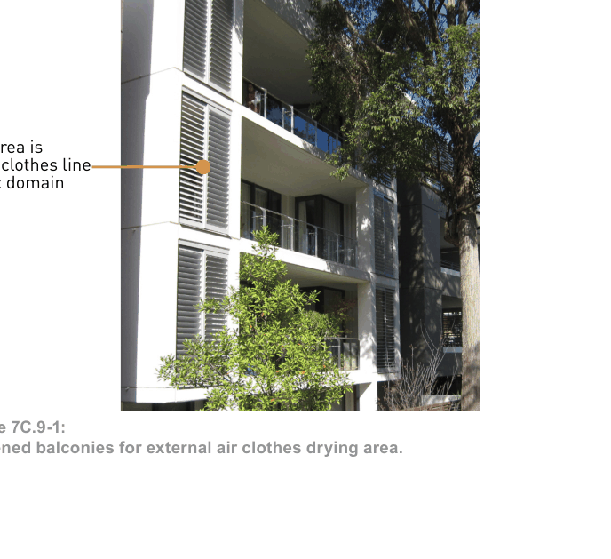

### 7C.9  LAUNDRY AND AIR CLOTHES DRYING

### FACILITIES

#### Objectives

#### Controls

1 Each apartment is required to have access to an external air clothes

drying area, such as a screened balcony, a terrace or clothes lines

within the common area (see Figure 7C.9-1). 2 All external air clothes drying areas are to be screened and not be

visible from any public domain area.

1	 To ensure buildings

maximise the

opportunities for sun and

wind drying of clothes and

reduce the use of electric

dryers.

3 Storage volume calculation within laundries is to exclude the space

required to accommodate a washing tub, washing machine and

dryer.

2	 To provide external air

clothes drying areas that

do not detract from the

visual appearance of the

building and common

areas.

4 Where clothes drying is provided within private open space within a

communal open space, its area is to be additional to that required for

the private open space or communal open space.

> [Picture on page 38: a picture, saved as a picture (images/part-07-residential-flat-buildings-page-38-28.gif, 150 dpi).]
> Words printed on the picture (title and legend, copied from the PDF):
> Screened balconies for external air clothes drying area.

Figure 7C.9-1:

Screened area is

concealing clothes line

from public domain
