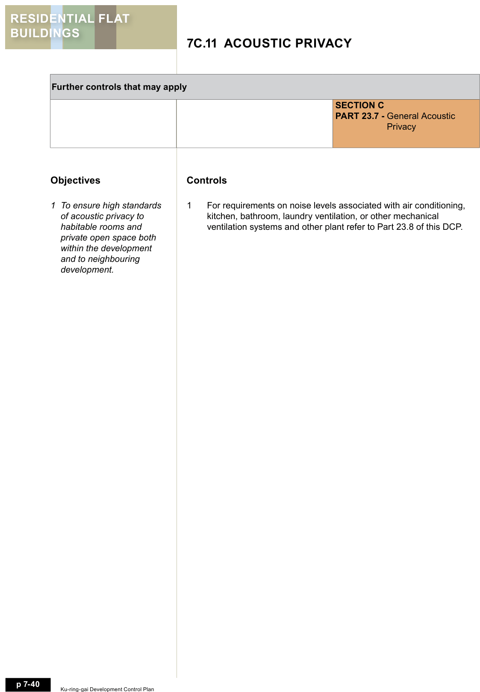

### 7C.10  FENCING

#### Objectives

#### Controls

1 Front boundary fences and walls (to a public street) and side

boundary fences within the street setback are not to be higher than:

1	 To ensure fencing design

responds to the character

of the streetscape in terms

of:

i) 0.9m if of closed construction (such as masonry, lapped and

capped timber or brushwood fences); or

ii)	 1.2m if of open construction (such as open paling and picket

i) open landscape

character;

fences).

ii)	 visibility and

security;

Note: Open fencing includes: panels set into a timber frame or between

brick piers, where any solid base is not taller than 0.9m, and panels are

spaced pickets, palings, or lattice.

iii)	 materials selection;

iv)	 solid or transparent

qualities;

v)	 height;

2 Closed front fences with a maximum height of 1.8m may be

considered where the site fronts a busy road or other sources of

undesirable noise. These fences are to be set back at least 2m from

the front boundary and screened by landscaping.

vi)	 vertical and

Note: Rendered masonry boundary walls are generally inappropriate to the

landscape character of Ku-ring-gai.

horizontal

composition of the

materials; and/or

3 Fences and walls are to step down and follow the natural contours of

the site.

vii)	location of entries

and gates.

viii)	noise sources

4 Hedges and shrub planting are preferred to the street frontage, but

no higher than 1.2m along the entire front boundary, or 1.8m on a

site fronting a busy road.

ix)	 topography

5 All fencing is to be designed to highlight entrances, and be

compatible with buildings and letterbox areas. 6 External finishes for fencing are to be robust and graffiti resistant.

2	 To ensure that fencing

does not detract from the

overall visual amenity and

character of the area.

7 Groundfloor private open space, courtyard and terrace wall and

fence heights are not to exceed

i) 1.2m to any street frontage

ii)	 1.8m to any side or rear boundary with a maximum 1.2m high

solid component and a minimum 30% transparent component

above.

3	 To ensure on site fencing

and courtyard walls

are integrated with the

built form and provide

separation and privacy to

the private open areas.

### BUILDING DESIGN AND SUSTAINABILITY

> [Picture on page 40: a picture, saved as a picture (images/part-07-residential-flat-buildings-page-40-1.gif, 150 dpi).]
> Words printed on the picture (title and legend, copied from the PDF):
> Privacy
> of acoustic privacy to
> habitable rooms and
> private open space both
> within the development
> and to neighbouring
> development.
