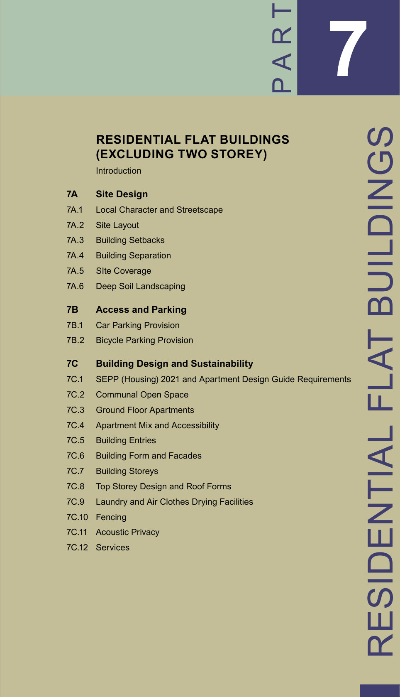

# Ku-ring-gai Development Control Plan - Part 7 Residential Flat Buildings

> This chapter is split into 23 section file(s), one per numbered heading, in the order they appear in the PDF.

Source PDF: [kdcp-section-a-part-7-residential-flat-buildings.pdf](https://planfortomorrow.sharepoint.com/sites/Planfortomorrow/Shared%20Documents/00%20NSW-Planning-Resources/dcp/ku-ring-gai-development-control-plan/part-07-residential-flat-buildings/kdcp-section-a-part-7-residential-flat-buildings.pdf)

> [Picture on page 1: a picture, saved as a picture (images/part-07-residential-flat-buildings-page-1-1.gif, 150 dpi).]
> Words printed on the picture (title and legend, copied from the PDF):
> Introduction
> 7B.1  	 Car Parking Provision
> 7B.2  	 Bicycle Parking Provision

### PART

### RESIDENTIAL FLAT BUILDINGS

### (EXCLUDING TWO STOREY)

#### 7A	 	 Site Design

7A.1  	 Local Character and Streetscape 7A.2  	 Site Layout 7A.3  	 Building Setbacks 7A.4 Building Separation 7A.5     SIte Coverage 7A.6  	 Deep Soil Landscaping

#### 7B	 	 Access and Parking

#### 7C	 	 Building Design and Sustainability

7C.1  	 SEPP (Housing) 2021 and Apartment Design Guide Requirements 7C.2  	 Communal Open Space 7C.3  	 Ground Floor Apartments 7C.4  	 Apartment Mix and Accessibility 7C.5  	 Building Entries 7C.6  	 Building Form and Facades 7C.7  	 Building Storeys 7C.8  	 Top Storey Design and Roof Forms 7C.9  	 Laundry and Air Clothes Drying Facilities 7C.10  	Fencing 7C.11	 Acoustic Privacy 7C.12	 Services

### RESIDENTIAL FLAT BUILDINGS

### INTRODUCTION

The objectives and controls in this Part guide development for residential

flat buildings in meeting the aims and objectives within the KLEP. The development of residential flat buildings is covered by this Part of the

DCP. Where a development only involves refurbishment works or alterations/

additions to existing buildings, new elements are to meet the requirements

of this Part. Where residential uses are provided to any part of the ground floor street

frontage within a mixed use zone, then the development is to be treated

as a Residential Flat Building and meet the standards of this Part. SEPP (Housing) 2021, stipulates nine design quality principles which are

to be achieved by residential flat developments. These are as follows:

i) Principle 1:  Context and neighbourhood character

ii)	 Principle 2:  Built form and scale

iii)	 Principle 3:  Density

iv)	 Principle 4:  Sustainability

v)	 Principle 5:  Landscape

vi)	 Principle 6:  Amenity

vii)	 Principle 7:  Safety

viii)	Principle 8:  Housing diversity and social interaction

ix)	 Principle 9:  Aesthetics In addition, the following aspects of residential flat building development

are to be consistent under (Housing) 2021 and the associated sections

of the Apartment Design Guide: visual privacy, solar and daylight access,

natural ventilation, ceiling heights, apartment size and layout, private open

space and balconies, common circulation and spaces, and storage.

### INTRODUCTION (continued)

The aims of this Part are to:

i) Ensure that development is in keeping with the garden character

of Ku-ring-gai where the tree canopy dominates the landscape by

making provision for quality deep soil landscaping, including: tall trees

to the streetscape; in-between and to all elevations of buildings on the

development site; in-between buildings on the development site and

on adjacent sites.

ii)	 Encourage development which does not dominate, but harmonises

with and contributes to the treed landscape and is sympathetic to the

street and locality in which it is proposed.

iii)	 Ensure that with each development sufficient landscaping is provided

to contribute to the conservation and replenishment of the tree canopy

of Ku-ring-gai, including locally occurring native tree species suited to

the site.

iv)	 Protect and minimise the impact of development on adjoining

properties

v)	 Protect and minimise the impact of development on the natural

environment

vi)	 Ensure development that minimises the depletion of raw materials and

non-renewable resources

vii)	 Ensure that development meets the needs of the present without

compromising the ability of future generations to meet their own need.

viii)	Encourage housing of the highest possible architectural,

environmental and amenity standards.

ix)	 Manage residential development in a way that embraces innovative

design and contemporary lifestyles

x)	 Ensure that there are more certain outcomes for applicants and the

community.

### INTRODUCTION

### THIS PAGE IS INTENTIONALLY BLANK

### 7A

<!-- sections -->
## Sections

1. [7A Site Design](01-7a-site-design.md)
2. [7A.1 LOCAL CHARACTER AND STREETSCAPE](02-7a-1-local-character-and-streetscape.md)
3. [7A.2 SITE LAYOUT](03-7a-2-site-layout.md)
4. [7A.3 BUILDING SETBACKS](04-7a-3-building-setbacks.md)
5. [7A.4 BUILDING SEPARATION](05-7a-4-building-separation.md)
6. [7A.5 SITE COVERAGE](06-7a-5-site-coverage.md)
7. [7A.6 DEEP SOIL LANDSCAPING](07-7a-6-deep-soil-landscaping.md)
8. [7B Access and Parking](08-7b-access-and-parking.md)
9. [7B.1 CAR PARKING PROVISION](09-7b-1-car-parking-provision.md)
10. [7B.2 BICYCLE PARKING PROVISION](10-7b-2-bicycle-parking-provision.md)
11. [7C Building Design and Sustainability](11-7c-building-design-and-sustainability.md)
12. [4G - Storage](12-4g-storage.md)
13. [7C.2 COMMUNAL OPEN SPACE](13-7c-2-communal-open-space.md)
14. [7C.3 GROUND FLOOR APARTMENTS](14-7c-3-ground-floor-apartments.md)
15. [7C.4 APARTMENT MIX AND ACCESSIBILITY](15-7c-4-apartment-mix-and-accessibility.md)
16. [7C.5 BUILDING ENTRIES](16-7c-5-building-entries.md)
17. [7C.6 BUILDING FORM AND FACADES](17-7c-6-building-form-and-facades.md)
18. [7C.7 BUILDING STOREYS](18-7c-7-building-storeys.md)
19. [7C.8 TOP STOREY DESIGN AND ROOF FORMS](19-7c-8-top-storey-design-and-roof-forms.md)
20. [7C.9 LAUNDRY AND AIR CLOTHES DRYING](20-7c-9-laundry-and-air-clothes-drying.md)
21. [7C.10 FENCING](21-7c-10-fencing.md)
22. [7C.11 ACOUSTIC PRIVACY](22-7c-11-acoustic-privacy.md)
23. [7C.12 SERVICES](23-7c-12-services.md)
