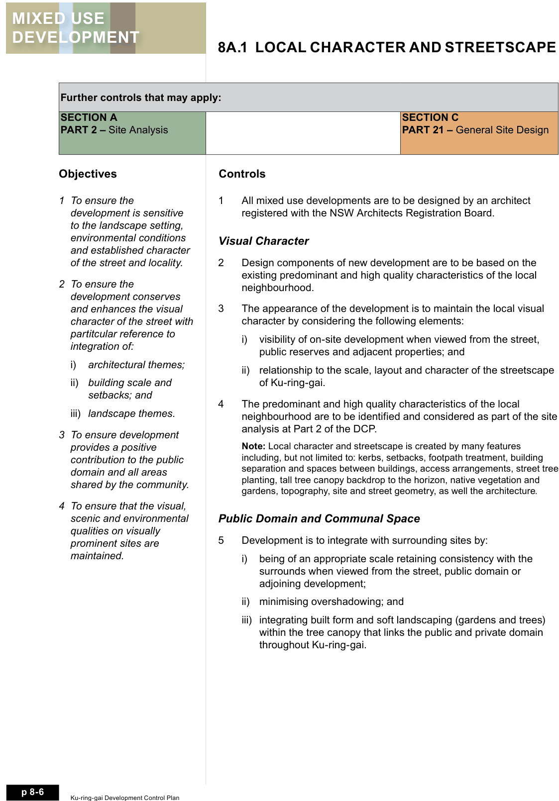

#### 8A	 	 Site Design

8A.1  	 Local Character and Streetscape 8A.2     Site Layout 8A.3     Building Setbacks 8A.4  	 Building Separation 8A.5  	 Wind Impact 8A.6     Site Coverage 8A.7  	 Deep Soil Landscaping

### READ WITH

#### SECTION A

PART 2 - Site Analysis

#### SECTION B

PART 14 - Local Character Areas, Urban Precinct and Sites

PART 20 - Development Near Road or Rail Noise

#### SECTION C

PART 21 - General Site Design

### REFER TO

#### LIVABLE HOUSING DESIGN GUIDELINES

> [Picture on page 5: a picture, saved as a picture (images/part-08-mixed-use-development-page-5-20.gif, 150 dpi).]

### SITE DESIGN

### REFER TO

#### SEPP (HOUSING) 2021 APARTMENT DESIGN GUIDE

> [Picture on page 6: a map, saved as a picture (images/part-08-mixed-use-development-page-6-1.gif, 150 dpi); the street names and other small labels are on the picture.]
> Words printed on the picture (title and legend, copied from the PDF):
> 1	 To ensure the
> development is sensitive
> to the landscape setting,
> and established character
> 2	 To ensure the
> and enhances the visual
> partitcular reference to
> i) architectural themes;
> ii)	 building scale and
> iii)	 landscape themes.
> 3	 To ensure development
> provides a positive
> contribution to the public
> domain and all areas
> shared by the community.
> Note: Local character and streetscape is created by many features
> including, but not limited to: kerbs, setbacks, footpath treatment, building
> separation and spaces between buildings, access arrangements, street tree
> planting, tall tree canopy backdrop to the horizon, native vegetation and
> gardens, topography, site and street geometry, as well the architecture.
> scenic and environmental
> qualities on visually
> prominent sites are
