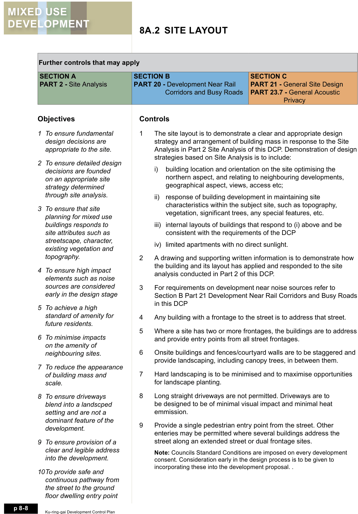

### 8A.1  LOCAL CHARACTER AND STREETSCAPE

#### Further controls that may apply: SECTION A

PART 2 – Site Analysis

#### SECTION C

PART 21 – General Site Design

#### Controls

#### Objectives

1 All mixed use developments are to be designed by an architect

registered with the NSW Architects Registration Board.

#### Visual Character

of the street and locality. 2 Design components of new development are to be based on the

existing predominant and high quality characteristics of the local

3 The appearance of the development is to maintain the local visual

character by considering the following elements:

character of the street with

i) visibility of on-site development when viewed from the street,

public reserves and adjacent properties; and

ii)	 	relationship to the scale, layout and character of the streetscape

4 The predominant and high quality characteristics of the local

neighbourhood are to be identified and considered as part of the site

analysis at Part 2 of the DCP.

#### Public Domain and Communal Space

5 Development is to integrate with surrounding sites by:

4	 To ensure that the visual,

i) being of an appropriate scale retaining consistency with the

surrounds when viewed from the street, public domain or

ii)	 minimising overshadowing; and

iii)	 integrating built form and soft landscaping (gardens and trees)

within the tree canopy that links the public and private domain

### 8A.1 	LOCAL CHARACTER AND STREETSCAPE

### (continued)

#### Controls Visually Prominent Sites

6 Development on visually prominent sites is to:

i) be of high architectural and aesthetic quality;

ii)	 be integrated into the existing landscape through the site

planning process and avoid tall and bulky structures;

iii)	 have a selection of external colours and finishes that are

sensitive to the site and locality;

iv)	 retain significant landscape and vegetation elements;

v)	 consider views to the site as well as those from the site; and

vi)	 soften visual impact by extensive landscaping including tall and

medium sized trees and shrubs. Note: Refer to Part 1B Dictionary for definiton of Visually Prominent Sites. 7 Colours of materials used in sites adjoining or in close proximity

to bushland areas and Heritage Conservation Areas are to be in

harmony with the built and natural landscape elements of the area.

### SITE DESIGN

> [Picture on page 8: a map, saved as a picture (images/part-08-mixed-use-development-page-8-1.gif, 150 dpi); the street names and other small labels are on the picture.]
> Words printed on the picture (title and legend, copied from the PDF):
> 1	 To ensure fundamental
> design decisions are
> appropriate to the site.
> decisions are founded
> on an appropriate site
> through site analysis.
> planning for mixed use
> buildings responds to
> site attributes such as
> existing vegetation and
> elements such as noise
> sources are considered
> in this DCP
> standard of amenity for
> 6	 To minimise impacts
> on the amenity of
> for landscape planting.
> of building mass and
> 8	 To ensure driveways
> blend into a landscped
> dominant feature of the
> Note: Councils Standard Conditions are imposed on every development
> clear and legible address
> into the development.
> consent. Consideration early in the design process is to be given to
> incorporating these into the development proposal. .
> continuous pathway from
> floor dwelling entry point
