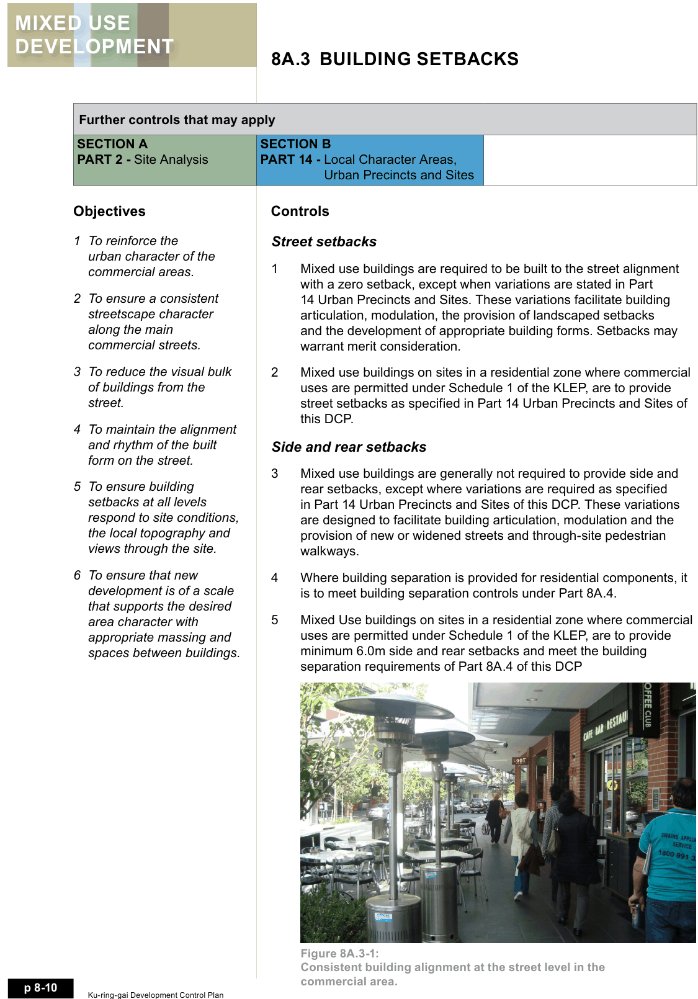

### 8A.2  SITE LAYOUT

| Further controls that may apply |  |
|---|---|
| SECTION A SECTION B PART 2 - Site Analysis PART 20 - Development Near Rail Corridors and Busy Roads | SECTION C PART 21 - General Site Design PART 23.7 - General Acoustic Privacy |
| Objectives Controls |  |

1 The site layout is to demonstrate a clear and appropriate design

strategy and arrangement of building mass in response to the Site

Analysis in Part 2 Site Analysis of this DCP. Demonstration of design

strategies based on Site Analysis is to include:

i) building location and orientation on the site optimising the

northern aspect, and relating to neighbouring developments,

geographical aspect, views, access etc;

2	 To ensure detailed design

ii)	 response of building development in maintaining site

characteristics within the subject site, such as topography,

vegetation, significant trees, any special features, etc.

iii)	 internal layouts of buildings that respond to (i) above and be

consistent with the requirements of the DCP

iv)	 limited apartments with no direct sunlight.

3	 To ensure that site

2 A drawing and supporting written information is to demonstrate how

the building and its layout has applied and responded to the site

analysis conducted in Part 2 of this DCP.

4	 To ensure high impact

early in the design stage

3 For requirements on development near noise sources refer to

Section B Part 21 Development Near Rail Corridors and Busy Roads

4 Any building with a frontage to the street is to address that street.

5	 To achieve a high

5 Where a site has two or more frontages, the buildings are to address

and provide entry points from all street frontages. 6 Onsite buildings and fences/courtyard walls are to be staggered and

provide landscaping, including canopy trees, in between them. 7 Hard landscaping is to be minimised and to maximise opportunities

7	 To reduce the appearance

8 Long straight driveways are not permitted. Driveways are to

be designed to be of minimal visual impact and minimal heat

setting and are not a

9 Provide a single pedestrian entry point from the street. Other

enteries may be permitted where several buildings address the

street along an extended street or dual frontage sites.

9	 To ensure provision of a

10	To provide safe and

the street to the ground

### 8A.2	SITE LAYOUT (continued)

#### Objectives

#### Controls

11	To ensure building

facades address the public

domain and give direct

access from both primary

and secondary streets. 12	To ensure mixed use

developments contribute

to the streetscapes

through high quality and

varied elevations. 13	To ensure developments

provide architectural merit

and variation to the street

elevation.

### SITE DESIGN

> [Picture on page 10: a map, saved as a picture (images/part-08-mixed-use-development-page-10-1.gif, 150 dpi); the street names and other small labels are on the picture.]
> Words printed on the picture (title and legend, copied from the PDF):
> Urban Precincts and Sites
> 1	 To reinforce the
> urban character of the
> along the main
> warrant merit consideration.
> of buildings from the
> form on the street.
> 5	 To ensure building
> setbacks at all levels
> respond to site conditions,
> the local topography and
> views through the site.
> that supports the desired
> area character with
> appropriate massing and
> spaces between buildings.
> Consistent building alignment at the street level in the

Figure 8A.3-1:
