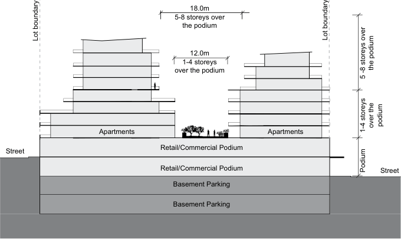
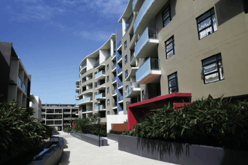
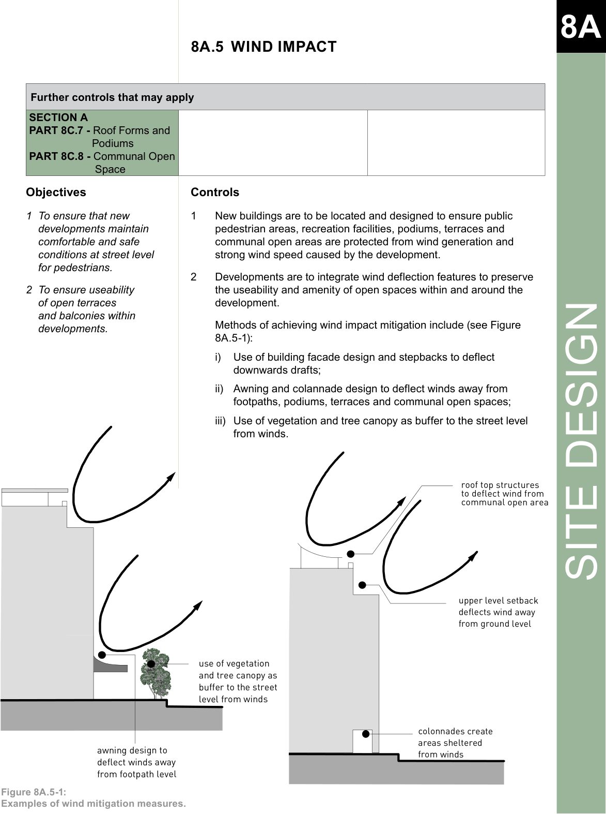

### 8A.4  BUILDING SEPARATION

#### Objectives

#### Controls

1 The minimum separation between a residential component of the

building and any neighbouring building on the development site is to

comply with the following controls: Buildings up to 4 storeys over the podium (see Figure 8A.4-2)

i) 12m between habitable rooms/balconies;

ii)	 9m between habitable rooms/balconies and non-habitable rooms;

1	 To ensure that the new

development scaling,

massing and spacing

between buildings support

the desired local area

character and the Ku-ring-

gai landscaped garden

character.

iii)	 6m between non-habitable rooms. Buildings of 5 to 8 storeys over the podium (see figure 8A.4-2)

iv)	 18m between habitable rooms / balconies;

2	 To provide building form

and layout that minimises

overshadowing of adjacent

properties and open

space.

v)	 13.5m between habitable room / balcony and non habitable

room;

vi)	 9m between non-habitable rooms. Buildings 9 storeys or more over the podium

vii)	 24m between habitable rooms

viii)	18m between habitable room / balcony and non habitable room;

3	 To provide building

configuration that

facilitates the provision of

useable communal open

space, private open space

landscaping and view

corridors.

ix)	 12m between non-habitable rooms.

> [Picture on page 11: a map, saved as a picture (images/part-08-mixed-use-development-page-11-40.gif, 150 dpi); the street names and other small labels are on the picture.]
> Words printed on the picture (title and legend, copied from the PDF):
> 5-8 storeys over
> over the podium
> 5 -8 storeys over

4	 To maximise view sharing. 5	 To configure buildings

to protect and enhance

visual and acoustic

privacy for occupants and

adjacent residents.

### SITE DESIGN

#### Figure 8A.4-1:

#### Minimum building separation controls for residential buildings

of 1-4 storeys and 5-8 storeys (over commercial podium).

### 8A.4 BUILDING SEPARATION (continued)

#### Controls

2 For all non-residential developments adjacent to residential

developments:

i) the retail, office and commercial balconies are to be treated

as habitable rooms and provide the same building separation

required in 8A.4(1);

ii)	 the service and plant areas are to be treated as non-habitable

rooms and provide the same building separation required in

8A.4(1); Note: refer to section 8C.15 Acoustic Privacy. 3 Office developments adjacent to residential developments are to

demonstrate that the adjoining residential development retains

adequate visual and acoustic privacy, access to sunlight, outlooks

and that the massing of the building is appropriate to the character of

the locality.

> [Picture on page 12: a picture, saved as a picture (images/part-08-mixed-use-development-page-12-17.gif, 150 dpi).]

#### Figure 8A.4-2:

Adequate separation between buildings to

ensure visual and acoustic privacy.

> [Picture on page 13: a map, saved as a picture (images/part-08-mixed-use-development-page-13-1.gif, 150 dpi); the street names and other small labels are on the picture.]
> Words printed on the picture (title and legend, copied from the PDF):
> comfortable and safe
> conditions at street level
> 2	 To ensure useability
> of open terraces
> and balconies within
> use of vegetation
> and tree canopy as
> buffer to the street
> level from winds
> awning design to
> deflect winds away
> from footpath level
> roof top structures
> to deflect wind from
> communal open area
> upper level setback
> deflects wind away
> from ground level
> use of vegetation
> and tree canopy as
> buffer to the street
> level from winds
> awning design to
> deflect winds away
> from footpath level
> Examples of wind mitigation measures.

Figure 8A.5-1:
