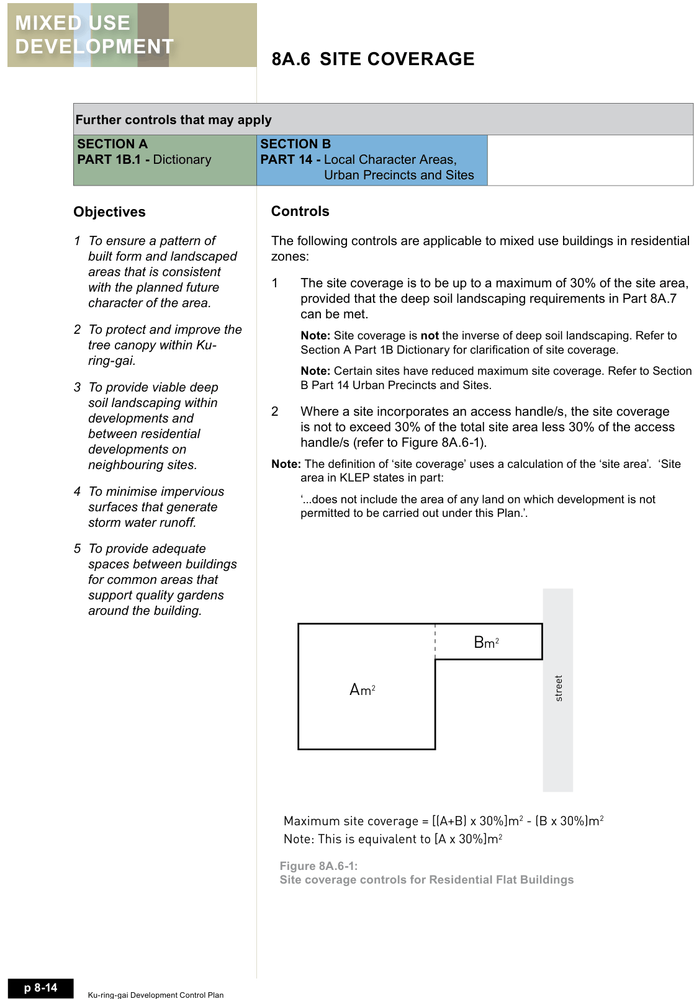

### 8A.5  WIND IMPACT

#### Further controls that may apply SECTION A

PART 8C.7 - Roof Forms and

PART 8C.8 - Communal Open

#### Objectives

#### Controls

1 New buildings are to be located and designed to ensure public

pedestrian areas, recreation facilities, podiums, terraces and

communal open areas are protected from wind generation and

strong wind speed caused by the development.

1	 To ensure that new

2 Developments are to integrate wind deflection features to preserve

the useability and amenity of open spaces within and around the

development. Methods of achieving wind impact mitigation include (see Figure

8A.5-1):

i) Use of building facade design and stepbacks to deflect

ii)	 Awning and colannade design to deflect winds away from

footpaths, podiums, terraces and communal open spaces;

iii)	 Use of vegetation and tree canopy as buffer to the street level

### SITE DESIGN

roof top structures

to deflect wind from

communal open area

> [Picture on page 14: a picture, saved as a picture (images/part-08-mixed-use-development-page-14-1.gif, 150 dpi).]
> Words printed on the picture (title and legend, copied from the PDF):
> PART 1B.1 - Dictionary
> Urban Precincts and Sites
> built form and landscaped
> areas that is consistent
> with the planned future
> character of the area.
> can be met.
> Note: Site coverage is not the inverse of deep soil landscaping. Refer to
> Section A Part 1B Dictionary for clarification of site coverage.
> tree canopy within Ku-
> ring-gai.
> Note: Certain sites have reduced maximum site coverage. Refer to Section
> B Part 14 Urban Precincts and Sites.
> Note: The definition of ‘site coverage’ uses a calculation of the ‘site area’.  ‘Site
> soil landscaping within
> developments and
> between residential
> developments on
> neighbouring sites.
> area in KLEP states in part:
> ‘...does not include the area of any land on which development is not
> permitted to be carried out under this Plan.’.
> 4	 To minimise impervious
> surfaces that generate
> storm water runoff.
> 5	 To provide adequate
> spaces between buildings
> for common areas that
> support quality gardens
> around the building.
> street
> Maximum site coverage = [(A+B) x 30%]m2 - (B x 30%)m2
> Note: This is equivalent to [A x 30%]m2
> Site coverage controls for Residential Flat Buildings

Figure 8A.6-1:
