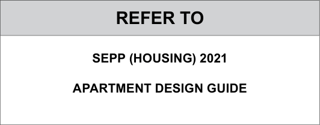
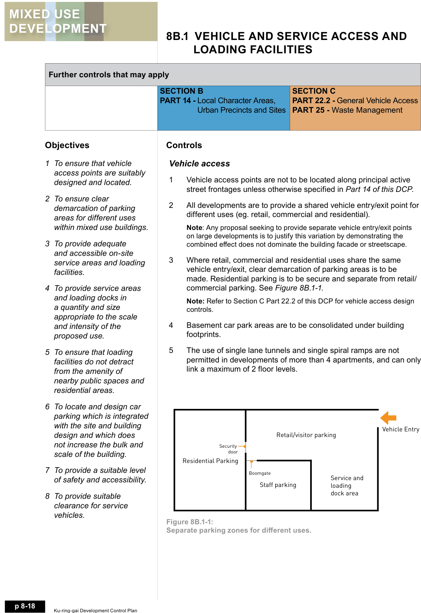

#### 8B 	 	 Access and Parking

8B.1  	 Vehicle and Service Access and Loading

Facilities

8B.2  	 Car Parking Provision 8B.3  	 Bicycle Parking and Support Facilities

Provision

### READ WITH

#### SECTION B

PART 14 - Local Character Areas, Urban Precincts and Sites

#### SECTION C

PART 22 - General Access and Parking

22.2: General Vehicle Access

22.3: Basement Parking

22.4: Visitor Parking

22.5: Parking For People With A Disability

22.6: Pedestrian Movements within Car Parks

22.7: Bicycle Parking and Facilities

22R.2: Car Parking Rates

PART 23 - General Building Design and Sustainability

PART 25 - Waste Management

### REFER TO

#### LIVABLE HOUSING DESIGN GUIDELINES

> [Picture on page 17: a picture, saved as a picture (images/part-08-mixed-use-development-page-17-24.gif, 150 dpi).]

### REFER TO

#### SEPP (HOUSING) 2021

### ACCESS AND PARKING

#### APARTMENT DESIGN GUIDE

> [Picture on page 18: a map, saved as a picture (images/part-08-mixed-use-development-page-18-1.gif, 150 dpi); the street names and other small labels are on the picture.]
> Words printed on the picture (title and legend, copied from the PDF):
> Urban Precincts and Sites
> access points are suitably
> designed and located.
> 2	 To ensure clear
> demarcation of parking
> areas for different uses
> within mixed use buildings.
> Note: Any proposal seeking to provide separate vehicle entry/exit points
> on large developments is to justify this variation by demonstrating the
> combined effect does not dominate the building facade or streetscape.
> 3	 To provide adequate
> and accessible on-site
> service areas and loading
> Note: Refer to Section C Part 22.2 of this DCP for vehicle access design
> and loading docks in
> a quantity and size
> appropriate to the scale
> and intensity of the
> facilities do not detract
> from the amenity of
> nearby public spaces and
> parking which is integrated
> design and which does
> scale of the building.
> of safety and accessibility.
> 8	 To provide suitable
> clearance for service
> Separate parking zones for different uses.

Figure 8B.1-1:
