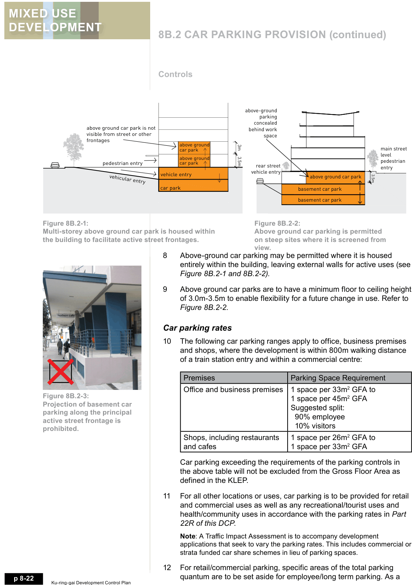
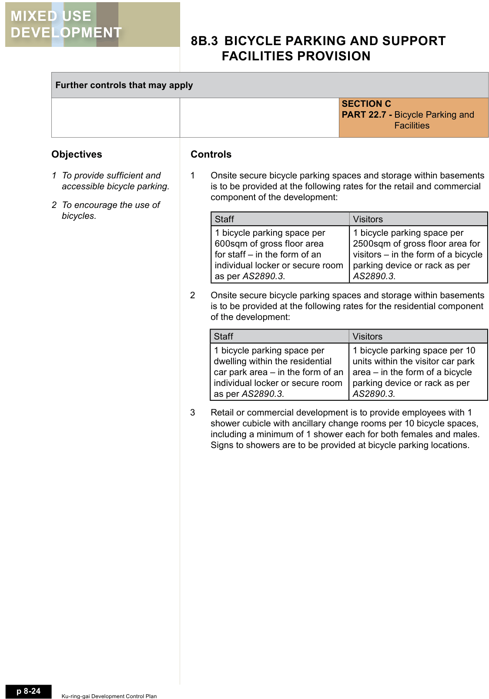

### 8B.2  CAR PARKING PROVISION

#### Further controls that may apply

#### SECTION C

PART 22 - General Access and

Parking

PART 22.3 - Basement Parking

PART 22.4 - Visitor Parking

PART 22.5 - Parking For People with

a Disability

PART 22.6 - Pedestrian Movement

within Car Parks

PART 22R.1 - Car Parking Rates

#### Objectives

#### Controls Car parking design

1 All car parking areas are to be provided within the basement of a

development.

1	 To ensure the provision

of unobstructed and

accessible principal active

street frontages. 2	 To provide safe and

convenient vertical

circulation for building

users.

2 The basement car park areas are not to project above finished

ground level along the principal active street frontage. On supporting

active street frontages the car park may project above existing

ground level by a maximum of 1m to the floor level of the storey

immediately above.

3	 To provide for future

connections between

adjacent basement car

parks where required.

3 Separate and direct lift/stair access is to be provided from basement

car parks to apartments, to commercial units and to retail facilities.

Where this is not possible, it is to be demonstrated that there is no

conflict or danger in the use of shared lifts/stairs. 4 Every Platinum Level unit requires an accessible car space designed

to Australian Standard 2890.6. Note: All common areas and paths of travel are to be accessible in line with

the requirements of the National Construction Code.

4	 To ensure that

streetscapes are active

and attractive, and that

above ground parking

does not compromise the

public domain.

5 For the non-residential component of the development, car parking

spaces, circulation aisles, roadways and ramps are to comply with

AS2890.1 - Parking Facilities - Off street car parking.

5	 To ensure that above

ground car parking can be

adapted for future use.

6 Knock-out panels are to be provided in perimeter walls of the

basement car park where adjacent sites are narrow or isolated. 7 Car park design is to include the following:

6	 To provide adequate car

parking for the building’s

users and visitors.

i) the car park layout is to be adaptable to provide logical

circulation within the car park, and between adjacent car parks,

once connectivity is achieved.

### ACCESS AND PARKING

7	 To ensure the location

and design of car parking

is integrated with the site

and building design.

ii)	 the connection between car parks is to remain open permanently

and not closed by shutters/gates.

iii)	 the connection between car parks it to be made for the same

8	 To encourage walking and

public transport use.

user group, preferably connecting adjacent customer/public

parking levels.

9	 To enable future

connections between

adjacent basement car

parks.

> [Picture on page 22: a map, saved as a picture (images/part-08-mixed-use-development-page-22-1.gif, 150 dpi); the street names and other small labels are on the picture.]
> Words printed on the picture (title and legend, copied from the PDF):
> above ground car park is not
> visible from street or other
> above ground car park
> basement car park
> basement car park
> Multi-storey above ground car park is housed within
> the building to facilitate active street frontages.
> Above ground car parking is permitted
> on steep sites where it is screened from
> Projection of basement car
> parking along the principal
> active street frontage is
> defined in the KLEP.
> 22R of this DCP.
> Note: A Traffic Impact Assessment is to accompany development
> applications that seek to vary the parking rates. This includes commercial or
> strata funded car share schemes in lieu of parking spaces.

Figure 8B.2-1:

Figure 8B.2-2:

Figure 8B.2-1 and 8B.2-2).

Figure 8B.2-2.

Figure 8B.2-3:

### 8B.2 CAR PARKING PROVISION (continued)

#### Controls

8 Above-ground car parking may be permitted where it is housed

entirely within the building, leaving external walls for active uses (see

9 Above ground car parks are to have a minimum floor to ceiling height

of 3.0m-3.5m to enable flexibility for a future change in use. Refer to

#### Car parking rates

10 The following car parking ranges apply to office, business premises

and shops, where the development is within 800m walking distance

of a train station entry and within a commercial centre:

| Premises | Parking Space Requirement |
|---|---|
| Office and business premises | 1 space per 33m2 GFA to 1 space per 45m2 GFA Suggested split: 90% employee 10% visitors |
| Shops, including restaurants and cafes | 1 space per 26m2 GFA to 1 space per 33m2 GFA |

Car parking exceeding the requirements of the parking controls in

the above table will not be excluded from the Gross Floor Area as

11 For all other locations or uses, car parking is to be provided for retail

and commercial uses as well as any recreational/tourist uses and

health/community uses in accordance with the parking rates in Part

12 For retail/commercial parking, specific areas of the total parking

quantum are to be set aside for employee/long term parking. As a

### 8B.2 CAR PARKING PROVISION (continued)

#### Controls

guide, 20% of retail parking and 90% of commercial parking could

be set aside as employee/long term parking. 13 Visitor parking for each separate use is to be provided within the

main parking area allocated for that use. 14 The following car parking requirements only apply to the residential

component within 800m walking distance of a train station entry

within mixed use developments.

| Apartment Size | Minimum number of parking spaces per dwelling | Maximum number of parking spaces per dwelling |
|---|---|---|
| Studio | 0 spaces | 0.5 spaces |
| One bedroom | 0.6 spaces | 1 space |
| Two bedrooms | 0.9 spaces | 1.25 spaces |
| Three or more bedrooms | 1 space | 2 spaces |

Car parking exceeding the requirements of the parking controls in

the above table will not be excluded from the Gross Floor Area as

defined in the KLEP. 15 Residential visitor parking is to be provided within the site at the rate

of one space per 6 apartments or part thereof. 16 At least one visitor parking space is to comply with the dimensional

and locational requirements of AS2890.6. 17 One visitor parking bay is to be provided with a tap, to make

provision for on-site car washing. 18 At least one car share space is to be provided in the basement per

90 dwellings, or part thereof. Note: any proposed reduction in car parking on the basis of providing car

share space/s is to be justified by the proponent through supporting studies. 19 All parking bays are to be EV ready with design and construction

(provision for conduits, switchboards, electrical capacity etc) to

enable installation of electric vehicle charging points that are linked

to each individual dwelling electricity meter.

10	To provide for future

transport and vehicle

options including Electric

Vehicle charging stations,

e-bicycles and the like.

### ACCESS AND PARKING

> [Picture on page 24: a picture, saved as a picture (images/part-08-mixed-use-development-page-24-1.gif, 150 dpi).]
> Words printed on the picture (title and legend, copied from the PDF):
> Facilities
> accessible bicycle parking.
> component of the development:
> bicycles.
> of the development:
