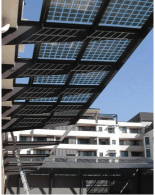
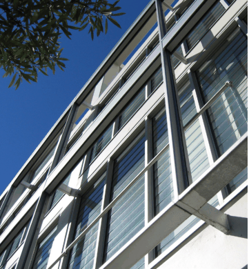
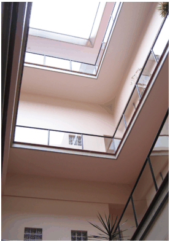
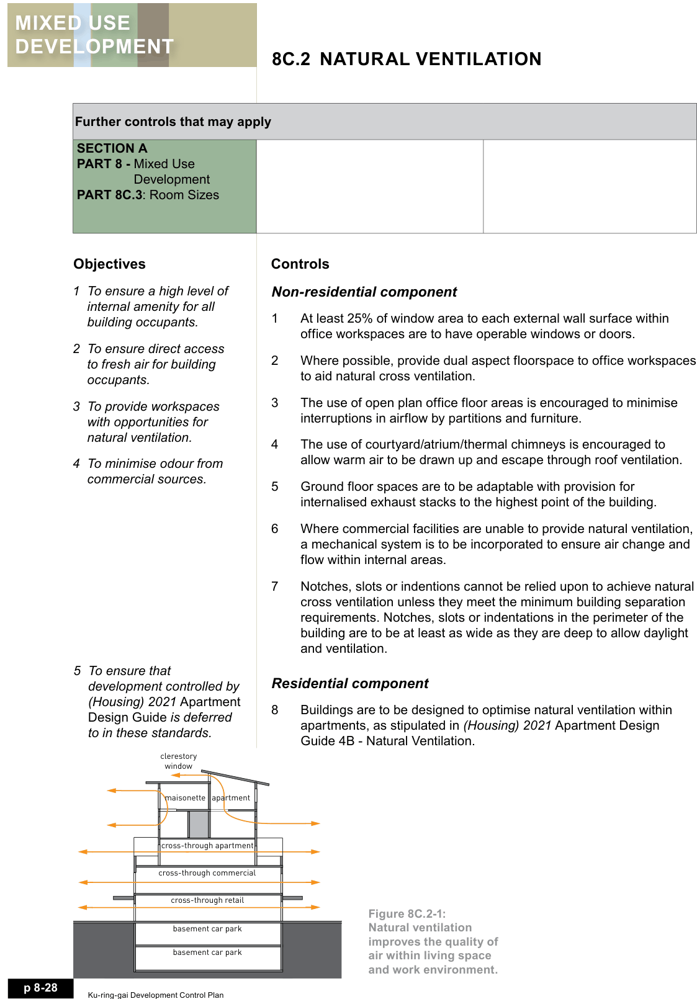

### 8C.1  SOLAR ACCESS AND DAYLIGHT

#### Objectives

#### Controls Non-residential component

1 Buildings are to be oriented to optimise the northern aspect.

1	 To ensure a high level

of internal amenity and

comfort for all occupants:

2 All office workspaces are to be within 10m and in direct line of sight

of a perimeter window.

2	 To ensure building

occupants have access

to daylight within the

building.

3 Notches, slots or indentations in the perimeter of the building are to

be at least as wide as they are deep to allow daylight that enables

functional use of interior areas. 4 Overshadowing is not to compromise the development potential of

adjoining yet to be developed sites.

3	 To minimise the negative

impact of overshadowing

on living areas and

private and communal

open space areas of

residential neighbouring

development.

5 Developments are to allow the retention of a minimum four hours

direct sunlight between 9am and 3pm on 21st June to all existing

solar collectors and solar hot water services on neighbouring

buildings.

4	 To minimise the impact of

development on existing

solar collection devices.

6 Three hours of direct sunlight between 9am and 3pm on 21st June

is to be maintained to the living rooms, primary private open spaces

and any communal open spaces within residential developments on

> [Picture on page 26: a picture, saved as a picture (images/part-08-mixed-use-development-page-26-37.gif, 150 dpi).]

adjoining sites.

> [Picture on page 26: a picture, saved as a picture (images/part-08-mixed-use-development-page-26-39.gif, 150 dpi).]

5	 To ensure that

development controlled

by SEPP (Housing) 2021,

Apartment Design Guide

is deferred to in these

standards.

> [Picture on page 26: a picture, saved as a picture (images/part-08-mixed-use-development-page-26-46.gif, 150 dpi).]

#### Figure 8C.1-3:

#### Photovoltaic cells integrated into

the awning design.

#### Figure 8C1-2:

Retractable shading devices to the

windows for solar access control.

#### Figure 8C.1-1:

#### Internal atrium space

provided to promote daylight

access.

### 8C.1 SOLAR ACCESS AND DAYLIGHT

### (continued)

#### Controls Residential component

7 Developments are to be designed to optimise solar and daylight

access into apartments and private open spaces within the mixed

use development as stipulated in SEPP (Housing) 2021, Apartment

Design Guide Part 4A - Solar and Daylight Access.

#### Residential component

8 Developments are to be designed to optimise solar and daylight

access into apartments and private open spaces within the mixed

use development as stipulated in SEPP (Hosuing) 2021, Apartment Design Guide Part 4A - Solar and Daylight Access.

#### Sun shading

9 All shading devices are to be integrated with building facade design

(see Figure. 8C.1-2). 10 Consideration is to be given to the integration of solar shading with

solar energy collection technology (see Figure 8C.1-3). 11 All developments are to utilise shading and glare control. Design

solutions include:

i) providing external horizontal shading to north-facing windows,

such as eaves, overhangs, pergolas, awnings, colonnades,

upper floor balconies, and/or deciduous vegetation;

ii)	 providing vertical shading to east and west windows, such as

sliding screens, adjustable louvres, blinds and/or shutters;

iii)	 providing shading to glazed and transparent roofs;.

### BUILDING DESIGN AND SUSTAINABILITY

> [Picture on page 28: a map, saved as a picture (images/part-08-mixed-use-development-page-28-1.gif, 150 dpi); the street names and other small labels are on the picture.]
> Words printed on the picture (title and legend, copied from the PDF):
> PART 8C.3: Room Sizes
> internal amenity for all
> 3	 To provide workspaces
> with opportunities for
> flow within internal areas.
> 5	 To ensure that
> development controlled by
> (Housing) 2021 Apartment
> Design Guide is deferred
> to in these standards.
