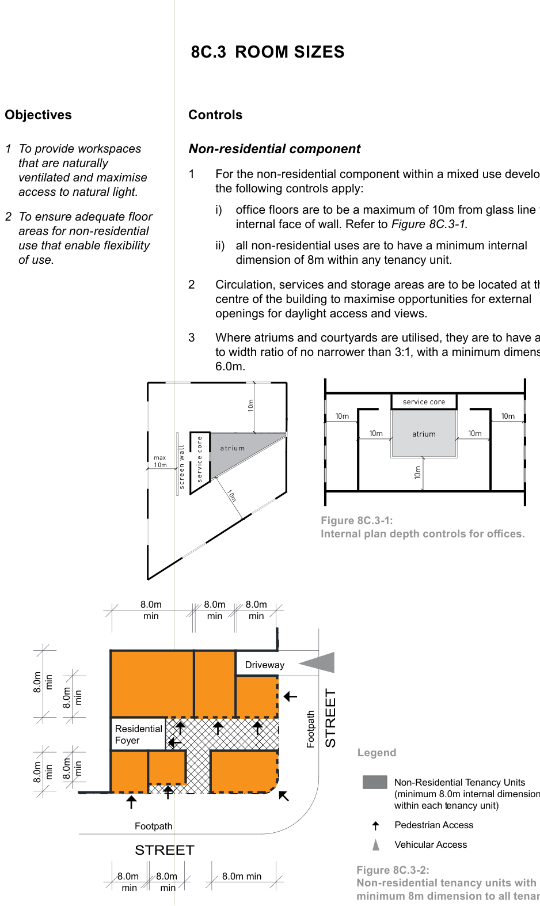

### 8C.2  NATURAL VENTILATION

#### Further controls that may apply SECTION A

PART 8 - Mixed Use

#### Objectives

#### Controls Non-residential component

1	 To ensure a high level of

1 At least 25% of window area to each external wall surface within

office workspaces are to have operable windows or doors. 2 Where possible, provide dual aspect floorspace to office workspaces

to aid natural cross ventilation.

2	 To ensure direct access

to fresh air for building

3 The use of open plan office floor areas is encouraged to minimise

interruptions in airflow by partitions and furniture. 4 The use of courtyard/atrium/thermal chimneys is encouraged to

allow warm air to be drawn up and escape through roof ventilation.

4	 To minimise odour from

5 Ground floor spaces are to be adaptable with provision for

internalised exhaust stacks to the highest point of the building. 6 Where commercial facilities are unable to provide natural ventilation,

a mechanical system is to be incorporated to ensure air change and

7 Notches, slots or indentions cannot be relied upon to achieve natural

cross ventilation unless they meet the minimum building separation

requirements. Notches, slots or indentations in the perimeter of the

building are to be at least as wide as they are deep to allow daylight

#### Residential component

8 Buildings are to be designed to optimise natural ventilation within

apartments, as stipulated in (Housing) 2021 Apartment Design

Guide 4B - Natural Ventilation.

clerestory window

> Words printed on the picture (title and legend, copied from the PDF):
> basement car park
> basement car park

#### Figure 8C.2-1:

#### Natural ventilation

improves the quality of

air within living space

and work environment.

> [Picture on page 29: a map, saved as a picture (images/part-08-mixed-use-development-page-29-1.gif, 150 dpi); the street names and other small labels are on the picture.]
> Words printed on the picture (title and legend, copied from the PDF):
> 1	 To provide workspaces
> that are naturally
> ventilated and maximise
> access to natural light.
> areas for non-residential
> use that enable flexibility
> screen w all
> Internal plan depth controls for offices.
> Non-Residential Tenancy Units
> (minimum 8.0m internal dimension
> within each tenancy unit)
> Non-residential tenancy units with

Figure 8C.3-1:

Figure 8C.3-2:
