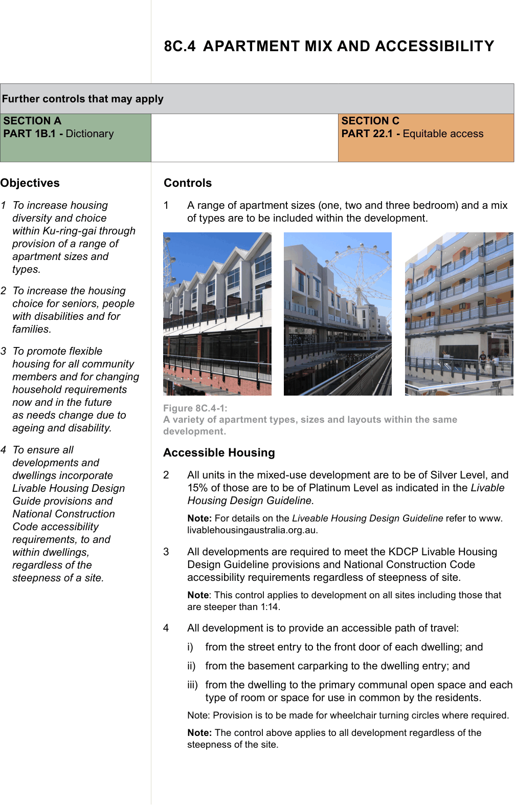

### 8C.3  ROOM SIZES

#### Objectives

#### Controls Non-residential component

1 For the non-residential component within a mixed use development

the following controls apply:

i) office floors are to be a maximum of 10m from glass line to an

internal face of wall. Refer to Figure 8C.3-1.

ii)	 all non-residential uses are to have a minimum internal

2	 To ensure adequate floor

dimension of 8m within any tenancy unit.

2 Circulation, services and storage areas are to be located at the

centre of the building to maximise opportunities for external

openings for daylight access and views. 3 Where atriums and courtyards are utilised, they are to have a height

to width ratio of no narrower than 3:1, with a minimum dimension of

#### Footpath STREET

#### STREET

#### Footpath STREET

#### STREET

### minimum 8m dimension to all tenancies. BUILDING DESIGN AND SUSTAINABILITY

Non-Residential Tenancy Units

### 8C.3 ROOM SIZES (continued)

#### Controls Residential component

4 Apartments are to have minimum internal areas and layouts as

stipulated in SEPP (Housing) 2021 Apartment Design Guide 4D -

Apartment Size and Layout.

3	 To ensure that

development controlled

by SEPP (Housing) 2021

Apartment Design Guide

is deferred to in these

standards.

5 Apartments are to include private open space in the form of

courtyards, balconies, terraces as stipulated by SEPP (Housing)

2021 Apartment Design Guide Part 4E - Private Open Space. 6 Apartments are to provide storage space as stipulated in SEPP

(Housing) 2021 Apartment Design Guide Part 4G - Storage.

> [Picture on page 31: a map, saved as a picture (images/part-08-mixed-use-development-page-31-1.gif, 150 dpi); the street names and other small labels are on the picture.]
> Words printed on the picture (title and legend, copied from the PDF):
> PART 1B.1 - Dictionary
> 1	 To increase housing
> diversity and choice
> within Ku-ring-gai through
> apartment sizes and
> choice for seniors, people
> with disabilities and for
> 3	 To promote flexible
> housing for all community
> members and for changing
> ageing and disability.
> A variety of apartment types, sizes and layouts within the same
> Housing Design Guideline.
> Note: For details on the Liveable Housing Design Guideline refer to www.
> 4	 To ensure all
> Livable Housing Design
> Guide provisions and
> requirements, to and
> regardless of the
> steepness of a site.
> Note: This control applies to development on all sites including those that
> are steeper than 1:14.
> Note: Provision is to be made for wheelchair turning circles where required.
> Note: The control above applies to all development regardless of the
> steepness of the site.

Figure 8C.4-1:
