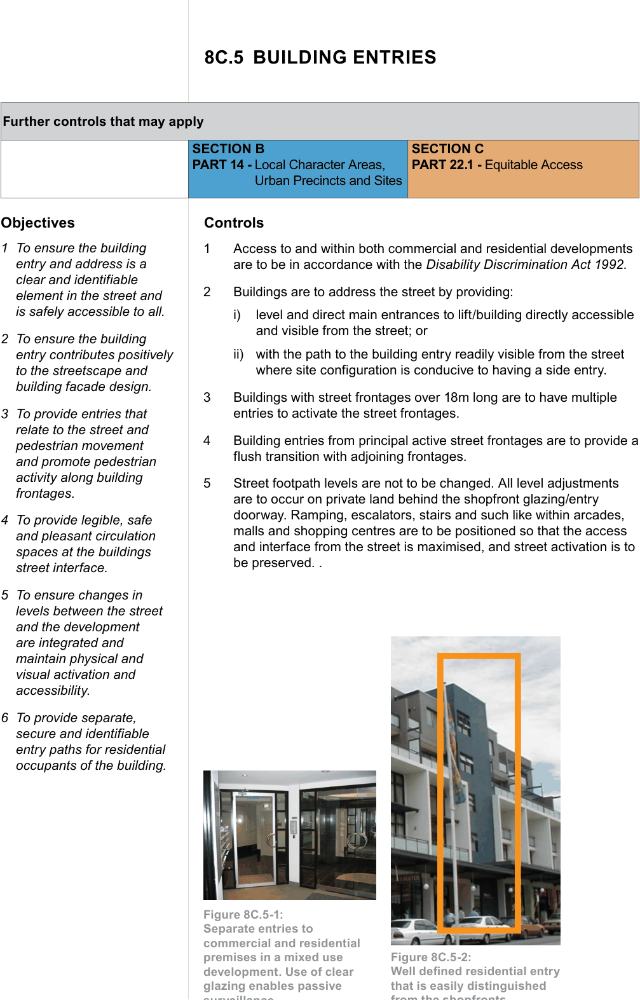

### 8C.4  APARTMENT MIX AND ACCESSIBILITY

#### Further controls that may apply SECTION A

#### SECTION C

PART 22.1 - Equitable access

#### Objectives

#### Controls

1 A range of apartment sizes (one, two and three bedroom) and a mix

of types are to be included within the development.

provision of a range of

2	 To increase the housing

now and in the future

as needs change due to

#### Accessible Housing

2 All units in the mixed-use development are to be of Silver Level, and

15% of those are to be of Platinum Level as indicated in the Livable

3 All developments are required to meet the KDCP Livable Housing

Design Guideline provisions and National Construction Code

accessibility requirements regardless of steepness of site.

4 All development is to provide an accessible path of travel:

i) from the street entry to the front door of each dwelling; and

ii)	 from the basement carparking to the dwelling entry; and

iii)	 from the dwelling to the primary communal open space and each

type of room or space for use in common by the residents.

### BUILDING DESIGN AND SUSTAINABILITY

### 8C.4 APARTMENT MIX AND ACCESSIBILITY

### (continued)

#### Controls

5 Where the internal finished floor level of a ground floor dwelling

and/or private open space is not more than 0.9m below the existing

ground level at the building line, the ground level adjacent to the

building is to be levelled to the finished floor level for a distance of

3.0m from the building line. Note: A step at the threshold for compliance with waterproofing

requirements is acceptable, however thresholds to the primary private open

space are to be accessible for all Platinum Level dwellings. 6 For Platinum level units with more than one level, an internal lift is to

be provided to allow access to all levels. Note: Provision of a lift is not in lieu of accommodating Platinum Level

provisions required at the dwelling entry level. 7 Chair lifts, platform lifts and the like are not permitted on internal

and external communal/shared paths and circulation areas. Where

lifts are required they are to be constructed within lift shafts with full

weather protection for users.

> [Picture on page 33: a map, saved as a picture (images/part-08-mixed-use-development-page-33-1.gif, 150 dpi); the street names and other small labels are on the picture.]
> Words printed on the picture (title and legend, copied from the PDF):
> Urban Precincts and Sites
> clear and identifiable
> entry contributes positively
> to the streetscape and
> building facade design.
> and promote pedestrian
> activity along building
> be preserved. .
> and pleasant circulation
> spaces at the buildings
> levels between the street
> and the development
> are integrated and
> maintain physical and
> visual activation and
> 6	 To provide separate,
> secure and identifiable
> entry paths for residential
> occupants of the building.
> Well defined residential entry
> that is easily distinguished
> Separate entries to
> commercial and residential
> premises in a mixed use
> development. Use of clear
> glazing enables passive

Figure 8C.5-2:

Figure 8C.5-1:
