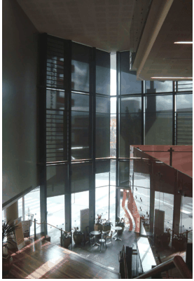
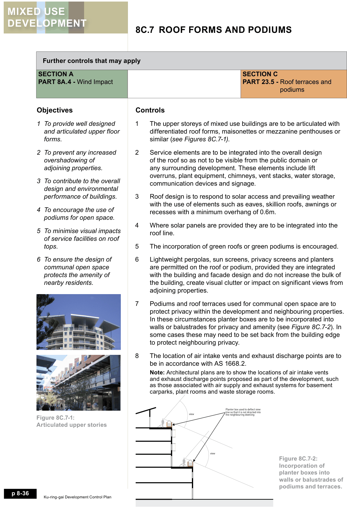

### 8C.6  INTERNAL COMMON CIRCULATION

### AREAS

#### Objectives

#### Controls Non-Residential Component

1	 To provide accessible,

safe and pleasant

circulation spaces for all

building occupants and

users.

1 The design of internal common circulation is to provide adequate

pedestrian mobility and access space, and comply with the

provisions in AS1428.1 and AS1428.2 - Design for Access and

Mobility. 2 All common circulation areas including foyers, lift lobbies and

stairways are to have:

i) appropriate levels of lighting with a preference for natural light

where possible;

ii)	 short corridor lengths that give clear sight lines;

2	 To minimise ongoing

maintenance costs

by providing natural

ventilation, natural light,

efficient lighting and

appriopriate materials to

circulation areas.

Note: Fire doors within corridors are not considered to shorten corridors.

iii)	 clear signage showing the location of commercial facilities,

apartments, common areas as well as general direction finding;

iv)	 natural ventilation;

v)	 low maintenance and robust materials.

3	 To ensure that

development controlled

by SEPP (Housing) 2021

Apartment Design Guide

is deferred to in these

standards.

> [Picture on page 35: a picture, saved as a picture (images/part-08-mixed-use-development-page-35-38.gif, 150 dpi).]

3 Where artificial lighting is required energy efficient lights are to be

used in conjunction with timers or daylight controls. 4 Building design is to avoid blind corners or dark alcoves near lifts

and stairwells, at entrances, along corridors and walkways and

within car parks and provide opportunities for passive surveillance of

circulation spaces. 5 Separate access points (via lift or stairs) are to be provided for each

different use. Both commercial and residential are to have its own

entry. 6 Seating areas are to be provided within the foyer/atrium of

commercial components and are encouraged in common circulation

areas near workspaces.

#### Residential Components

7 Common circulation spaces are to comply with the requirements

stipulated by SEPP (Housing) 2021 Apartment Design Guide Part

4F - Common Circulation and Spaces.

#### Figure 8C.6-2:

#### Generous open common

circulation space for

commercial uses on upper

floor levels.

### BUILDING DESIGN AND SUSTAINABILITY

#### Figure 8C.6-1:

Generous ceiling height to

lift lobby to promote daylight

access.

> [Picture on page 36: a map, saved as a picture (images/part-08-mixed-use-development-page-36-1.gif, 150 dpi); the street names and other small labels are on the picture.]
> Words printed on the picture (title and legend, copied from the PDF):
> and articulated upper floor
> similar (see Figures 8C.7-1).
> communication devices and signage.
> design and environmental
> podiums for open space.
> communal open space
> protects the amenity of
> to protect neighbouring privacy.
> Note: Architectural plans are to show the locations of air intake vents
> and exhaust discharge points proposed as part of the development, such
> as those associated with air supply and exhaust systems for basement
> carparks, plant rooms and waste storage rooms.
> Planter box used to deflect view
> line so that it is not directed into
> the neighbouring dwelling
> Articulated upper stories
> planter boxes into
> walls or balustrades of
> podiums and terraces.

Figure 8C.7-1:

Figure 8C.7-2:
