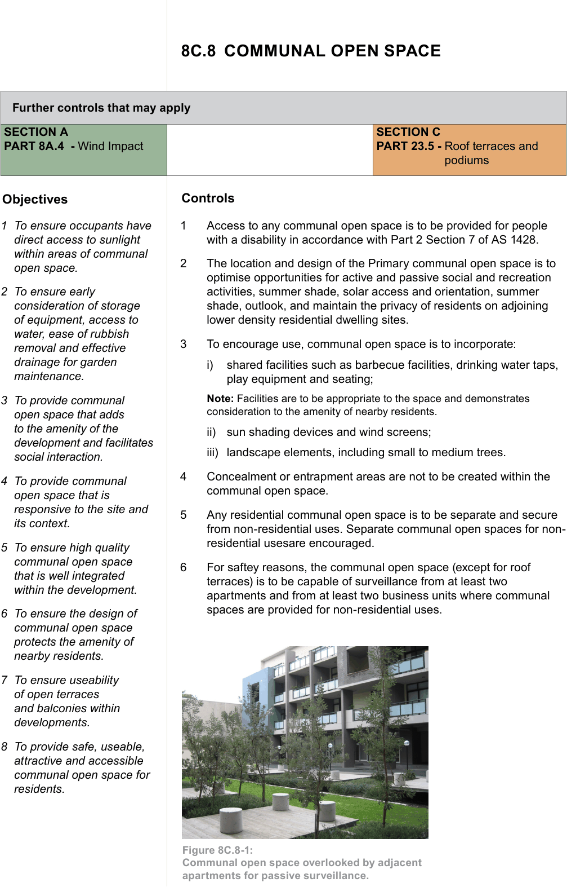

### 8C.7  ROOF FORMS AND PODIUMS

#### Further controls that may apply SECTION A

PART 8A.4 - Wind Impact

#### SECTION C

PART 23.5 - Roof terraces and

#### Objectives

#### Controls

1	 To provide well designed

1 The upper storeys of mixed use buildings are to be articulated with

differentiated roof forms, maisonettes or mezzanine penthouses or

2	 To prevent any increased

2 Service elements are to be integrated into the overall design

of the roof so as not to be visible from the public domain or

any surrounding development. These elements include lift

overruns, plant equipment, chimneys, vent stacks, water storage,

3	 To contribute to the overall

performance of buildings. 3 Roof design is to respond to solar access and prevailing weather

with the use of elements such as eaves, skillion roofs, awnings or

recesses with a minimum overhang of 0.6m.

4	 To encourage the use of

4 Where solar panels are provided they are to be integrated into the

5	 To minimise visual impacts

of service facilities on roof

5 The incorporation of green roofs or green podiums is encouraged.

6	 To ensure the design of

6 Lightweight pergolas, sun screens, privacy screens and planters

are permitted on the roof or podium, provided they are integrated

with the building and facade design and do not increase the bulk of

the building, create visual clutter or impact on significant views from

7 Podiums and roof terraces used for communal open space are to

protect privacy within the development and neighbouring properties.

In these circumstances planter boxes are to be incorporated into

walls or balustrades for privacy and amenity (see Figure 8C.7-2). In

some cases these may need to be set back from the building edge

8 The location of air intake vents and exhaust discharge points are to

be in accordance with AS 1668.2.

> [Picture on page 37: a map, saved as a picture (images/part-08-mixed-use-development-page-37-1.gif, 150 dpi); the street names and other small labels are on the picture.]
> Words printed on the picture (title and legend, copied from the PDF):
> direct access to sunlight
> within areas of communal
> 2	 To ensure early
> consideration of storage
> of equipment, access to
> water, ease of rubbish
> removal and effective
> drainage for garden
> play equipment and seating;
> Note: Facilities are to be appropriate to the space and demonstrates
> consideration to the amenity of nearby residents.
> 3	 To provide communal
> open space that adds
> development and facilitates
> communal open space.
> 4	 To provide communal
> open space that is
> residential usesare encouraged.
> communal open space
> that is well integrated
> within the development.
> communal open space
> protects the amenity of
> 7	 To ensure useability
> of open terraces
> and balconies within
> attractive and accessible
> communal open space for
> Communal open space overlooked by adjacent
> apartments for passive surveillance.

Figure 8C.8-1:
