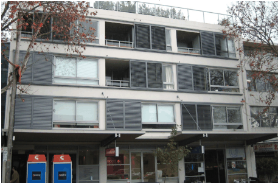
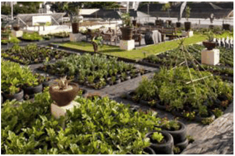
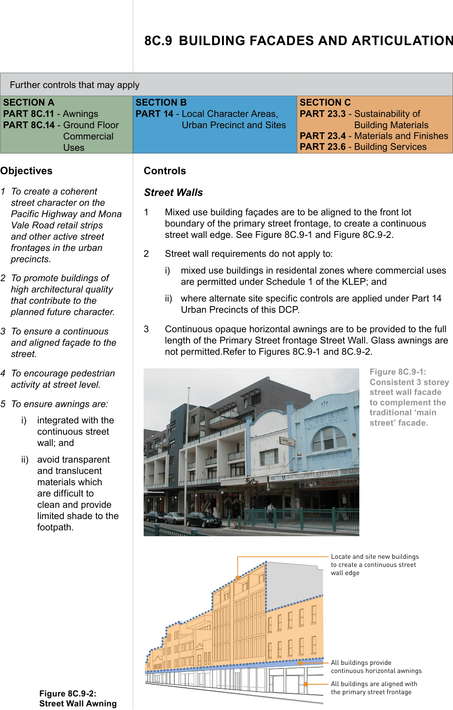

### 8C.8  COMMUNAL OPEN SPACE

#### Further controls that may apply SECTION A

PART 8A.4  - Wind Impact

#### SECTION C

PART 23.5 - Roof terraces and

#### Objectives

#### Controls

1 Access to any communal open space is to be provided for people

with a disability in accordance with Part 2 Section 7 of AS 1428.

1	 To ensure occupants have

2 The location and design of the Primary communal open space is to

optimise opportunities for active and passive social and recreation

activities, summer shade, solar access and orientation, summer

shade, outlook, and maintain the privacy of residents on adjoining

lower density residential dwelling sites. 3 To encourage use, communal open space is to incorporate:

i) shared facilities such as barbecue facilities, drinking water taps,

ii)	 sun shading devices and wind screens;

iii)	 landscape elements, including small to medium trees.

to the amenity of the

4 Concealment or entrapment areas are not to be created within the

responsive to the site and

5 Any residential communal open space is to be separate and secure

from non-residential uses. Separate communal open spaces for non-

5	 To ensure high quality

6 For saftey reasons, the communal open space (except for roof

terraces) is to be capable of surveillance from at least two

apartments and from at least two business units where communal

spaces are provided for non-residential uses.

6	 To ensure the design of

8	 To provide safe, useable,

### BUILDING DESIGN AND SUSTAINABILITY

### 8C.8  COMMUNAL OPEN SPACE (continued)

#### Controls

7 Garden maintenance storage areas and connections to water and

drainage are to be provided to communal open space. Note: Proposals are to demonstrate entry and access to communal open

spaces and common areas for maintenance purposes.

#### Residential Components

8 A minimum of 10m2 of communal open space per dwelling is to be

provided. This can be provided on the podium or roof area. Note: Roof top communal open space(s) may be required in circumstances

where a ground level or podium level communal open space cannot meet

performance requirements. 9 At least one single area of Primary communal open space for the

residents is to be provided with the following requirements:

i) a minimum area of 80m2; and

ii)	 a minimum dimension of 8m; and

iii)	 access to direct sunlight for at least two hours between 9am and

3pm on 21st June, to at least 50% of the space, and

iv)	 directly accessible from the internal common circulation/lobby

area.

10 Where additional parcels of communal open space are required to

> [Picture on page 38: a picture, saved as a picture (images/part-08-mixed-use-development-page-38-22.gif, 150 dpi).]

meet 8C.8(7) above, a minimum dimension of 5m is required.

> [Picture on page 38: a picture, saved as a picture (images/part-08-mixed-use-development-page-38-24.gif, 150 dpi).]

#### Figure 8C.8-2:

Use of roof terrace for communal open space in a

mixed use development.

#### Figure 8C.8-3:

Use of roof terrace for community garden in

communal open space

> [Picture on page 39: a map, saved as a picture (images/part-08-mixed-use-development-page-39-1.gif, 150 dpi); the street names and other small labels are on the picture.]
> Words printed on the picture (title and legend, copied from the PDF):
> Urban Precinct and Sites
> PART 8C.11 - Awnings
> street character on the
> Pacific Highway and Mona
> Vale Road retail strips
> and other active street
> frontages in the urban
> high architectural quality
> that contribute to the
> planned future character.
> 4	 To encourage pedestrian
> activity at street level.
> Consistent 3 storey
> street wall facade
> to complement the
> i) integrated with the
> ii)	 avoid transparent
> are difficult to
> clean and provide
> limited shade to the
> Locate and site new buildings
> to create a continuous street
> All buildings provide
> continuous horizontal awnings
> All buildings are aligned with
> the primary street frontage
> Street Wall Awning

Figure 8C.9-1:

Figure 8C.9-2:
