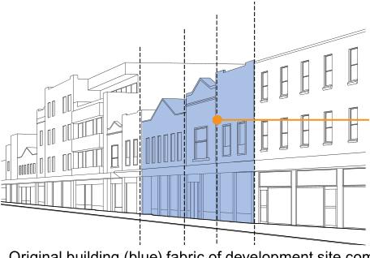
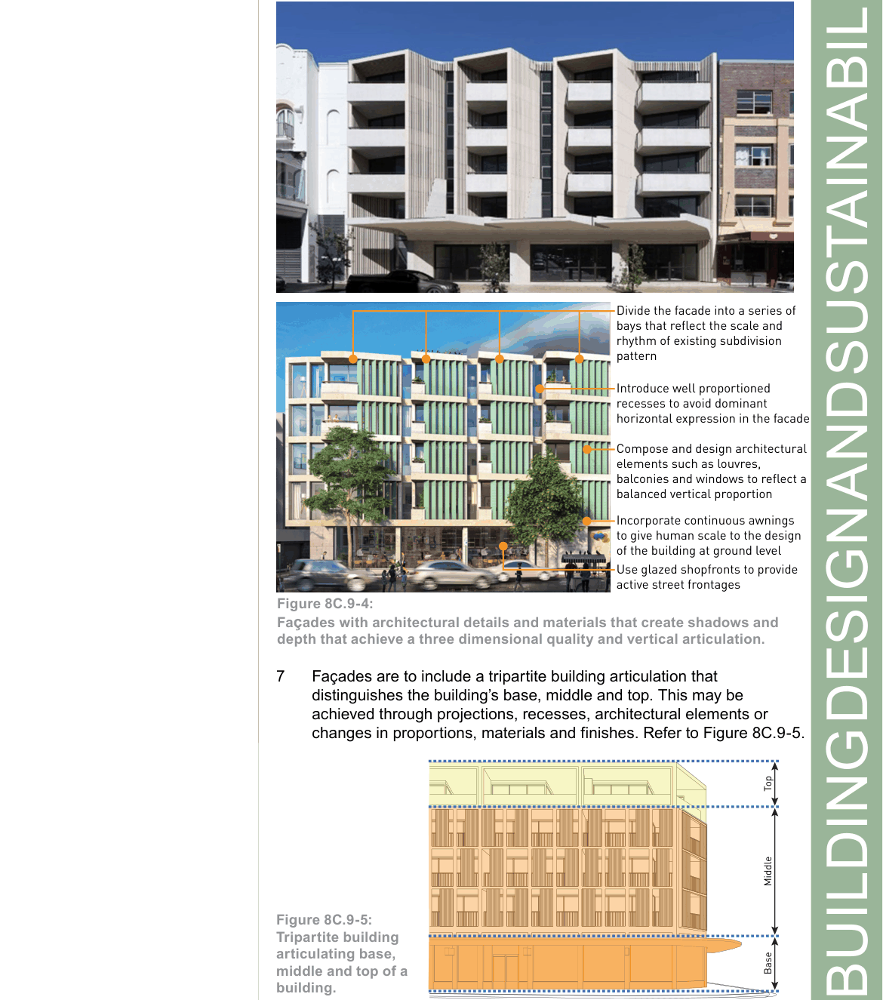

### 8C.9  BUILDING FACADES AND ARTICULATION

Further controls that may apply

#### SECTION B

PART 14 - Local Character Areas,

#### SECTION C

PART 23.3 - Sustainability of

#### SECTION A

PART 8C.14 - Ground Floor

PART 23.4 - Materials and Finishes

PART 23.6 - Building Services

#### Objectives

#### Controls Street Walls

1 Mixed use building façades are to be aligned to the front lot

boundary of the primary street frontage, to create a continuous

street wall edge. See Figure 8C.9-1 and Figure 8C.9-2. 2 Street wall requirements do not apply to:

1	 To create a coherent

i) mixed use buildings in residental zones where commercial uses

are permitted under Schedule 1 of the KLEP; and

ii)	 where alternate site specific controls are applied under Part 14

Urban Precincts of this DCP.

2	 To promote buildings of

3 Continuous opaque horizontal awnings are to be provided to the full

length of the Primary Street frontage Street Wall. Glass awnings are

not permitted.Refer to Figures 8C.9-1 and 8C.9-2.

3	 To ensure a continuous

and aligned façade to the

5	 To ensure awnings are:

### BUILDING DESIGN AND SUSTAINABILITY

### (continued)

#### Objectives

#### Controls Facade Articulation

5 Façades are to be designed to express the underlying fine grain

subdivision pattern of the street. See Figure 8C.9-3 and Figure

8C.9-4.

> [Picture on page 40: a picture, saved as a picture (images/part-08-mixed-use-development-page-40-8.gif, 150 dpi).]

6	 To integrate building

elements (such as

balconyies, terraces,

openings) into the overall

building form and facade

design. 7	 To create building facades

that are environmentally

responsive.

Existing subdivision pattern of the street

Existing subdivision pattern of the street

8	 To demonstrate

appropriate levels of

architectural detail that will

achieve the desired urban

character of Ku-ring-gai.

Original building (blue) fabric of development site comprises 3 subdivided lots

each with separate buildings.

9	 To enable the building

facade, entries and

openings to directly relate

to the street frontage.

Building facades are to be articulated into a series of vertically proportioned bays using projecting and recessed elements such as louvres, balconies, doors and windows

Building facades are to be articulated into a series of vertically proportioned bays using projecting and recessed elements such as louvres, balconies, doors and windows

10	To ensure that private

open space design

allows views and passive

surveillance of the street

while providing for safety

and visual privacy of

residents.

Facades are to be designed to express the underlying subdivision pattern of the street

Facades are to be designed to express the underlying subdivision pattern of the street

11	To ensure openings

and articulation on

the elevations do not

compromise the liveability

of the internal areas.

Consolidated development (orange) lot includes vertical articulation of the

original 3 subdivision patterns.

#### Figure 8C.9-3:

#### Building articulation and modulation based on existing fine grain

subdivision patterns.

12	To provide distinct building

articulation on corner sites

that reinforce the street

intersection and create

a unique memorable

building that supports

urban wayfinding.

6 Building façades are to focus on vertically proportioned bays using

projecting and recessed elements and architectural details such

as louvres, balconies, doors and windows. See Figure 8C.9-3 and

Figure 8C.9-4.

13	To reinforce street

intersections and create

landmarks.

### (continued)

#### Controls

> [Picture on page 41: a picture, saved as a picture (images/part-08-mixed-use-development-page-41-3.gif, 150 dpi).]
> Words printed on the picture (title and legend, copied from the PDF):
> Divide the facade into a series of
> bays that reflect the scale and
> rhythm of existing subdivision
> pattern
> Introduce well proportioned
> recesses to avoid dominant
> horizontal expression in the facade
> Compose and design architectural
> elements such as louvres,
> balconies and windows to reflect a
> balanced vertical proportion
> Incorporate continuous awnings
> to give human scale to the design
> of the building at ground level
> Use glazed shopfronts to provide
> active street frontages
> depth that achieve a three dimensional quality and vertical articulation.

Figure 8C.9-4:

Façades with architectural details and materials that create shadows and

7 Façades are to include a tripartite building articulation that

distinguishes the building’s base, middle and top. This may be

achieved through projections, recesses, architectural elements or

changes in proportions, materials and finishes. Refer to Figure 8C.9-5.

#### Figure 8C.9-5:

#### Tripartite building

articulating base,

middle and top of a

building.

### BUILDING DESIGN AND SUSTAINABILITY

### (continued)

#### Controls

8 Windows to a habitable room are to be situated to create

opportunities for passive surveillance of the street. Snorkel windows

are not permitted. 9 All facades are to be designed to minimise on-going maintenance

and weathering by:

i) selecting appropiate robust materials/finishes;

ii)	 including appropriate building edge, balcony edge, sill head and

parapet detailing that demonstrates protection from prevailing

weather and harsh solar aspects. Note: Refer to Part 23.4 Materials, Finishes and Colours of this DCP. 10 Subterranean rooms for residential and non-residential purposes are

not permitted. 11 Building facades are to be designed to respond to solar access by

using solar protection elements such as eaves, louvres and other

sun shading devices as environmental controls. 12 All building elements including shading devices, signage, drainage

pipes, awnings/colonnades, solar devices and communication

devices are to be coordinated and integrated with the overall facade

design. Note: See Part 12 of this DCP for other signage requirements.

#### Balconies

13 Balconies that run the full length of the building facade are not

permitted. 14 Balconies are not to project more than 1.5m from the outermost

wall of the building facade unless they are an integrated part of the

building composition. Note: Setback and building separation requirements apply to balcony

projections. Note: Refer to Part 23.4 Control 20 for further requirements on balconies.

### (continued)

#### Controls Corner Sites

15 Street corners are to be emphasised architecturally by articulating

parts of the building and façade, including:

i) chamfered, splayed or rounded façades extending through the

height of the building;

ii)	 variations in building height to express the corner;

iii)	 variations in materials and finishes;

iv)	 changes in building roof form;

v)	 projecting or recessed balconies. 16 Buildings located on corner sites are to turn the corner and address

both street frontages equally, including at street level with active

street frontages by utilising:

i) glazed shopfronts displaying goods or internal activities to all

ground floor facades;

ii)	 building entries on the corner.

Include chamfered / rounded corners extending through the height of the facade detailed as stronger visual elements

Turn the corner and address both street frontages Provide building entries on corners to activate and express corner locations

#### Figure 8C.9-6:

#### Corner site articulation

### BUILDING DESIGN AND SUSTAINABILITY
