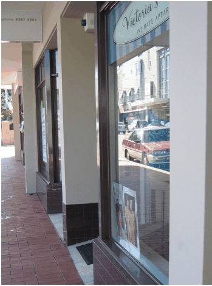
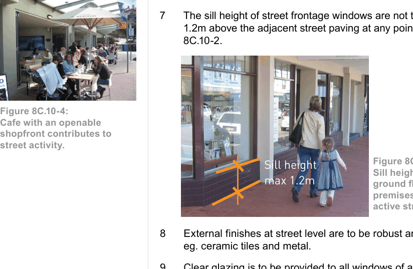

### 8C.10  GROUND FLOOR COMMERCIAL USES

#### Objectives

#### Controls

1 Building entries to each individual commercial premises are to be

level with adjoining footpaths, with openings (doors and windows)

that allow a direct visual connection between the building and the

street. See Figure 8C.10-4.

1	 To support accessible

pedestrian activity and

enhance the amenity,

safety and surveillance of

the public domain.

Note: Variations may be permitted on very steep streets.

> [Picture on page 44: a picture, saved as a picture (images/part-08-mixed-use-development-page-44-14.gif, 150 dpi).]

2	 To provide direct physical

and visual connection

between the private and

public domain. 3	 To ensure activation and

surveillance at street level. 4	 To provide visual interest

at street level. 5	 To provide internal

ventilation systems that

contribute to flexibility and

adaptability of use in the

future.

#### Figure 8C.10-1:

#### Level access to all shopfronts.

2 Building slabs are to be stepped on sloping sites to ensure ground

floor level does not exceed 0.3m above or below finished footpath

level. Note: Variations may be permitted on very steep streets. 3 Ground floor street frontages are to provide for active uses that

contribute to the active street frontage. 4 Buildings on principal active street frontages are to:

i) maintain active frontage to 80% of the length of the building

facade at the street level;

ii)	 support a mix of activities, including after hour activities;

iii)	 provide facades that address the street and public domain with

appropriate facade treatments at street level that respond to the

pedestrian scale;

iv)	 contain well articulated pedestrian entrances at frequent

intervals;

v)	 provide continuous awnings;

vi)	 avoid the incorporation of vehicle access points; and

vii)	 not have projecting basements.

### 8C.10 GROUND FLOOR COMMERCIAL USES

### (continued)

#### Controls

5 Buildings on supporting active street frontages (including mixed use

buildings in R4 - High Density Residential zones) are to:

i) minimise the extent of blank walls and incorporate modulation or

changes in texture and materials to reduce their impact;

ii)	 support dispersed pedestrian-oriented activities with well

articulated entrances;

iii)	 provide facades that address the street and public domain and

integrate vehicle access where provided; and

iv)	 provide awnings, especially at key pedestrian entry points.

#### Figure 8C.10-3:

Openable shopfronts with

merchandise creates interest

and engages the passer-by.

6 Ground floor building design articulation for retail/commercial uses

are to avoid the creation of dark alcoves or entrapment areas.

> [Picture on page 45: a picture, saved as a picture (images/part-08-mixed-use-development-page-45-19.gif, 150 dpi).]
> Words printed on the picture (title and legend, copied from the PDF):
> 8C.10-2.
> Cafe with an openable
> shopfront contributes to
> street activity.
> Sill height
> max 1.2m

Figure 8C.10-4:

7 The sill height of street frontage windows are not to be more than

1.2m above the adjacent street paving at any point. See Figure

#### Figure 8C.10-2:

Sill height controls for

ground floor commercial

premises to achieve an

active street frontage.

8 External finishes at street level are to be robust and graffiti resistant,

eg. ceramic tiles and metal. 9 Clear glazing is to be provided to all windows of active street

frontage. 10 Security roller shutters are not permitted on the external face of the

building. Where they are deemed necessary, grilles or transparent

security shutters may only be used behind the window display. 11 Openable shopfronts for restaurants and cafes are to be provided

where practicable. See Figure 8C.10-3 and Figure 8C.10-4. 12 No residential dwellings are permitted on the street level frontage.

Where dwellings are provided on the street level frontage, the

development is considered to be a Residential Flat Building and is to

comply with all controls in Part 7 Residential Flat Buildings. 13 All new development is to be designed to include an internal

ventilation shaft to ensure future alterations do not place the shaft in

an unsuitable location.

### BUILDING DESIGN AND SUSTAINABILITY
