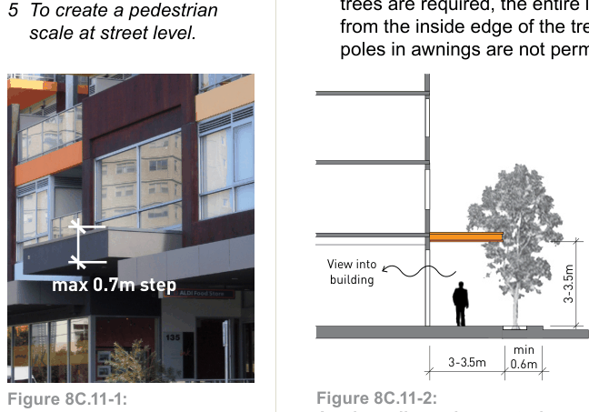
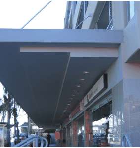

### 8C.11  AWNINGS

#### Objectives

#### Controls

1 Continuous awning is to be provided to the full length of the principal

active street frontage.

1	 To ensure that awnings

are in scale with

development and overall

design.

2 Provide awnings along the supporting active street frontages

(including mixed use buildings in R4 - High Density Residential

zones) wherever practical, especially at key pedestrian entrances. 3 Awning design is restricted to suspended steel box section type

along the principal active street frontages. Variations may be

permitted in certain situations such as corners and building entries.

2	 To ensure that awnings

are designed to be

consistent throughout Ku-

ring-gai  and with adjacent

developments awning

structures.

4 Glass awnings are not permitted.

3	 To provide high levels of

pedestrian amenity with

sun and rain protection.

5 Awning heights are to be between 3m and 3.5m except where

integration with an adjoining property’s awning(s) is desired, in which

event awning height is not to be greater than 4.2m. Refer to Figure

8C.11-2.

4	 To create well lit, visible

street frontages that deter

vandalism. 5	 To create a pedestrian

6 Awnings are to be set back a minimum of 0.6m from the face of the

kerb and to wrap around the corner on corner sites. Where street

> [Picture on page 46: a picture, saved as a picture (images/part-08-mixed-use-development-page-46-36.gif, 150 dpi).]
> Words printed on the picture (title and legend, copied from the PDF):
> scale at street level.
> View into
> building
> 3-3.5m
> 3-3.5m
> min
> 0.6m

Figure 8C.11-2:

Figure 8C.11-1:

trees are required, the entire length of the awning is to be set back

from the inside edge of the tree hole. Cut outs for trees and light

> [Picture on page 46: a picture, saved as a picture (images/part-08-mixed-use-development-page-46-39.gif, 150 dpi).]

poles in awnings are not permitted.

max 0.7m step

#### Figure 8C.11-3:

#### Suspended steel box section type

awning with under awning lighting.

#### Awnings dimension controls.

#### Awning stepped to express

building entry

7 Awning depths are to be between 3 and 3.5m along the principal

active street frontages. Refer to Figure 8C.11-2. 8 Steps within an awning for design articulation or to accommodate

sloping streets are to be integrated with the building design and

architectural composition of the elevations. The step is not to exceed

0.7m in height. See Figure 8C.15-1. 9 Vertical canvas drop blinds are not permitted along the outer edge of

awnings. 10 Provide under awning lighting recessed into the soffit of the awning

or wall mounted on the building. 11 Under awning lighting is to achieve luminance levels consistent with

community safety and security in AS1228.1-2001. Evendebi taturi
