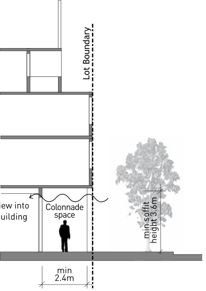
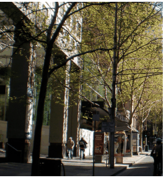
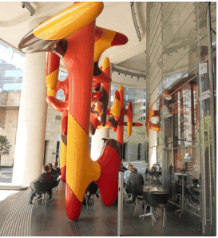
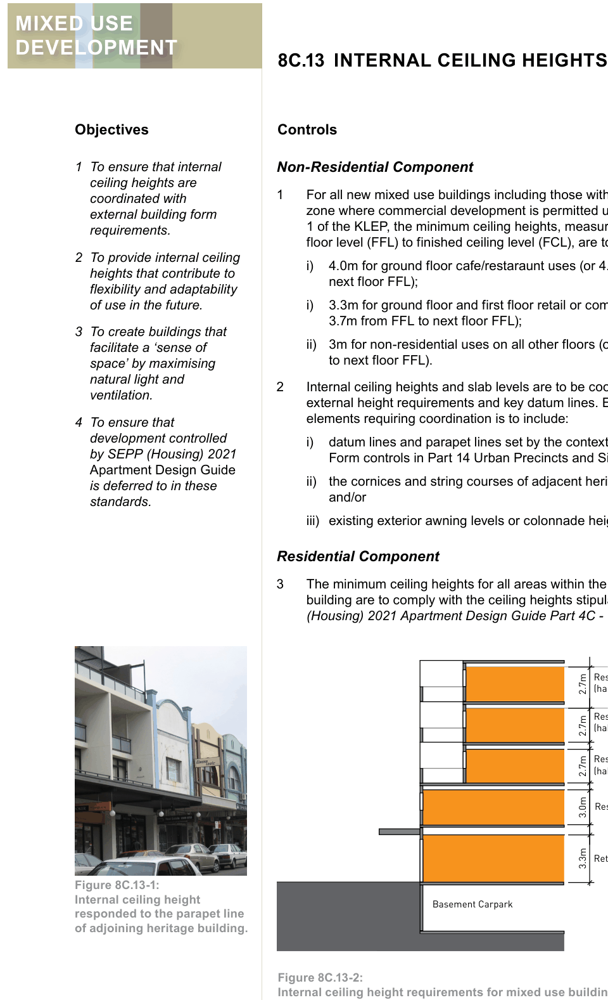

### 8C.12  COLONNADES

#### Objectives

#### Controls

1 All colonnade spaces are to be within the property boundary. 2 Colonnades are to have a height/width ratio no less than 1.5:1, a

minimum width of 2.4m, and a minimum soffit height of 3.6m.

> [Picture on page 47: a picture, saved as a picture (images/part-08-mixed-use-development-page-47-7.gif, 150 dpi).]
> Words printed on the picture (title and legend, copied from the PDF):
> Lot Boundary
> View into Colonnade
> space
> building
> min soffit
> height 3.6m
> min
> 2.4m

1	 To ensure that colonnades

are safe, accessible and

in keeping with desired

streetscape character

and appropriate to the

development in scale and

overall design. 2	 To ensure that colonnades

respond to the pedestrian

scale of the street. 3	 To provide colonnades

that increase pedestrian

amenity with sun and rain

protection. 4	 To provide colonnades

that facilitate opportunities

for outdoor dining. 5	 To ensure that colonnade

areas are well lit and have

high visibility.

> [Picture on page 47: a picture, saved as a picture (images/part-08-mixed-use-development-page-47-28.gif, 150 dpi).]

#### Figure 8C.12-2:

#### Colonnade space activates street level.

3 Colonnade heights and widths are to be continuous along a block,

and should readily allow extension into neighbouring sites. 4 The size and spacing of supports are to be designed to allow

pedestrian circulation and views of ground floor activity from the

street, and avoid concealment areas.

#### Figure 8C.12-1:

#### Colonnade space within

property boundary.

> [Picture on page 47: a picture, saved as a picture (images/part-08-mixed-use-development-page-47-39.gif, 150 dpi).]

5 On sloping sites an access point with a flush transition is to be

provided between the colonnade area and adjoining footpaths. 6 Provide under colonnade lighting recessed into the soffit of the

colonnade or wall mounted on the building, ensuring shadowed

recesses are not created as potential entrapment areas. 7 Under colonnade lighting is to achieve luminance levels consistent

with community safety and security in AS1228.1-2001. 8 Vertical canvas drop blinds are not permitted along edge of

colonnades.

### BUILDING DESIGN AND SUSTAINABILITY

#### Figure 8C.12-3:

Colonnade space used for

outdoor dining.

> [Picture on page 48: a map, saved as a picture (images/part-08-mixed-use-development-page-48-1.gif, 150 dpi); the street names and other small labels are on the picture.]
> Words printed on the picture (title and legend, copied from the PDF):
> ceiling heights are
> external building form
> next floor FFL);
> heights that contribute to
> flexibility and adaptability
> to next floor FFL).
> facilitate a ‘sense of
> space’ by maximising
> natural light and
> 4	 To ensure that
> by SEPP (Housing) 2021
> Apartment Design Guide
> Internal ceiling height
> responded to the parapet line
> of adjoining heritage building.
> Internal ceiling height requirements for mixed use buildings.

Figure 8C.13-1:

Figure 8C.13-2:
