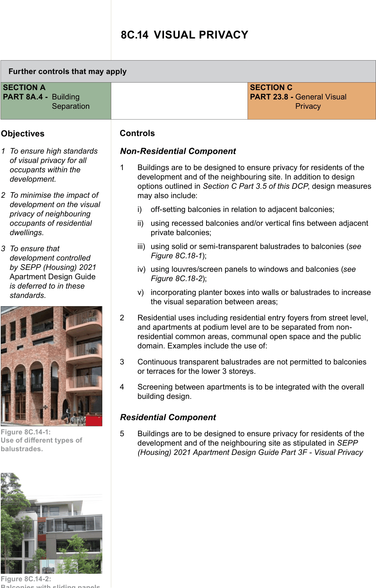

### 8C.13  INTERNAL CEILING HEIGHTS

#### Objectives

#### Controls Non-Residential Component

1	 To ensure that internal

1 For all new mixed use buildings including those within a residential

zone where commercial development is permitted under Schedule

1 of the KLEP, the minimum ceiling heights, measured from finished

floor level (FFL) to finished ceiling level (FCL), are to be:

i) 4.0m for ground floor cafe/restaraunt uses (or 4.4m from FFL to

2	 To provide internal ceiling

of use in the future.

i) 3.3m for ground floor and first floor retail or commercial uses (or

3.7m from FFL to next floor FFL);

ii)	 3m for non-residential uses on all other floors (or 3.4m from FFL

3	 To create buildings that

2 Internal ceiling heights and slab levels are to be coordinated with

external height requirements and key datum lines. External building

elements requiring coordination is to include:

i) datum lines and parapet lines set by the context or the Built

Form controls in Part 14 Urban Precincts and Sites;

ii)	 the cornices and string courses of adjacent heritage buildings;

is deferred to in these

iii)	 existing exterior awning levels or colonnade heights.

#### Residential Component

3 The minimum ceiling heights for all areas within the residential flat

building are to comply with the ceiling heights stipulated in SEPP

(Housing) 2021 Apartment Design Guide Part 4C - Ceiling Heights.

Residential (habitable rooms)

Residential (habitable rooms)

Residential (habitable rooms)

Residential/Commercial

Retail/Commercial

Residential (habitable rooms)

.7m

2.7m

Residential (habitable rooms)

> [Picture on page 49: a map, saved as a picture (images/part-08-mixed-use-development-page-49-1.gif, 150 dpi); the street names and other small labels are on the picture.]
> Words printed on the picture (title and legend, copied from the PDF):
> PART 8A.4 -  Building
> occupants within the
> development on the visual
> privacy of neighbouring
> occupants of residential
> 3	 To ensure that
> by SEPP (Housing) 2021
> Apartment Design Guide
> Use of different types of

Figure 8C.18-1);

Figure 8C.18-2);

Figure 8C.14-1:

Figure 8C.14-2:
