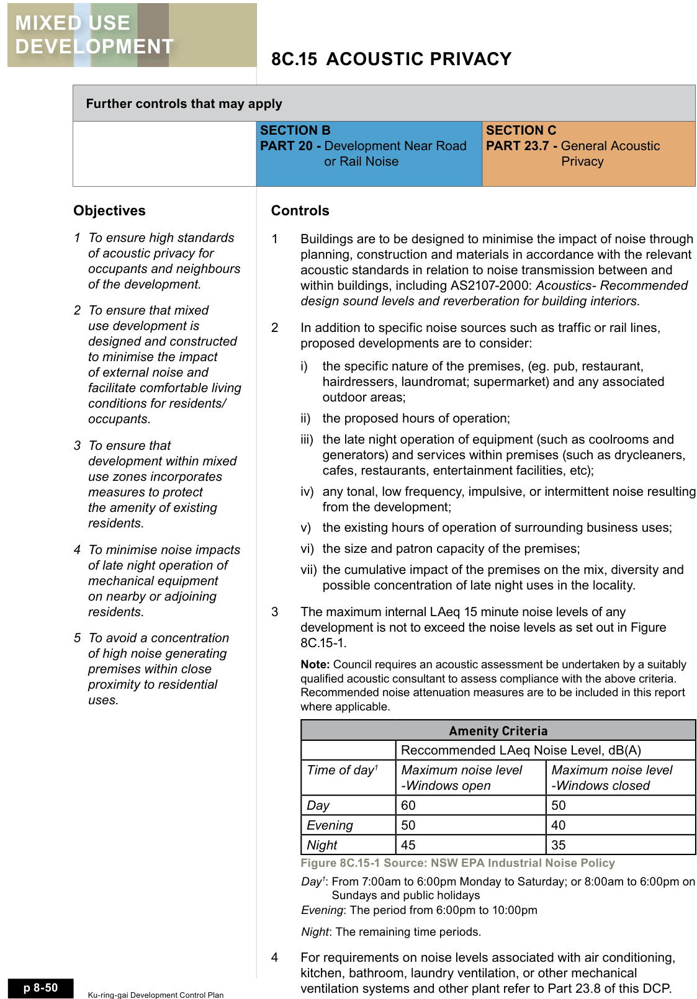

### 8C.14  VISUAL PRIVACY

#### Further controls that may apply SECTION A

#### SECTION C

PART 23.8 - General Visual

#### Objectives

#### Controls Non-Residential Component

1	 To ensure high standards

of visual privacy for all

1 Buildings are to be designed to ensure privacy for residents of the

development and of the neighbouring site. In addition to design

options outlined in Section C Part 3.5 of this DCP, design measures

may also include:

i) off-setting balconies in relation to adjacent balconies;

ii)	 using recessed balconies and/or vertical fins between adjacent

2	 To minimise the impact of

iii)	 using solid or semi-transparent balustrades to balconies (see

iv)	 using louvres/screen panels to windows and balconies (see

v)	 incorporating planter boxes into walls or balustrades to increase

is deferred to in these

the visual separation between areas;

2 Residential uses including residential entry foyers from street level,

and apartments at podium level are to be separated from non-

residential common areas, communal open space and the public

domain. Examples include the use of: 3 Continuous transparent balustrades are not permitted to balconies

or terraces for the lower 3 storeys. 4 Screening between apartments is to be integrated with the overall

#### Residential Component

5 Buildings are to be designed to ensure privacy for residents of the

development and of the neighbouring site as stipulated in SEPP

(Housing) 2021 Apartment Design Guide Part 3F - Visual Privacy

### BUILDING DESIGN AND SUSTAINABILITY

#### Balconies with sliding panels

to increase visual privacy.

> [Picture on page 50: a map, saved as a picture (images/part-08-mixed-use-development-page-50-1.gif, 150 dpi); the street names and other small labels are on the picture.]
> Words printed on the picture (title and legend, copied from the PDF):
> or Rail Noise
> of acoustic privacy for
> occupants and neighbours
> of the development.
> use development is
> designed and constructed
> to minimise the impact
> of external noise and
> facilitate comfortable living
> conditions for residents/
> from the development;
> 3	 To ensure that
> development within mixed
> use zones incorporates
> measures to protect
> the amenity of existing
> on nearby or adjoining
> of high noise generating
> premises within close
> proximity to residential
> Note: Council requires an acoustic assessment be undertaken by a suitably
> qualified acoustic consultant to assess compliance with the above criteria.
> Recommended noise attenuation measures are to be included in this report
> Day1: From 7:00am to 6:00pm Monday to Saturday; or 8:00am to 6:00pm on
> Sundays and public holidays
> Evening: The period from 6:00pm to 10:00pm
> Night: The remaining time periods.

Figure 8C.15-1 Source: NSW EPA Industrial Noise Policy
