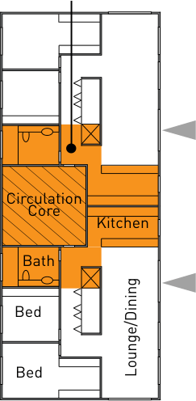

### 8C.15  ACOUSTIC PRIVACY

#### Further controls that may apply

#### SECTION B

PART 20 - Development Near Road

#### SECTION C

PART 23.7 - General Acoustic

#### Objectives

#### Controls

1	 To ensure high standards

1 Buildings are to be designed to minimise the impact of noise through

planning, construction and materials in accordance with the relevant

acoustic standards in relation to noise transmission between and

within buildings, including AS2107-2000: Acoustics- Recommended

design sound levels and reverberation for building interiors. 2 In addition to specific noise sources such as traffic or rail lines,

proposed developments are to consider:

i) the specific nature of the premises, (eg. pub, restaurant,

hairdressers, laundromat; supermarket) and any associated

ii)	 the proposed hours of operation;

2	 To ensure that mixed

iii)	 the late night operation of equipment (such as coolrooms and

generators) and services within premises (such as drycleaners,

cafes, restaurants, entertainment facilities, etc);

iv)	 any tonal, low frequency, impulsive, or intermittent noise resulting

v)	 the existing hours of operation of surrounding business uses;

vi)	 the size and patron capacity of the premises;

vii)	 the cumulative impact of the premises on the mix, diversity and

possible concentration of late night uses in the locality.

4	 To minimise noise impacts

of late night operation of

3 The maximum internal LAeq 15 minute noise levels of any

development is not to exceed the noise levels as set out in Figure

| Amenity Criteria |  |  |
|---|---|---|
|  | Reccommended LAeq Noise Level, dB(A) |  |
| Time of day1 | Maximum noise level -Windows open | Maximum noise level -Windows closed |
| Day | 60 | 50 |
| Evening | 50 | 40 |
| Night | 45 | 35 |

5	 To avoid a concentration

4 For requirements on noise levels associated with air conditioning,

kitchen, bathroom, laundry ventilation, or other mechanical

ventilation systems and other plant refer to Part 23.8 of this DCP.

### 8C.15 ACOUSTIC PRIVACY (continued)

#### Controls

5 Noise reduction measures to achieve these outcomes may include,

but are not limited to the following design criteria:

Service and circulation areas used to buffer noise sensitive areas.

> [Picture on page 51: a picture, saved as a picture (images/part-08-mixed-use-development-page-51-10.gif, 150 dpi).]
> Words printed on the picture (title and legend, copied from the PDF):
> Circulation
> Core
> Kitchen
> Bath
> Bed
> Lounge/Dining
> Bed

i) incorporating appropriate noise shielding or attenuation

techniques into the design and construction of the building. In

particular, noise shielding will be required between uses, walls

and floors;

ii)	 using noise barrier planning principles such as using the building

mass to shield noise (eg using podiums to shield noise from

below); and locating non-habitable rooms towards the noise

source and habitable rooms oriented to quieter areas on the

site; minimising the size and number of windows and balconies

oriented to the noise source. Note: Refer to Part 20 Development Near Rail Corridors and Busy Roads.

iii)	 enclosing plant rooms;

iv)	 locating plant in basements;

v)	 minimising the amount of shared walls between apartments,

commercial occupancies and/or plant;

vi)	 locating building services (laundries/ storage areas) and

circulation zone apartment entries away from noise sensitive

areas (ie. bedrooms) to provide a buffer from noise generators,

such as traffic, mechanical plant equipment, and service and

loading vehicle entries (see Figure 8C.15-2);

vii)	 recessing balconies and fitting sound absorption materials (see

Figure 8C.15-3);

viii)	fitting out building services, (including plant, piping and ducting)

#### Figure 8C.15-1:

#### Provision of buffer zone

to minimise noise impacts

within a dwelling.

with appropriate acoustic insulation; (comment delete as it is

required by BCA);

ix)	 replacing conventional roof design with eaves by a flat roof

with parapets where requirements for weather protection are

otherwise achieved;

x)	 using solid core doors, thicker window glass, double glazing,

baffles to openable windows.

apply sound absorbtion material (orange) to the underside of balcony above and inside solid railings

### BUILDING DESIGN AND SUSTAINABILITY

#### Figure 8C.15-2:

Limiting reflected noise on high rise balconies and within adjacent rooms. p 8-51

### 8C.15 ACOUSTIC PRIVACY (continued)

#### Controls Commercial uses in residential zones

6 Commercial uses, where permitted in residential zones, are to only

operate within the following hours:

i) 9:00am to 6:00pm weekdays;

ii)	 9:00am to 4:00pm Saturdays; and

iii)	 9:00am to 1:00pm Sundays. 7 Use of mixed use buildings in residential zones providing medical

services outside of the above hours and on public holidays will be

permitted in the case of emergency services.

#### Commercial Uses in business zones

8 Commercial uses, where permitted in a local centre are to only

operate within the following hours:

i) 7:00am to 10:00pm weekdays and Saturdays; and

ii)	 8:00am to 9:00pm Sundays and public holidays. 9 Loading docks associated with commercial uses in a local centre are

to operate within the following hours:

i) 6:00am to 8:00pm weekdays; and

ii)	 8:00am to 5:00pm Saturdays;

iii)	 8:00am to 2:00pm Sundays and Public Holidays.
