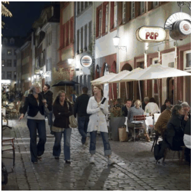

### 8C.16  LATE NIGHT TRADING

#### Objectives

#### Controls

1 Development for late night trading premises are to be designed to

minimise the impacts of noise production on nearby and adjoining

premises. 2 In particular, proposed developments are to consider:

i) the size and patron capacity of the premises, including for

associated outdoor areas;

1	 To ensure that late

night premises provide

adequate safety and

security for patrons,

nearby or adjoining

residents/occupants and

the general public within

the vicinity.

ii)	 the proposed hours of operation;

iii)	 the existing hours of operation of surrounding business uses;

iv)	 the cumulative impact of the premises on the mix, diversity and

possible concentration of late night uses in the locality;

v)	 measures to ensure adequate safety, security and crime

2	 To ensure that late night

trading premises are

designed, constructed and

managed to minimise the

impact of noise on nearby

residents/ occupants.

prevention both on the site and in the public domain immediately

adjacent to, and surrounding, the premises;

vi)	 the accessibility and frequency of public transport during the late

night trading hours.

3	 To reduce the potential for

anti-social behaviour and

promote positive social

activities.

3 Crime reduction measures to achieve these outcomes may include,

but are not limited to the following:

i) lighting at entry, exits and outdoor areas;

ii)	 locating late night trading entries, exits and outdoor areas away

4	 To avoid a concentration

of high noise late night

trading premises in close

proximity to residential

uses.

> [Picture on page 53: a picture, saved as a picture (images/part-08-mixed-use-development-page-53-46.gif, 150 dpi).]

from noise sensitive areas (eg bedrooms);

iii)	 minimising the size and number of residential windows and

balconies oriented towards the entries, exits and outdoor areas

associated with the late night premises;

iv)	 providing windows from residential living areas that overlook the

development to provide passive surveillance of the street.

v)	 providing unobstructed sightlines within and around the

development.

4 Development applications for late night trading premises are to be

accompanied by a detailed plan of management which addresses

amenity, safety and security and demonstrates a strong commitment

to effectively managing potential noise impacts on adjoining and

surrounding land uses. Note: Proposals for smaller late night premises may not be required to

provide a plan of management. A pre-lodgement meeting with Council is

recommended for any proposal that includes late night trading.

#### Figure 8C.16.1

#### Well lit night time street

activity.

### BUILDING DESIGN AND SUSTAINABILITY
