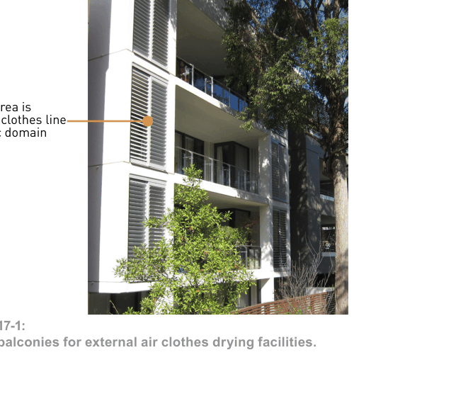

### 8C.17  EXTERNAL AIR CLOTHES DRYING

### FACILITIES

#### Objectives

#### Controls

1 Each apartment is required to have access to an external air clothes

drying area, eg. a screened balcony, a terrace or common area.

1	 To ensure buildings

maximise the

opportunities for sun and

wind drying of clothes.

2 External air clothes drying areas are to be screened from public and

common open space areas. Refer to Figure 8C.17-1. 3 Where provided in common areas, drying facilities, including clothes

lines, are to be provided.

> [Picture on page 54: a picture, saved as a picture (images/part-08-mixed-use-development-page-54-15.gif, 150 dpi).]
> Words printed on the picture (title and legend, copied from the PDF):
> Screened balconies for external air clothes drying facilities.

2	 To provide external air

clothes drying areas that

do not detract from the

visual appearance of the

building and common

areas.

Screened area is

concealing clothes line

from public domain

#### Figure 8C.17-1:
