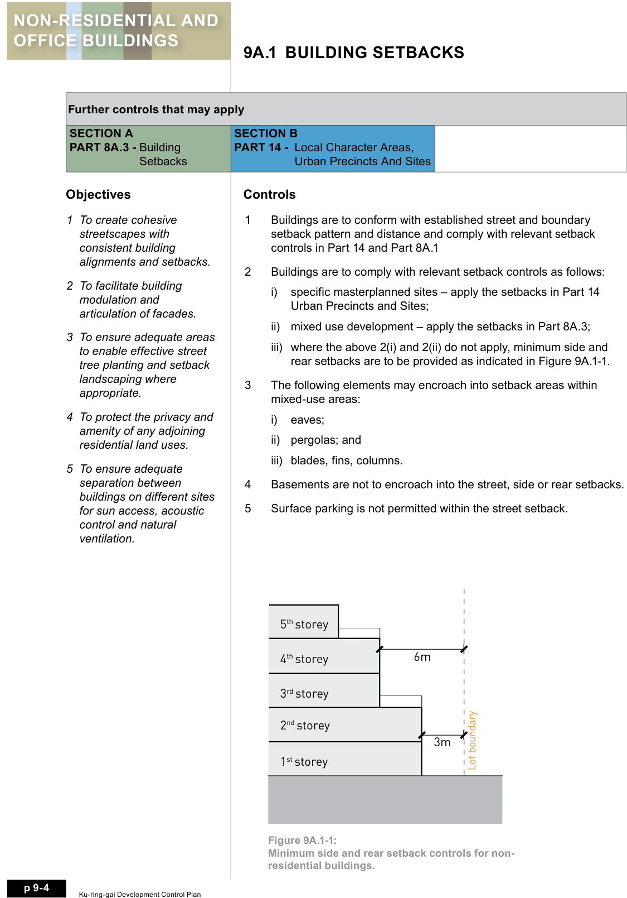

#### 9A	 	 Site Design

9A.1  	 Building Setbacks 9A.2  	 Building Separation 9A.3  	 Deep Soil Landscaping

### READ WITH

#### SECTION A

PART 8 - Mixed Use Development

8A.4: Building Separation

#### SECTION B

PART 14 - Local Character Areas Urban Precinct and Sites

#### SECTION C

PART 21 - General Site Design

### SITE DESIGN

> [Picture on page 4: a map, saved as a picture (images/part-09-non-residential-and-office-buildings-page-4-1.gif, 150 dpi); the street names and other small labels are on the picture.]
> Words printed on the picture (title and legend, copied from the PDF):
> PART 8A.3 - Building
> Urban Precincts And Sites
> 1	 To create cohesive
> alignments and setbacks.
> Urban Precincts and Sites;
> 2	 To facilitate building
> articulation of facades.
> to enable effective street
> tree planting and setback
> ii)	 pergolas; and
> amenity of any adjoining
> residential land uses.
> iii)	 blades, fins, columns.
> 5	 To ensure adequate
> buildings on different sites
> for sun access, acoustic
> control and natural
> Minimum side and rear setback controls for non-

Figure 9A.1-1:
