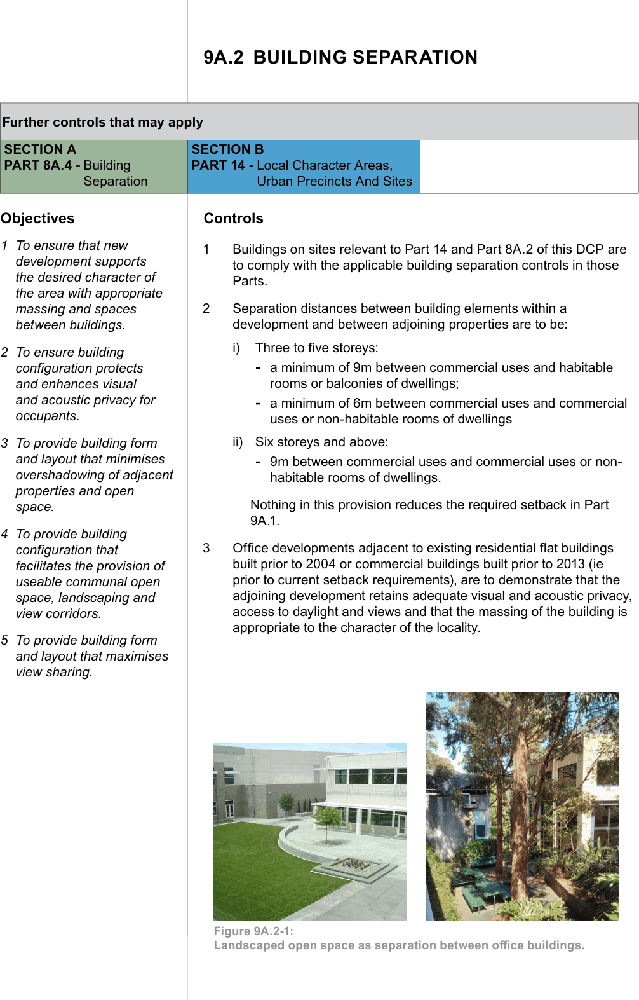

### 9A.1  BUILDING SETBACKS

#### Further controls that may apply SECTION A

#### SECTION B

PART 14 -  Local Character Areas,

#### Objectives

#### Controls

1 Buildings are to conform with established street and boundary

setback pattern and distance and comply with relevant setback

controls in Part 14 and Part 8A.1 2 Buildings are to comply with relevant setback controls as follows:

i) specific masterplanned sites – apply the setbacks in Part 14

ii)	 mixed use development – apply the setbacks in Part 8A.3;

iii)	 where the above 2(i) and 2(ii) do not apply, minimum side and

rear setbacks are to be provided as indicated in Figure 9A.1-1.

3	 To ensure adequate areas

3 The following elements may encroach into setback areas within

4	 To protect the privacy and

4 Basements are not to encroach into the street, side or rear setbacks. 5 Surface parking is not permitted within the street setback.

min 9m

side/rear se

### 9A

> [Picture on page 5: a map, saved as a picture (images/part-09-non-residential-and-office-buildings-page-5-2.gif, 150 dpi); the street names and other small labels are on the picture.]
> Words printed on the picture (title and legend, copied from the PDF):
> PART 8A.4 - Building
> Urban Precincts And Sites
> the desired character of
> the area with appropriate
> massing and spaces
> 2	 To ensure building
> and enhances visual
> and acoustic privacy for
> habitable rooms of dwellings.
> and layout that minimises
> overshadowing of adjacent
> properties and open
> 4	 To provide building
> facilitates the provision of
> useable communal open
> space, landscaping and
> and layout that maximises
> Landscaped open space as separation between office buildings.

Figure 9A.2-1:
