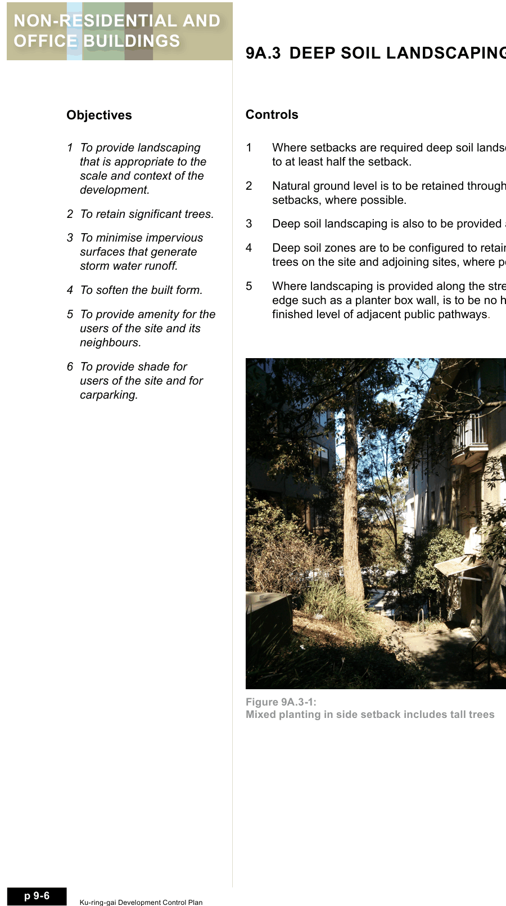

### 9A.2  BUILDING SEPARATION

#### Further controls that may apply SECTION A

#### SECTION B

PART 14 - Local Character Areas,

#### Controls

#### Objectives

1 Buildings on sites relevant to Part 14 and Part 8A.2 of this DCP are

to comply with the applicable building separation controls in those

2 Separation distances between building elements within a

development and between adjoining properties are to be:

1	 To ensure that new

i) Three to five storeys:

- a minimum of 9m between commercial uses and habitable

rooms or balconies of dwellings;

- a minimum of 6m between commercial uses and commercial

uses or non-habitable rooms of dwellings

ii)	 Six storeys and above:

- 9m between commercial uses and commercial uses or non-

3	 To provide building form

Nothing in this provision reduces the required setback in Part

3 Office developments adjacent to existing residential flat buildings

built prior to 2004 or commercial buildings built prior to 2013 (ie

prior to current setback requirements), are to demonstrate that the

adjoining development retains adequate visual and acoustic privacy,

access to daylight and views and that the massing of the building is

appropriate to the character of the locality.

5	 To provide building form

### SITE DESIGN

> [Picture on page 6: a picture, saved as a picture (images/part-09-non-residential-and-office-buildings-page-6-1.gif, 150 dpi).]
> Words printed on the picture (title and legend, copied from the PDF):
> 1	 To provide landscaping
> development.
> setbacks, where possible.
> surfaces that generate
> storm water runoff.
> neighbours.
> carparking.
> Mixed planting in side setback includes tall trees

Figure 9A.3-1:
