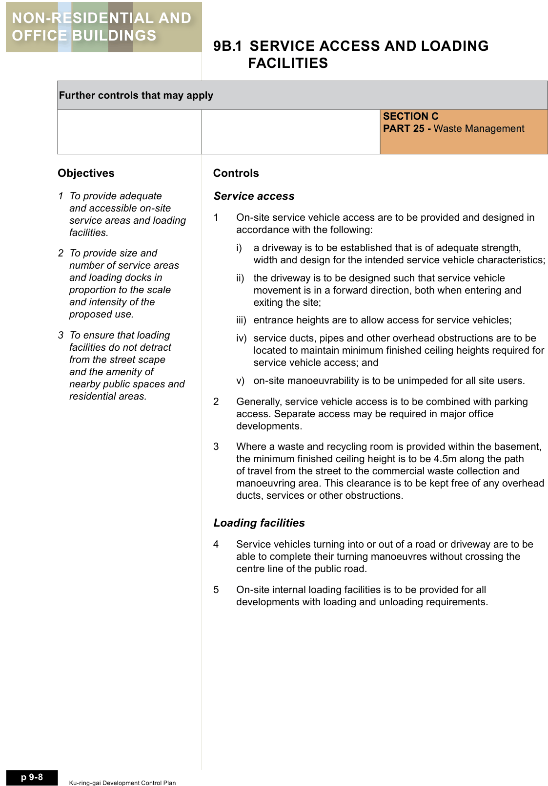

#### 9B	 	 Access and Parking

9B.1  	 Service Access and Loading Facilities 9B.2  	 Car Parking Provision 9B.3  	 Bicycle Parking Provision

### READ WITH

#### SECTION C

PART 22 - General Access and Parking

22.3: Basement Car Parking

22.4: Visitor Parking

22.5: Parking for People with a Disability

22.7: Bicycle Parking and Facilities

22R.2: Car Parking Rates

PART 23 - General Building and Sustainability

PART 25 -  Waste Management

### ACCESS AND PARKING

> [Picture on page 8: a map, saved as a picture (images/part-09-non-residential-and-office-buildings-page-8-1.gif, 150 dpi); the street names and other small labels are on the picture.]
> Words printed on the picture (title and legend, copied from the PDF):
> 1	 To provide adequate
> and accessible on-site
> service areas and loading
> exiting the site;
> number of service areas
> and loading docks in
> proportion to the scale
> and intensity of the
> service vehicle access; and
> facilities do not detract
> from the street scape
> and the amenity of
> nearby public spaces and
