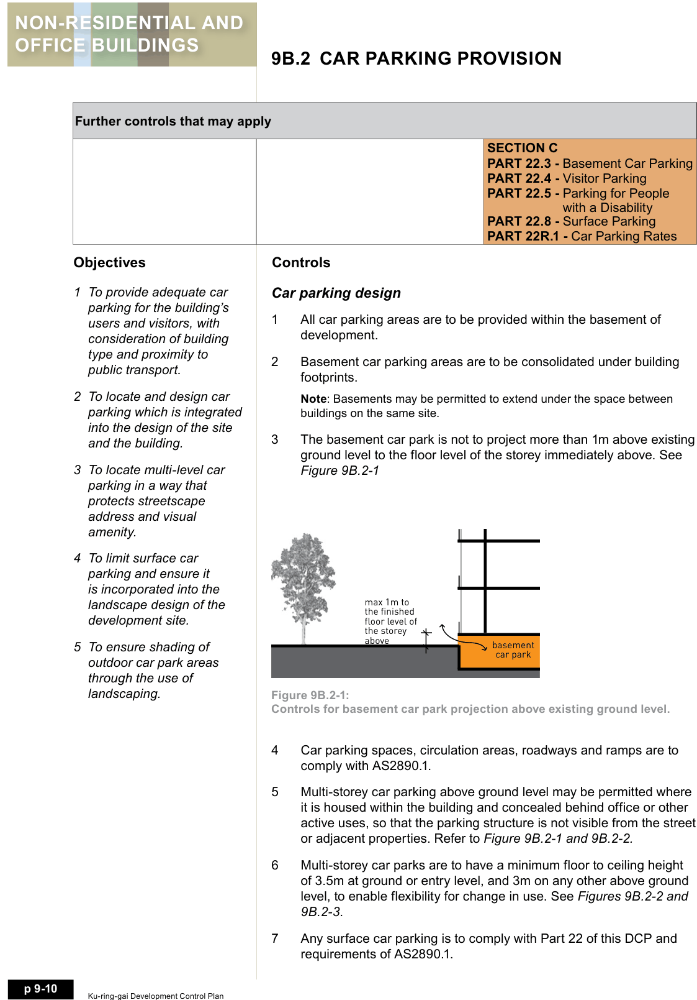

### 9B.1  SERVICE ACCESS AND LOADING

### FACILITIES

#### Further controls that may apply

#### SECTION C

PART 25 - Waste Management

#### Objectives

#### Controls Service access

1 On-site service vehicle access are to be provided and designed in

accordance with the following:

i) a driveway is to be established that is of adequate strength,

width and design for the intended service vehicle characteristics;

ii)	 the driveway is to be designed such that service vehicle

movement is in a forward direction, both when entering and

2	 To provide size and

iii)	 entrance heights are to allow access for service vehicles;

iv)	 service ducts, pipes and other overhead obstructions are to be

located to maintain minimum finished ceiling heights required for

v)	 on-site manoeuvrability is to be unimpeded for all site users.

3	 To ensure that loading

2 Generally, service vehicle access is to be combined with parking

access. Separate access may be required in major office

3 Where a waste and recycling room is provided within the basement,

the minimum finished ceiling height is to be 4.5m along the path

of travel from the street to the commercial waste collection and

manoeuvring area. This clearance is to be kept free of any overhead

ducts, services or other obstructions.

#### Loading facilities

4 Service vehicles turning into or out of a road or driveway are to be

able to complete their turning manoeuvres without crossing the

centre line of the public road. 5 On-site internal loading facilities is to be provided for all

developments with loading and unloading requirements.

### 9B.1 SERVICE ACCESS AND LOADING

### FACILITIES (continued)

#### Controls

6 Loading docks are to be:

i) accessed via a rear lane or side street where these are available,

and accessible to heavy vehicles;

ii)	 conveniently located in such a way that minimises conflict with

pedestrians and other traffic; and

iii)	 screened from the public street. Note: Refer to RTA Guidelines (RMS). 7 Gradients in service areas are to be kept to a minimum. The

maximum gradient measured in any direction at any one point, is to

be 1:6.5 (15.4%) where only forward movement is to take place or 1:8

(12.5%) where reverse manoeuvres will occur. 8 Circulation roadways and loading area dimensions are to

comply with the provisions in AS2890.2: Off-Street Parking (Part

2:Commercial Vehicle Facilities). 9 The design of the apron area in front of the loading dock(s) is to take

into account the type of vehicle to be used. Reference is to be made

to AS2890.2 for apron dimensions. 10 Turning provisions are to be made within the site for the

manoeuvring of vehicles using the loading and unloading facilities in

accordance with Austroads Design Vehicular and Turning Templates. Note: Refer to RTA guidelines (RMS)- RTA Guide to Traffic Generating

Developments and relevant Australian Standards.

### ACCESS AND PARKING

> [Picture on page 10: a map, saved as a picture (images/part-09-non-residential-and-office-buildings-page-10-1.gif, 150 dpi); the street names and other small labels are on the picture.]
> Words printed on the picture (title and legend, copied from the PDF):
> with a Disability
> parking for the building’s
> users and visitors, with
> consideration of building
> type and proximity to
> Note: Basements may be permitted to extend under the space between
> buildings on the same site.
> parking which is integrated
> and the building.
> address and visual
> parking and ensure it
> is incorporated into the
> landscape design of the
> max 1m to
> floor level of
> outdoor car park areas
> through the use of
> Controls for basement car park projection above existing ground level.
> comply with AS2890.1.
> requirements of AS2890.1.

Figure 9B.2-1

Figure 9B.2-1:
