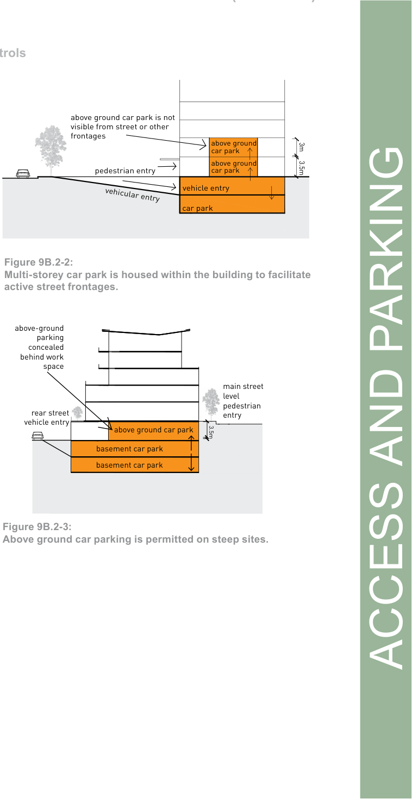
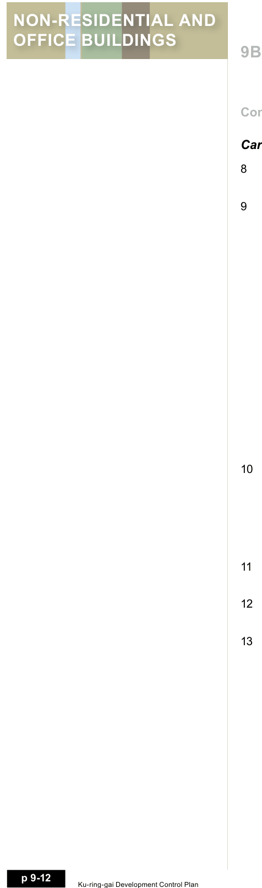
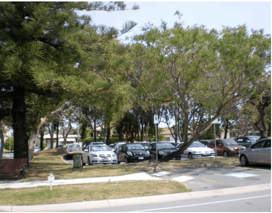
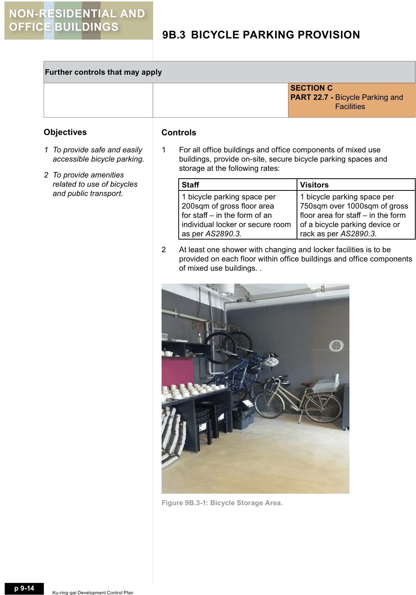

### 9B.2  CAR PARKING PROVISION

#### Further controls that may apply

#### SECTION C

PART 22.3 - Basement Car Parking

PART 22.4 - Visitor Parking

PART 22.5 - Parking for People PART 22.8 - Surface Parking

PART 22R.1 - Car Parking Rates

#### Objectives

#### Controls Car parking design

1 All car parking areas are to be provided within the basement of

1	 To provide adequate car

2 Basement car parking areas are to be consolidated under building

2	 To locate and design car

into the design of the site

3 The basement car park is not to project more than 1m above existing

ground level to the floor level of the storey immediately above. See

3	 To locate multi-level car

parking in a way that

4	 To limit surface car

5	 To ensure shading of

4 Car parking spaces, circulation areas, roadways and ramps are to

5 Multi-storey car parking above ground level may be permitted where

it is housed within the building and concealed behind office or other

active uses, so that the parking structure is not visible from the street

or adjacent properties. Refer to Figure 9B.2-1 and 9B.2-2. 6 Multi-storey car parks are to have a minimum floor to ceiling height

of 3.5m at ground or entry level, and 3m on any other above ground

level, to enable flexibility for change in use. See Figures 9B.2-2 and

7 Any surface car parking is to comply with Part 22 of this DCP and

### 9B.2 CAR PARKING PROVISION (continued)

> [Picture on page 11: a map, saved as a picture (images/part-09-non-residential-and-office-buildings-page-11-2.gif, 150 dpi); the street names and other small labels are on the picture.]
> Words printed on the picture (title and legend, copied from the PDF):
> above ground car park is not
> visible from street or other
> Multi-storey car park is housed within the building to facilitate
> active street frontages.
> above ground car park
> basement car park
> basement car park
> Above ground car parking is permitted on steep sites.

Figure 9B.2-2:

Figure 9B.2-3:

#### Controls

### ACCESS AND PARKING

> [Picture on page 12: a picture, saved as a picture (images/part-09-non-residential-and-office-buildings-page-12-1.gif, 150 dpi).]

#### Controls Car parking rates

8 For all non-residential development the parking provisions are to meet

the requirements of Part 22 of this DCP. 9 The following car parking ranges apply to non-residential premises,

where the development is within 800m walking distance of a train

station entry and within a commercial centre located on the train line:

| Premises | Parking Space Requirement Range |
|---|---|
| Office and business premises | 1 space per 33m2 GFA to 1 space per 45m2 GFA Suggested division: 90% employee; 10% visitor Plus 1 space if resident/manager or caretaker Plus 1 courier space for development in excess of 200m2 GFA |
| Retail | 1 space per 26m2 GFA to 1 space per 33m2 GFA Suggested division: 30% employee: 70% visitor |

Car parking exceeding the requirements of the parking controls in the above table will not be excluded from the Gross Floor Area as defined in the KLEP. 10 For all non-residential development located more than 800m from

a train station, car parking is to be provided in accordance with the

parking rates in Part 22R.1. Note: A Traffic Impact Assessment is to accompany development

applications that seek to vary the parking rates. This includes commercial or

strata funded car share schemes in lieu of parking spaces. 11 A minimum of 1 space or 1-2% (whichever is greater) is to be

provided for accessible car parking for people with a disability. 12 10% of total parking within office developments is to be provided for

visitors. 13 Consideration is to be given to accommodation of other road users,

such as motor cycles and minibuses.

#### Controls

14 Parking provision at a rate less than 1 per 45m2 GFA may be

considered if accompanied by firm and ongoing proposals to

encourage alternative means of transport. This may include

strategies such as:

i) Transport Access Guides (TAG);

ii)	 Staff discount/subsidy towards public transport costs;

iii)	 Dedicated shuttle bus between the development and

railway station;

iv)	 Adoption and implementation of a car pool/car sharing scheme;

v)	 Use of taxis or public transport for work related journeys;

vi)	 Priority parking for staff who pool with 2 or more passengers. Any proposed alternate scheme is to establish a plan with

measurable targets and is to be regularly publicised and monitored. 15 At least one car share space is to be provided. Note: any proposed reduction in car parking on the basis of providing car

share space/s is to be justified by the proponent through supporting studies.

> [Picture on page 13: a picture, saved as a picture (images/part-09-non-residential-and-office-buildings-page-13-18.gif, 150 dpi).]

#### Figure 9B.2-4:

#### Broad canopy trees shading for at grade car parking.

### ACCESS AND PARKING

> [Picture on page 14: a picture, saved as a picture (images/part-09-non-residential-and-office-buildings-page-14-1.gif, 150 dpi).]
> Words printed on the picture (title and legend, copied from the PDF):
> Facilities
> accessible bicycle parking.
> 2	 To provide amenities
> and public transport.

Figure 9B.3-1: Bicycle Storage Area.
