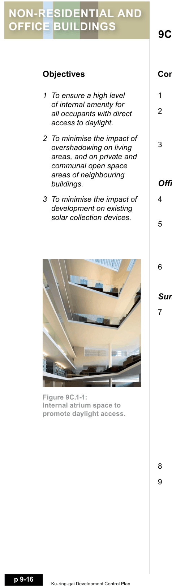

### 9C.1  SOLAR ACCESS

> [Picture on page 16: a picture, saved as a picture (images/part-09-non-residential-and-office-buildings-page-16-2.gif, 150 dpi).]
> Words printed on the picture (title and legend, copied from the PDF):
> of internal amenity for
> all occupants with direct
> access to daylight.
> overshadowing on living
> communal open space
> areas of neighbouring
> buildings.
> development on existing
> solar collection devices.
> Internal atrium space to
> promote daylight access.

Figure 9C.1-1:

#### Objectives

#### Controls

1 Buildings are to be oriented to optimise the northern aspect.

1	 To ensure a high level

2 Use light shelves, reflectors, lightwells, skylights, atriums and

clerestories where possible to maximise the quantity and quality of

natural light within internal areas. 3 Developments are to allow the retention of a minimum of 4 hours

direct sunlight between 9am to 3pm on 21st June to all existing

neighbouring solar collectors and solar hot water services.

2	 To minimise the impact of

areas, and on private and

#### Office shading

4 At least 90% of all workspaces are to be within 10m and in direct line

of sight of a perimeter window.

3	 To minimise the impact of

5 All developments are to allow the retention of at least three hours of

sunlight between 9am and 3pm on 21st June to the living areas and

the principal portion of the private and communal open space of any

residential development on adjoining lots. 6 Where existing overshadowing by buildings is greater than this,

sunlight is not to be reduced by more than 20%.

#### Sun shading

7 All developments are to utilise shading and glare control. For

example:

i) provide external horizontal shading to north-facing windows,

such as eaves, overhangs, pergolas, awnings, colonnades,

upper floor balconies, and/or deciduous vegetation;

ii)	 provide vertical shading to east and west windows, such as

sliding screens, adjustable louvres, blinds and/or shutters;

iii)	 provide shading to glazed and transparent roofs;

iv)	 use low glare high performance glass with an overall 3 star

Window Energy Rating Scheme rating Note: Refer to www.wers.net

v)	 avoid the use of reflective films;

vi)	 use a glass with reflectance below 20%. 8 All shading devices are to be integrated with building facade design. 9 Consideration is to be given to the integration of solar shading with

solar energy collection technology.
