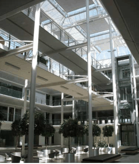
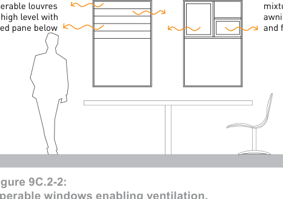
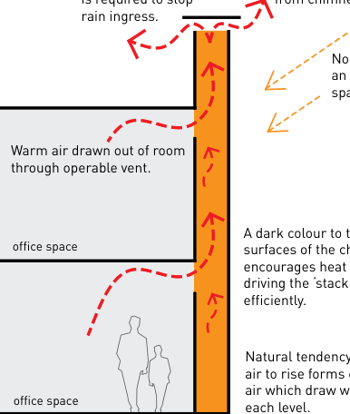

### 9C.2  NATURAL VENTILATION

#### Objectives

#### Controls

1	 To enable opportunities for

natural ventilation.

> [Picture on page 17: a picture, saved as a picture (images/part-09-non-residential-and-office-buildings-page-17-6.gif, 150 dpi).]

1 Wherever possible, provide dual aspect floor space to aid cross

ventilation. 2 The use of open plan floor areas is encouraged to minimise

interruptions in air flow by partitions and furniture. 3 Wherever possible, courtyard / atrium / thermal chimneys are to be

provided to enable warm air to be drawn up and escape through roof

ventilation.

#### Offices

4 All workspaces are to have operable windows or doors which open

to at least 30% of the window or door areas.

> [Picture on page 17: a picture, saved as a picture (images/part-09-non-residential-and-office-buildings-page-17-17.gif, 150 dpi).]
> Words printed on the picture (title and legend, copied from the PDF):
> operable louvres
> at high level with
> fixed pane below
> Operable windows enabling ventilation.

Figure 9C.2-2:

mixture of awning window and fixed panes

#### Figure 9C.2-1:

#### Atrium to provide natural

ventilation.

Warm air escapes from chimney.

A weather proof cap

> [Picture on page 17: a picture, saved as a picture (images/part-09-non-residential-and-office-buildings-page-17-27.gif, 150 dpi).]
> Words printed on the picture (title and legend, copied from the PDF):
> rain ingress.
> Warm air drawn out of room
> through operable vent.
> office space
> surfaces of the chimney
> encourages heat buildup
> efficiently.
> office space
> Natural tendency of heated
> air to rise forms currents of
> each level.

is required to stop

Northerly sun heats up an enclosed vertical space - or chimney.

A dark colour to the exterior

driving the ‘stack effect’ more

air which draw warm air from

#### Figure 9C.2-3:

#### Section showing thermal chimney ‘stack effect’.

### BUILDING DESIGN AND SUSTAINABILITY
