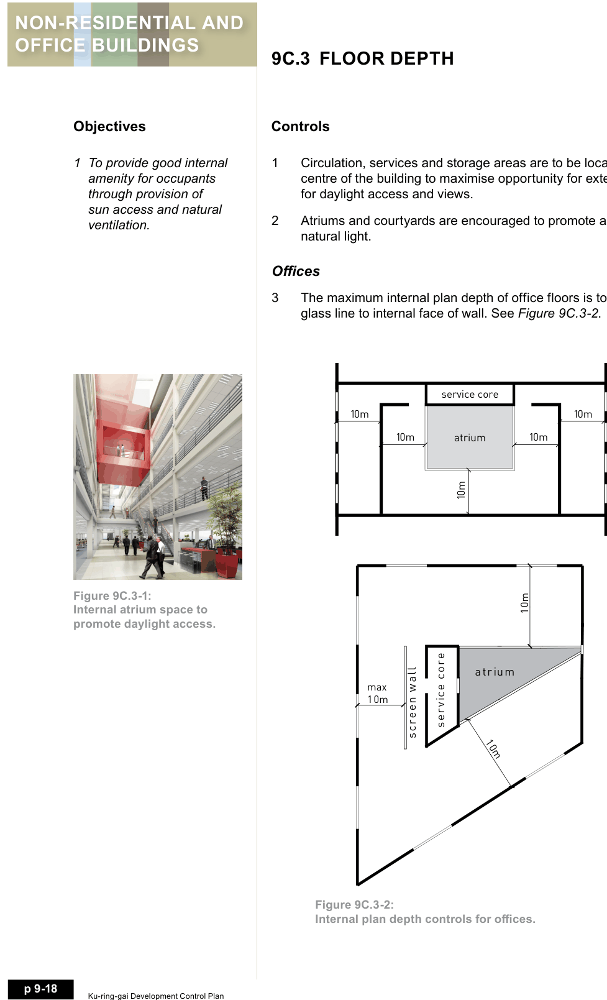

### 9C.3  FLOOR DEPTH

> [Picture on page 18: a picture, saved as a picture (images/part-09-non-residential-and-office-buildings-page-18-2.gif, 150 dpi).]
> Words printed on the picture (title and legend, copied from the PDF):
> amenity for occupants
> through provision of
> sun access and natural
> ventilation.
> Internal atrium space to
> promote daylight access.

Figure 9C.3-1:

#### Objectives

#### Controls

1 Circulation, services and storage areas are to be located at the

centre of the building to maximise opportunity for external openings

for daylight access and views.

1	 To provide good internal

2 Atriums and courtyards are encouraged to promote access to

natural light.

> Words printed on the picture (title and legend, copied from the PDF):
> screen w all

#### Offices

3 The maximum internal plan depth of office floors is to be 10m from

glass line to internal face of wall. See Figure 9C.3-2.

#### Figure 9C.3-2:

#### Internal plan depth controls for offices.
