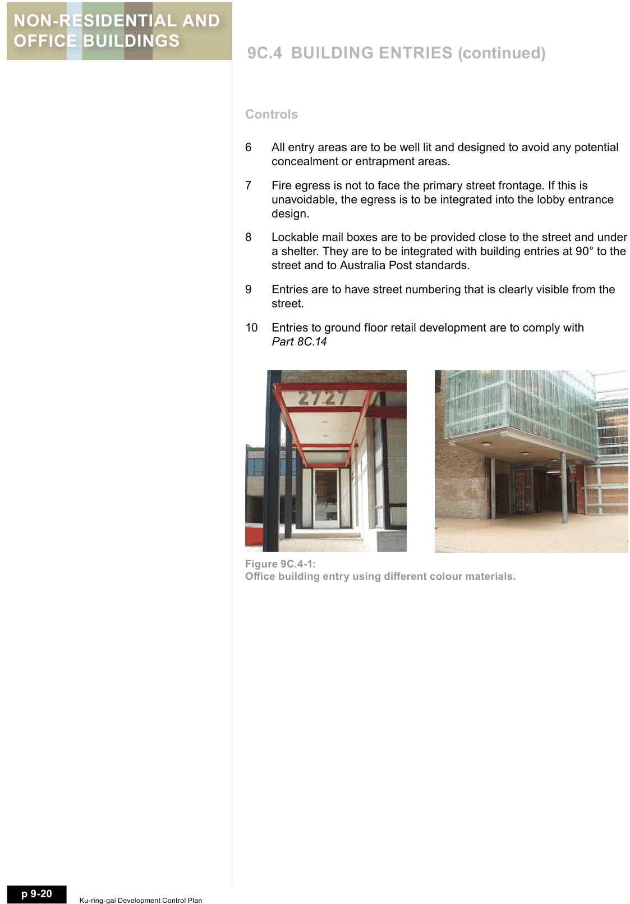

### 9C.4  BUILDING ENTRIES

#### Further controls that may apply SECTION A

PART 8C.14: Ground Floor

Commercial

Uses

#### Objectives

#### Controls

1 Provide access to and within all developments in accordance with

the Disability Discrimination Act 1992.

Letterbox

2 Buildings are to address the street either:

1	 To ensure that the building

entry is clear and easily

identifiable in the street,

and is accessible to all.

footpath

Pedestrian Entry

street

i) with main entrances to lift lobbies directly accessible and visible

from the street; or

ii)	 with the path to the building entry readily visible from the street

where site configuration promotes a side entry.

2	 To ensure that the building

entry contributes positively

to the building facade

design, streetscape and

enhances the active street

frontage.

3 Building entries are to be integrated into building facade design.

At street level, the entry is to be articulated with awnings, porticos,

recesses or projecting bays for clear identification. 4 Building entrances from primary street frontages are to be level with

adjoining footpaths. Note: Footpath levels are not to be changed. All level adjustments are to

occur on private lands. 5 All entry ramps for disabled access are to be located inside the

building facade and integrated into the lobby entrance design.

Measures to enable disabled access are not to dominate the front

facade.

Letterbox

Letterbox

Pedestrian Entry

footpath

footpath

Pedestrian Entry

street

street

#### Figure 9C.4-2:

#### Letterbox to be positioned at 90þ to the street.

### BUILDING DESIGN AND SUSTAINABILITY

> [Picture on page 20: a picture, saved as a picture (images/part-09-non-residential-and-office-buildings-page-20-1.gif, 150 dpi).]
> Words printed on the picture (title and legend, copied from the PDF):
> concealment or entrapment areas.
> design.
> street.
> Part 8C.14
> Office building entry using different colour materials.

Figure 9C.4-1:

### 9C.4  BUILDING ENTRIES (continued)

#### Controls

6 All entry areas are to be well lit and designed to avoid any potential

7 Fire egress is not to face the primary street frontage. If this is

unavoidable, the egress is to be integrated into the lobby entrance

8 Lockable mail boxes are to be provided close to the street and under

a shelter. They are to be integrated with building entries at 90° to the

street and to Australia Post standards. 9 Entries are to have street numbering that is clearly visible from the

10 Entries to ground floor retail development are to comply with
