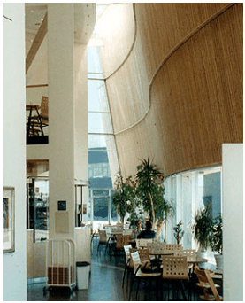
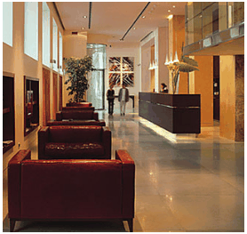
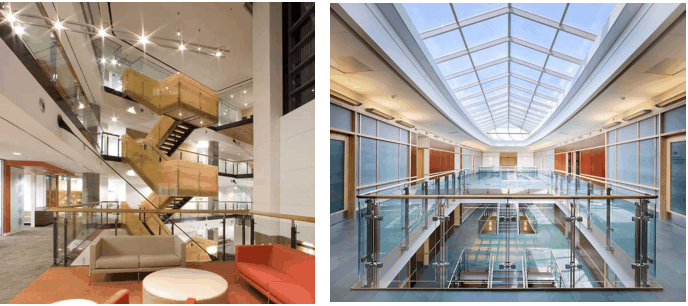
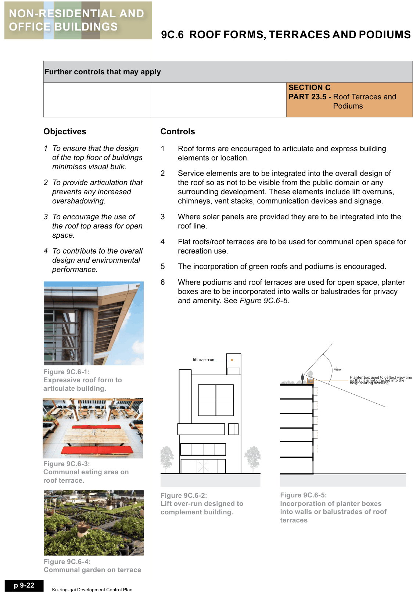

### 9C.5  INTERNAL COMMON CIRCULATION

#### Objectives

#### Controls

1 The design of internal common circulation space is to comply with

the provisions in AS1428.1 and AS1428.2 to provide adequate

pedestrian mobility and access.

1	 To provide accessible,

safe and pleasant

circulation spaces for all

occupants and users.

2 All common circulation areas including foyers, lift lobbies and

stairwells are to have:

i) appropriate levels of lighting with a preference for natural light

where possible;

ii)	 short corridor lengths that give clear sight lines;

2	 To minimise ongoing

maintenance costs by

providing natural light

and efficient lighting to

circulation areas.

> [Picture on page 21: a picture, saved as a picture (images/part-09-non-residential-and-office-buildings-page-21-21.gif, 150 dpi).]

> [Picture on page 21: a picture, saved as a picture (images/part-09-non-residential-and-office-buildings-page-21-22.gif, 150 dpi).]

iii)	 clear signage to offices and facilities;

iv)	 natural ventilation; and

v)	 low maintenance and robust materials. 3 Where artificial lighting is required, energy efficient lights are to be

used in conjunction with timers or daylight controls. 4 Building design is to avoid blind corner or dark alcoves near lifts and

stairwells, at entrances, along corridors and walkways, and within

car parks.

#### Offices

5 Seating areas are to be provided within the foyer/atrium and are

encouraged in common circulation areas near workspaces.

> [Picture on page 21: a picture, saved as a picture (images/part-09-non-residential-and-office-buildings-page-21-34.gif, 150 dpi).]

#### Figure 9C.5-2:

#### Well designed internal common circulation areas.

#### Figure 9C.5-1

#### Well designed foyer/atrium

with seating areas provided.

### BUILDING DESIGN AND SUSTAINABILITY

> [Picture on page 22: a map, saved as a picture (images/part-09-non-residential-and-office-buildings-page-22-1.gif, 150 dpi); the street names and other small labels are on the picture.]
> Words printed on the picture (title and legend, copied from the PDF):
> elements or location.
> minimises visual bulk.
> prevents any increased
> design and environmental
> Planter box used to deflect view line
> so that it is not directed into the
> Expressive roof form to
> Communal eating area on
> Lift over-run designed to
> Incorporation of planter boxes
> into walls or balustrades of roof
> Communal garden on terrace

Figure 9C.6-1:

Figure 9C.6-3:

Figure 9C.6-2:

Figure 9C.6-5:

Figure 9C.6-4:
