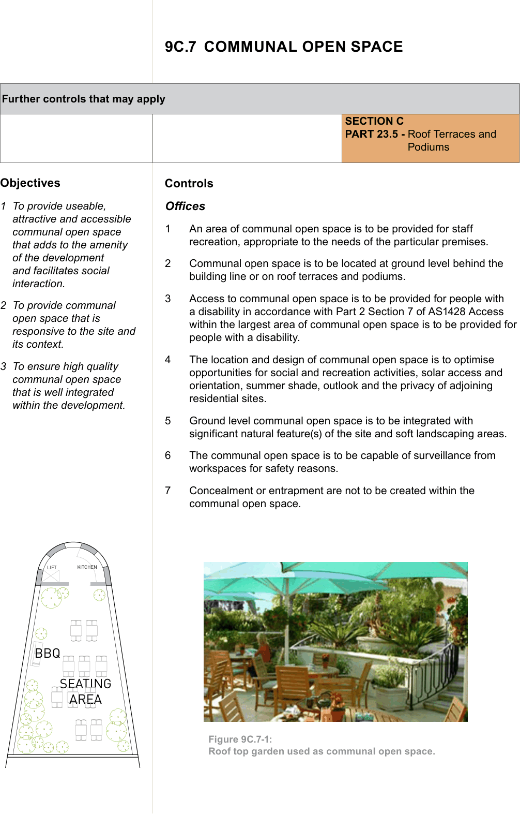

### 9C.6  ROOF FORMS, TERRACES AND PODIUMS

#### Further controls that may apply

#### SECTION C

PART 23.5 - Roof Terraces and

#### Objectives

#### Controls

1 Roof forms are encouraged to articulate and express building

1	 To ensure that the design

of the top floor of buildings

2	 To provide articulation that

2 Service elements are to be integrated into the overall design of

the roof so as not to be visible from the public domain or any

surrounding development. These elements include lift overruns,

chimneys, vent stacks, communication devices and signage. 3 Where solar panels are provided they are to be integrated into the

3	 To encourage the use of

the roof top areas for open

4 Flat roofs/roof terraces are to be used for communal open space for

5 The incorporation of green roofs and podiums is encouraged.

4	 To contribute to the overall

6 Where podiums and roof terraces are used for open space, planter

boxes are to be incorporated into walls or balustrades for privacy

and amenity. See Figure 9C.6-5.

> [Picture on page 23: a map, saved as a picture (images/part-09-non-residential-and-office-buildings-page-23-1.gif, 150 dpi); the street names and other small labels are on the picture.]
> Words printed on the picture (title and legend, copied from the PDF):
> 1	 To provide useable,
> attractive and accessible
> communal open space
> of the development
> and facilitates social
> people with a disability.
> 2	 To provide communal
> open space that is
> communal open space
> that is well integrated
> within the development.
> workspaces for safety reasons.
> communal open space.
> Roof top garden used as communal open space.

Figure 9C.7-1:
