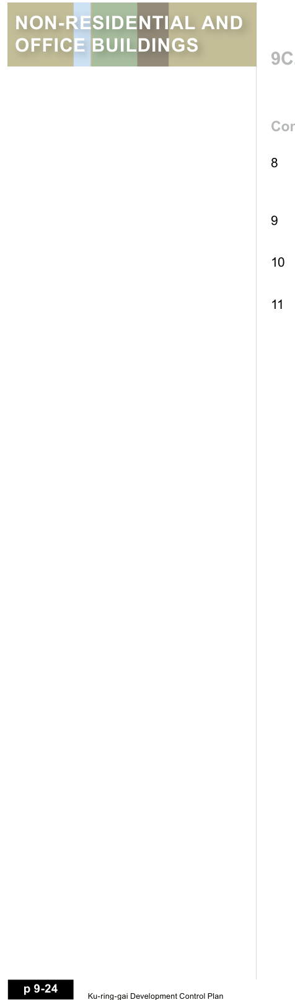
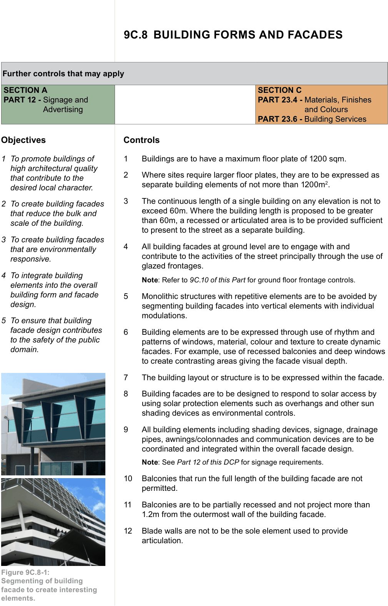

### 9C.7  COMMUNAL OPEN SPACE

#### Further controls that may apply

#### SECTION C

PART 23.5 - Roof Terraces and

#### Objectives

#### Controls Offices

1 An area of communal open space is to be provided for staff

recreation, appropriate to the needs of the particular premises. 2 Communal open space is to be located at ground level behind the

building line or on roof terraces and podiums.

that adds to the amenity

3 Access to communal open space is to be provided for people with

a disability in accordance with Part 2 Section 7 of AS1428 Access

within the largest area of communal open space is to be provided for

responsive to the site and

4 The location and design of communal open space is to optimise

opportunities for social and recreation activities, solar access and

orientation, summer shade, outlook and the privacy of adjoining

3	 To ensure high quality

5 Ground level communal open space is to be integrated with

significant natural feature(s) of the site and soft landscaping areas. 6 The communal open space is to be capable of surveillance from

7 Concealment or entrapment are not to be created within the

#### BBQ SEATING

#### AREA

### BUILDING DESIGN AND SUSTAINABILITY

### 9C.7  COMMUNAL OPEN SPACE (continued)

> [Picture on page 24: a picture, saved as a picture (images/part-09-non-residential-and-office-buildings-page-24-2.gif, 150 dpi).]

#### Controls

8 Communal open space is to be well lit with an energy efficient

lighting system to be used in conjunction with timers or daylight

controls. All light spill is prohibited. 9 Shared facilities such as barbecue facilities and seating are to be

provided within the communal open space. 10 Garden maintenance storage areas and connections to water and

drainage is to be provided to communal open space. 11 Where communal open space is provided on roof terraces and

podiums, the design considerations are to include:

i) incorporating sun shading devices and wind screens to

encourage usage;

ii)	 incorporating landscaping elements including small to medium

trees;

iii)	 a maximum wind speed of 10m/sec. This may be achieved by:

- Use of building facade design and setbacks to deflect

downwards drafts;

- Awning design to deflect winds away from footpath level;

- Use of vegetation and tree canopy as buffer to the street level

from winds..

> [Picture on page 25: a map, saved as a picture (images/part-09-non-residential-and-office-buildings-page-25-1.gif, 150 dpi); the street names and other small labels are on the picture.]
> Words printed on the picture (title and legend, copied from the PDF):
> high architectural quality
> that contribute to the
> desired local character.
> scale of the building.
> that are environmentally
> Note: Refer to 9C.10 of this Part for ground floor frontage controls.
> 4	 To integrate building
> elements into the overall
> building form and facade
> facade design contributes
> Note: See Part 12 of this DCP for signage requirements.
> Segmenting of building
> facade to create interesting

Figure 9C.8-1:
