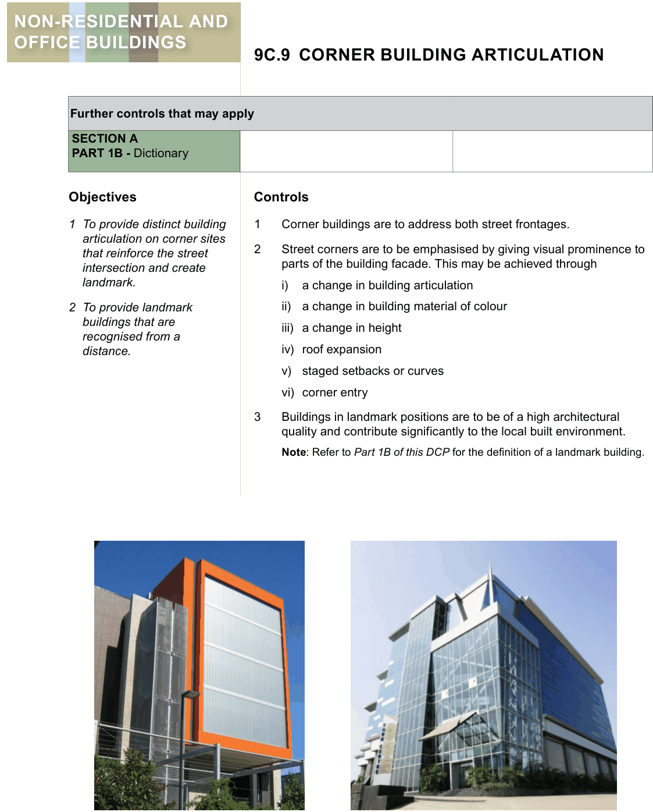

### 9C.8  BUILDING FORMS AND FACADES

#### Further controls that may apply SECTION A

PART 12 - Signage and

#### SECTION C

PART 23.4 - Materials, Finishes

PART 23.6 - Building Services

#### Objectives

#### Controls

1 Buildings are to have a maximum floor plate of 1200 sqm. 2 Where sites require larger floor plates, they are to be expressed as

separate building elements of not more than 1200m2.

1	 To promote buildings of

2	 To create building facades

that reduce the bulk and

3 The continuous length of a single building on any elevation is not to

exceed 60m. Where the building length is proposed to be greater

than 60m, a recessed or articulated area is to be provided sufficient

to present to the street as a separate building.

3	 To create building facades

4 All building facades at ground level are to engage with and

contribute to the activities of the street principally through the use of

5 Monolithic structures with repetitive elements are to be avoided by

segmenting building facades into vertical elements with individual

5	 To ensure that building

to the safety of the public

6 Building elements are to be expressed through use of rhythm and

patterns of windows, material, colour and texture to create dynamic

facades. For example, use of recessed balconies and deep windows

to create contrasting areas giving the facade visual depth. 7 The building layout or structure is to be expressed within the facade. 8 Building facades are to be designed to respond to solar access by

using solar protection elements such as overhangs and other sun

shading devices as environmental controls. 9 All building elements including shading devices, signage, drainage

pipes, awnings/colonnades and communication devices are to be

coordinated and integrated within the overall facade design.

10 Balconies that run the full length of the building facade are not

11 Balconies are to be partially recessed and not project more than

1.2m from the outermost wall of the building facade. 12 Blade walls are not to be the sole element used to provide

### BUILDING DESIGN AND SUSTAINABILITY

> [Picture on page 26: a picture, saved as a picture (images/part-09-non-residential-and-office-buildings-page-26-1.gif, 150 dpi).]
> Words printed on the picture (title and legend, copied from the PDF):
> PART 1B - Dictionary
> articulation on corner sites
> that reinforce the street
> intersection and create
> landmark.
> 2	 To provide landmark
> buildings that are
> recognised from a
> distance.
> Note: Refer to Part 1B of this DCP for the definition of a landmark building.
