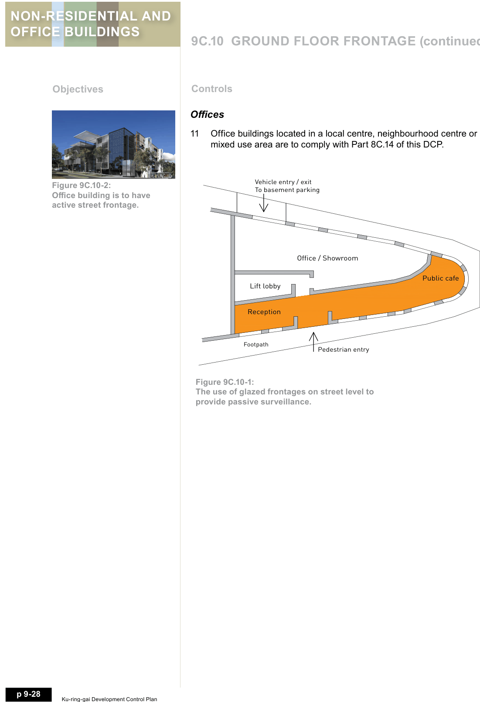
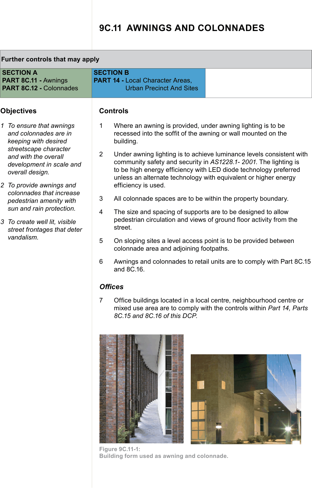

### 9C.10  GROUND FLOOR FRONTAGE

#### Objectives

#### Controls

1 Buildings are not to have a continuous length of blank wall of more

than 30% of the length of the building facade at the street level.

1	 To provide ground floor

facades that enhance

public domain amenity

and safety.

2 Ground floor building articulation is to be designed to avoid the

creation of entrapment areas. 3 External finishes at street level are to be robust and graffiti resistant,

eg. ceramic tiles and metal.

2	 To create active street

frontages that facilitate

direct physical and visual

connection between the

private and public domain.

4 Provide predominantly clear glazing to all street frontage windows

with a minimum 3 star Window Energy Rating Scheme rating. Note: Refer to www.wers.net. 5 Security roller shutters are not permitted on the external face of the

building. Where they are deemed necessary, grilles or transparent

security shutters are to be located internally.

3	 To support pedestrian

activity and enhance

the amenity, safety and

surveillance of the public

domain.

6 Where ancillary services such as cafes are provided, they are

to be located within the foyer/atrium area and have good visual

connection with the foyer and building entry. 7 Ground floor frontages to retail units are to comply with Part 8C.14. 8 Ground floor frontages are to provide for active uses that contribute

to the active street frontage. 9 Building slabs are to be stepped on sloping sites to ensure ground

floor level does not exceed 0.3m above or below finished footpath

level. Note: Variations may be permitted on very steep streets. 10 Building entries to each individual commercial premises are to be

level with adjoining footpaths, with openings (doors and windows)

that allow a direct visual connection between the building and the

street. Note: Variations may be permitted on very steep streets.

### BUILDING DESIGN AND SUSTAINABILITY

> [Picture on page 28: a map, saved as a picture (images/part-09-non-residential-and-office-buildings-page-28-1.gif, 150 dpi); the street names and other small labels are on the picture.]
> Words printed on the picture (title and legend, copied from the PDF):
> Vehicle entry / exit
> To basement parking
> Office building is to have
> active street frontage.
> Office / Showroom
> The use of glazed frontages on street level to
> provide passive surveillance.

Figure 9C.10-2:

Figure 9C.10-1:

### 9C.10  GROUND FLOOR FRONTAGE (continued)

#### Objectives

#### Controls Offices

11 Office buildings located in a local centre, neighbourhood centre or

mixed use area are to comply with Part 8C.14 of this DCP.

> [Picture on page 29: a map, saved as a picture (images/part-09-non-residential-and-office-buildings-page-29-1.gif, 150 dpi); the street names and other small labels are on the picture.]
> Words printed on the picture (title and legend, copied from the PDF):
> Urban Precinct And Sites
> PART 8C.11 - Awnings
> PART 8C.12 - Colonnades
> and colonnades are in
> keeping with desired
> and with the overall
> development in scale and
> efficiency is used.
> colonnades that increase
> pedestrian amenity with
> sun and rain protection.
> street frontages that deter
> Building form used as awning and colonnade.

Figure 9C.11-1:
