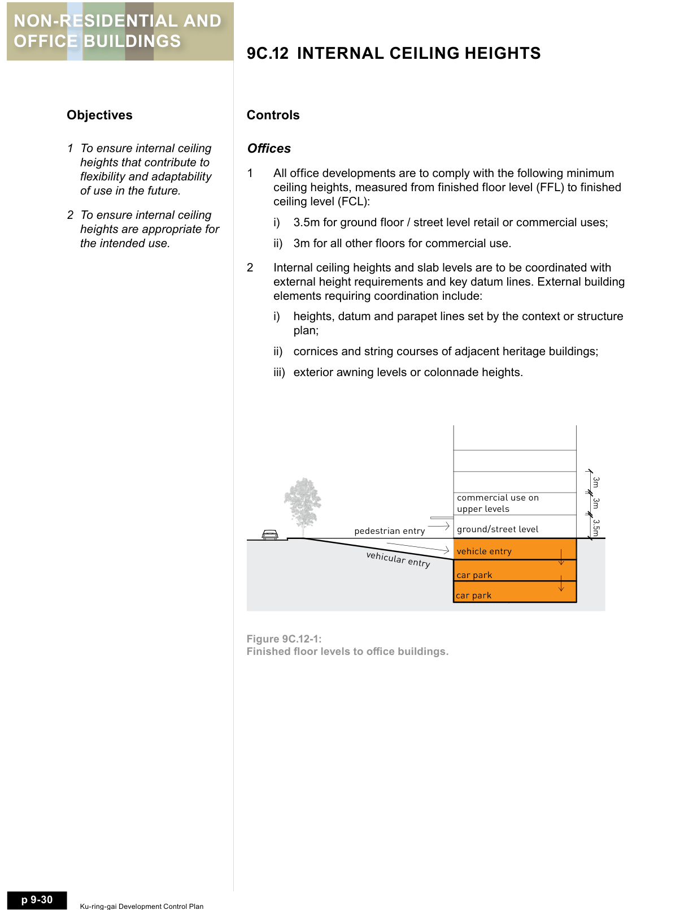

### 9C.11  AWNINGS AND COLONNADES

#### Further controls that may apply

#### SECTION B

PART 14 - Local Character Areas,

#### SECTION A

#### Objectives

#### Controls

1 Where an awning is provided, under awning lighting is to be

recessed into the soffit of the awning or wall mounted on the

1	 To ensure that awnings

2 Under awning lighting is to achieve luminance levels consistent with

community safety and security in AS1228.1- 2001. The lighting is

to be high energy efficiency with LED diode technology preferred

unless an alternate technology with equivalent or higher energy

3 All colonnade spaces are to be within the property boundary.

2	 To provide awnings and

4 The size and spacing of supports are to be designed to allow

pedestrian circulation and views of ground floor activity from the

3	 To create well lit, visible

5 On sloping sites a level access point is to be provided between

colonnade area and adjoining footpaths. 6 Awnings and colonnades to retail units are to comply with Part 8C.15

#### Offices

7 Office buildings located in a local centre, neighbourhood centre or

mixed use area are to comply with the controls within Part 14, Parts

8C.15 and 8C.16 of this DCP.

### BUILDING DESIGN AND SUSTAINABILITY

> [Picture on page 30: a map, saved as a picture (images/part-09-non-residential-and-office-buildings-page-30-1.gif, 150 dpi); the street names and other small labels are on the picture.]
> Words printed on the picture (title and legend, copied from the PDF):
> heights that contribute to
> flexibility and adaptability
> heights are appropriate for
> the intended use.
> commercial use on
> Finished floor levels to office buildings.

Figure 9C.12-1:
