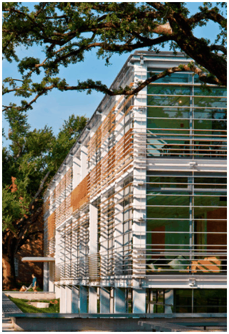
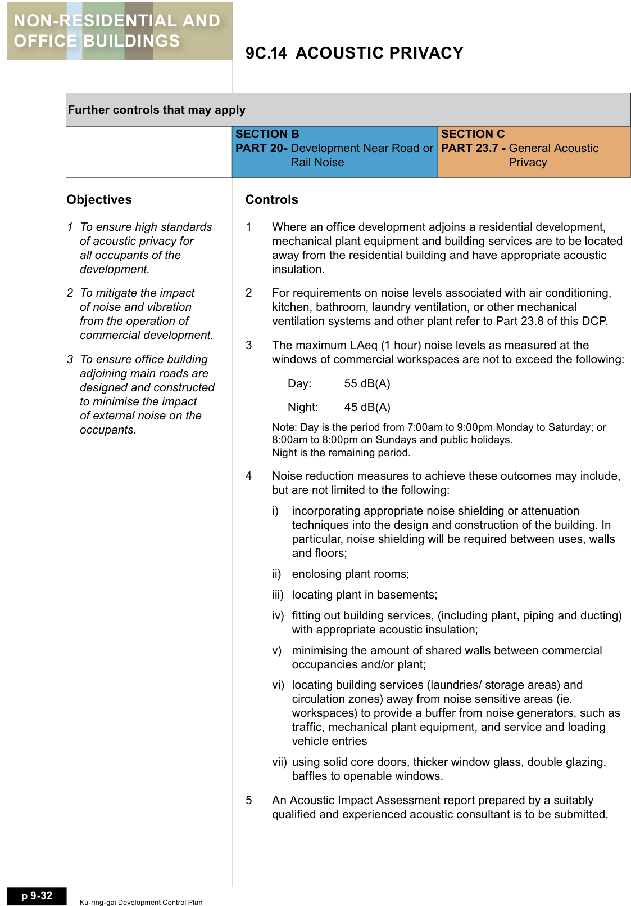

### 9C.13  VISUAL PRIVACY

#### Objectives

#### Controls

1	 To ensure high standards

of visual privacy for

residents and neighbours

1 Buildings are to be designed to ensure privacy for neighbouring

residents without compromising access to light and air. Measures to

achieve this include:

i) off-setting windows in adjacent buildings;

ii)	 recessing balconies or providing vertical fins between adjacent

balconies;

iii)	 using louvres/screen panels;

iv)	 providing vegetation as a screen between spaces;

v)	 incorporating planter boxes into walls or balustrades to allow

plant screening;

vi)	 utilising pergolas or shading devices to limit overlooking of lower

building levels or communal and private open space.

> [Picture on page 31: a picture, saved as a picture (images/part-09-non-residential-and-office-buildings-page-31-19.gif, 150 dpi).]

> [Picture on page 31: a picture, saved as a picture (images/part-09-non-residential-and-office-buildings-page-31-20.gif, 150 dpi).]

#### Figure 9C.13-1:

#### Operable external blinds to provide visual privacy and sun shading.

### BUILDING DESIGN AND SUSTAINABILITY

> [Picture on page 32: a map, saved as a picture (images/part-09-non-residential-and-office-buildings-page-32-1.gif, 150 dpi); the street names and other small labels are on the picture.]
> Words printed on the picture (title and legend, copied from the PDF):
> of acoustic privacy for
> all occupants of the
> of noise and vibration
> from the operation of
> Day:          55 dB(A)
> Night:        45 dB(A)
> adjoining main roads are
> designed and constructed
> to minimise the impact
> Note: Day is the period from 7:00am to 9:00pm Monday to Saturday; or
> 8:00am to 8:00pm on Sundays and public holidays.
> Night is the remaining period.
> with appropriate acoustic insulation;
> occupancies and/or plant;
> baffles to openable windows.
