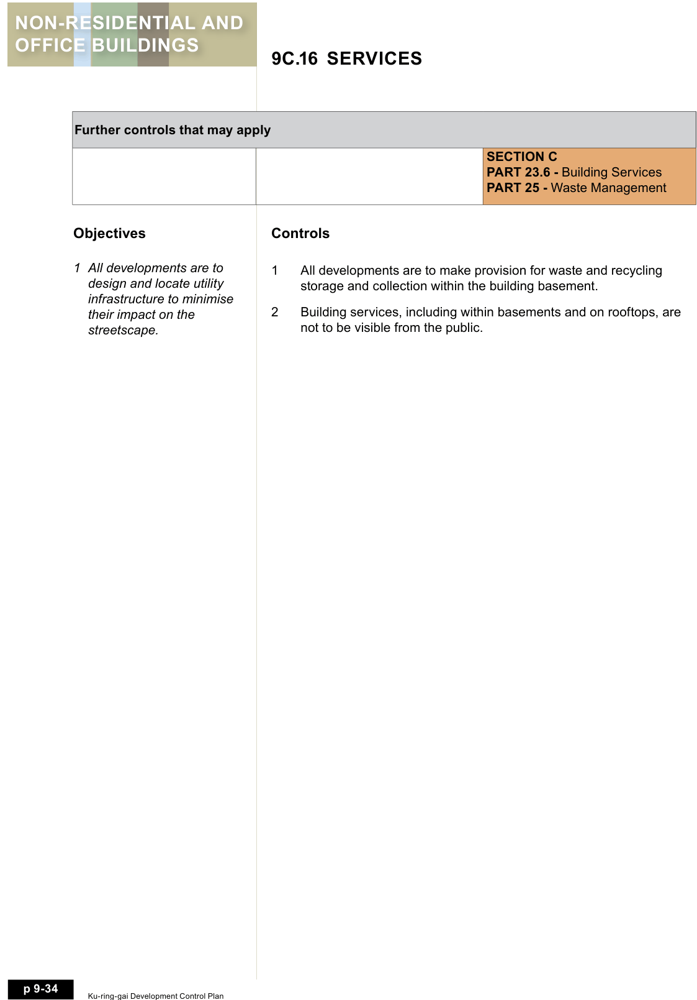

### 9C.15  FENCING

#### Objectives

#### Controls

1	 To provide an open

landscaped street

character.

1 Street fencing is not supported. Where setbacks to the street are

required, boundaries are to be delineated by soft landscaping

including, but not limited to, shrubs and trees of varied mature

height. 2 Where landscaping is provided along the street alignment, a physical

edge, such as a planter box or retaining wall is to be no higher than

1m above finished ground level. 3 Side and rear fencing are to be avoided. If side or rear fencing is

required, it is to be a maximum of 1.2m high and visually transparent.

(A transparent fence has an open to solid ratio of not less than 1:3).

### BUILDING DESIGN AND SUSTAINABILITY

> [Picture on page 34: a picture, saved as a picture (images/part-09-non-residential-and-office-buildings-page-34-1.gif, 150 dpi).]
> Words printed on the picture (title and legend, copied from the PDF):
> design and locate utility
> infrastructure to minimise
> their impact on the
> streetscape.
