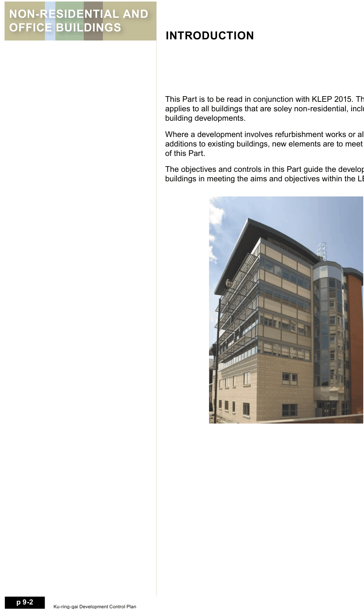

# Ku-ring-gai Development Control Plan - Part 9 Non-residential and Office Buildings

> This chapter is split into 25 section file(s), one per numbered heading, in the order they appear in the PDF.

Source PDF: [kdcp-section-a-part-9-non-residential-and-office-buildings.pdf](kdcp-section-a-part-9-non-residential-and-office-buildings.pdf)

### PART

### NON-RESIDENTIAL AND OFFICE BUILDINGS

Introduction

#### 9A	 	 Site Design

9A.1  	 Building Setbacks 9A.2  	 Building Separation 9A.3  	 Deep Soil Landscaping

#### 9B	 	 Access and Parking

9B.1  	 Service Access and Loading Facilities 9B.2  	 Car Parking Provision 9B.3  	 Bicycle Parking Provision

#### 9C	 	 Building Design and Sustainability

9C.1  	 Solar Access 9C.2  	 Natural Ventilation 9C.3  	 Floor Depth 9C.4  	 Building Entries 9C.5  	 Internal Common Circulation 9C.6  	 Roof Forms, Terraces and Podiums 9C.7  	 Communal Open Space 9C.8  	 Building Forms and Facades 9C.9  	 Corner and Landmark Building Articulation 9C.10  	Ground Floor Frontage 9C.11  	Awnings and Colonnades 9C.12  	Internal Ceiling Heights 9C.13  	Visual Privacy 9C.14  	Acoustic Privacy 9C.15  	Fencing 9C.16  	Services

### NON-RESIDENTIAL AND OFFICE BUILDINGS

### INTRODUCTION

This Part is to be read in conjunction with KLEP 2015. This section

applies to all buildings that are soley non-residential, including office

building developments. Where a development involves refurbishment works or alterations/

additions to existing buildings, new elements are to meet the requirements

> [Picture on page 2: a picture, saved as a picture (images/part-09-non-residential-and-office-buildings-page-2-7.gif, 150 dpi).]

of this Part. The objectives and controls in this Part guide the development of office

buildings in meeting the aims and objectives within the LEP.

### 9A

<!-- sections -->
## Sections

1. [9A Site Design](01-9a-site-design.md)
2. [9A.1 BUILDING SETBACKS](02-9a-1-building-setbacks.md)
3. [9A.2 BUILDING SEPARATION](03-9a-2-building-separation.md)
4. [9A.3 DEEP SOIL LANDSCAPING](04-9a-3-deep-soil-landscaping.md)
5. [9B Access and Parking](05-9b-access-and-parking.md)
6. [9B.1 SERVICE ACCESS AND LOADING](06-9b-1-service-access-and-loading.md)
7. [9B.2 CAR PARKING PROVISION](07-9b-2-car-parking-provision.md)
8. [9B.3 BICYCLE PARKING PROVISION](08-9b-3-bicycle-parking-provision.md)
9. [9C Building Design and Sustainability](09-9c-building-design-and-sustainability.md)
10. [9C.1 SOLAR ACCESS](10-9c-1-solar-access.md)
11. [9C.2 NATURAL VENTILATION](11-9c-2-natural-ventilation.md)
12. [9C.3 FLOOR DEPTH](12-9c-3-floor-depth.md)
13. [9C.4 BUILDING ENTRIES](13-9c-4-building-entries.md)
14. [9C.5 INTERNAL COMMON CIRCULATION](14-9c-5-internal-common-circulation.md)
15. [9C.6 ROOF FORMS, TERRACES AND PODIUMS](15-9c-6-roof-forms-terraces-and-podiums.md)
16. [9C.7 COMMUNAL OPEN SPACE](16-9c-7-communal-open-space.md)
17. [9C.8 BUILDING FORMS AND FACADES](17-9c-8-building-forms-and-facades.md)
18. [9C.9 CORNER BUILDING ARTICULATION](18-9c-9-corner-building-articulation.md)
19. [9C.10 GROUND FLOOR FRONTAGE](19-9c-10-ground-floor-frontage.md)
20. [9C.11 AWNINGS AND COLONNADES](20-9c-11-awnings-and-colonnades.md)
21. [9C.12 INTERNAL CEILING HEIGHTS](21-9c-12-internal-ceiling-heights.md)
22. [9C.13 VISUAL PRIVACY](22-9c-13-visual-privacy.md)
23. [9C.14 ACOUSTIC PRIVACY](23-9c-14-acoustic-privacy.md)
24. [9C.15 FENCING](24-9c-15-fencing.md)
25. [9C.16 SERVICES](25-9c-16-services.md)
