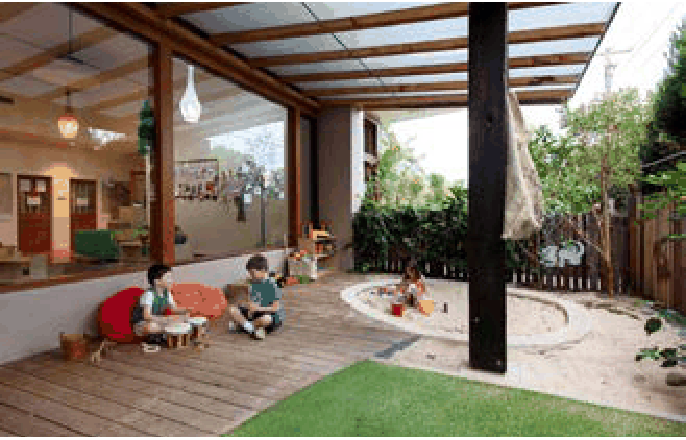

### 10.1 RISK ASSESSMENT (CONTINUED)

#### Controls

ii)	 the minimum floor area of refuge is to be calculated at the rate of

0.25m2 per person (staff and children).

#### Outdoor Areas

10	 No landscaped area within the child care centre is to contain plant

species that have the following characteristics:

i) plants known to be poisonous or that produce toxins;

ii)	 plants with high allergen properties;

iii)	 plants with thorns, spikes or prickly foliage; and

iv)	 plant species that Council considers may place the health, safety

and welfare of the centre’s users at risk.

11	 Outdoor play spaces are to be located away from public roads

i) in the side or rear setback of the site; and

ii)	 away from driveways, carparks and other sources of noise and

fumes. Note: Where it is not possible to locate outdoor play spaces in the side or

rear setback of the centre, the applicant will be required to demonstrate that

appropriate safety precautions have been implemented. 12	 Separate outdoor play spaces are to be provided for children aged

under 3 years and children aged between 3 and 5 years, with a clear

line of sight for supervision of both areas. 13	 The average noise level in the outdoor play spaces is not to exceed

55 dB(A) originating from external sources, during the centre’s

operating hours. Note: Council requires an acoustic assessment be undertaken by a

suitably qualified acoustic consultant that is to include recommended noise

attenuation measures.

> [Picture on page 6: a picture, saved as a picture (images/part-10-child-care-centres-page-6-29.gif, 150 dpi).]

#### Figure 10.1-1

#### Example of good design of outdoor play areas

#### Objectives

1	 To integrate the child

care centre and ensure

it is compatible with the

scale and character of

surrounding areas. 2	 To be sympathetic to the

amenity of neighbouring

properties.

3	 To provide attractive, site

responsive and practical

designs.

4	 To support Ku-ring-

gai’s unique character

of built form in a quality

landscape setting,

including canopy trees. 5	 To ensure landscaped

setbacks are compatible

with the streetscape

and adjoining residential

properties.

6	 To enable ground water

infiltration to limit heat

island effects and promote

outdoor comfort within the

site.
