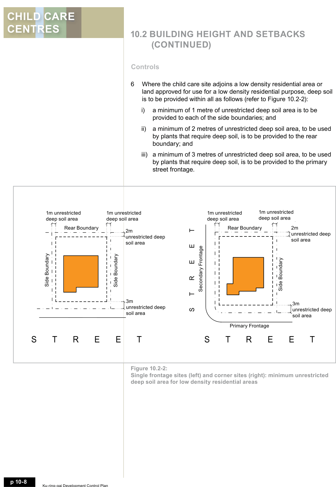

### 10.2            BUILDING HEIGHT AND SETBACKS

#### Controls

#### Building Heights

1 Building height is to be consistent with neighbouring dwellings,

integrate with the predominant street character and minimise

overlooking, bulk and scale impacts to neighbours.

#### Building Setbacks

2 Minimum side and rear setbacks are to comply with the setback

requirements of the predominant adjoining residential development

type of that location, as stated at:

| Location | DCP Section |
|---|---|
| Low Density Residential areas | Part 4 |
| Medium Density Residential areas | Part 6 |
| High Density Residential areas | Part 7 |
| High Density Mixed-Use and Business areas | Part 7, Part 8 and Part 9 |

#### Deep Soil Setbacks

3 The child care centre is to be designed to provide deep soil areas that

protect and retain existing trees and mature vegetation within setback

areas and across the site.

4 Deep soil setback areas are to incorporate planting style and species

selection that is appropriate to the locality including:

i) screen planting that can attain heights of 4m for single storey

centres. Screen planting may need to exceed 4m in height for

centres that are more than one storey.

ii)	 medium size trees (6-8 metres) to tall trees (10-13 metres).

#### Low Density Residential Areas Deep Soil Provisions

5 Lots with the following sizes are to support a minimum number of

medium sized trees (6-8 metres) to tall trees (10-13 metres):

| Lot size | Number of trees |
|---|---|
| Less than 850m2 | 1 |
| 850m2 to 1,000m2 | 3 |
| 1,001m2 to 1,500m2 | 5 |
| Over 1,500m2 | 7 or as directed |

Note: Council may require street tree planting in accordance with the Public

Domain Plan.

Note: Refer to Section C Part 21.2 and Section B Part 19 of this DCP

for the proportion of trees required to consist of locally occurring native

species, and other planting controls to protect biodiversity.

### BUILDING HEIGHT AND SETBACK

> [Picture on page 8: a map, saved as a picture (images/part-10-child-care-centres-page-8-1.gif, 150 dpi); the street names and other small labels are on the picture.]
> Words printed on the picture (title and legend, copied from the PDF):
> deep soil area
> 1m  landscaped area
> deep soil area
> deep soil area
> deep soil area
> 1m  landscaped area
> 1m  landscaped area
> 1m  landscaped area
> Single frontage sites (left) and corner sites (right): minimum unrestricted
> deep soil area for low density residential areas
> 1m  landscaped area
> 1m  landscaped area
> 1m  landscaped area
> 1m  landscaped area

Figure 10.2-2:
